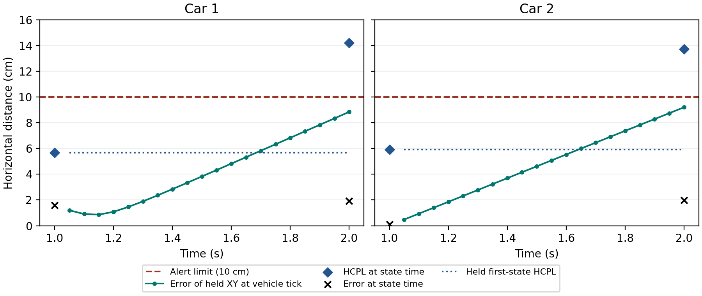

# Ground development example: initialization and the first motion update

**Figure.** Diamonds show the candidate horizontal cooperative protection level (HCPL) at the state timestamp. Crosses compare each new position with simultaneous antenna truth. The green curve compares the first published position, held by the vehicle, with truth at each 20 Hz display tick. At 2.00 s the vehicle still displays the first position while the second state is being processed.

| Car | State error / HCPL at 1 s (cm) | State error / HCPL at 2 s (cm) | Maximum held-position error (cm) | Ticks above held HCPL | Ticks above 10 cm |
|---|---:|---:|---:|---:|---:|
| 1 | 1.60 / 5.68 | 1.91 / 14.23 | 8.85 | 7/20 | 0/20 |
| 2 | 0.10 / 5.93 | 1.99 / 13.74 | 9.21 | 8/20 | 0/20 |

**Report text.** On the seed-101 ground development trajectory, 32 independent synthetic repeats of the initial survey made the first position available for both cars. The frozen baseline provided no available ticks; repeating the survey alone yielded the same one-second gain as adding the two validated link corrections. In the combined configuration, the first-state HCPLs were 5.68 and 5.93 cm. During the next one-second odometry propagation, the assumed 3 cm process standard deviation per horizontal axis raised both predicted levels above the 10 cm alert limit. The second range update was accepted and reduced the position variances, but the Gaussian terms alone still exceeded 10 cm. Including the propagated residual-bias bounds gave updated HCPLs of 14.23 and 13.74 cm, despite simultaneous position errors below 2 cm. Across the 20 vehicle ticks holding the first position (1.05–2.00 s inclusive), the moving antennas exceeded the held first-state HCPL on 7 and 8 ticks, respectively; neither car exceeded the alert limit. A state-time HCPL therefore needs a separate motion allowance to bound error throughout the display interval. The nominal and wall runs share this initial segment, which is counted once. An independent field survey remains future work.

[Full-precision table](first_second.csv). Rebuild from the repository root with `python3 tools/midterm_dual_robot_contract_a/calibration_v1/report_first_second.py`. The script reads the archived epochs at 32730dd3c405503b5ccacbde1c2f4f26ae9546cb and evaluation-only antenna truth at 01e588021e7e3ddd918b1d1fc9561973373758c6. It derives readiness intervals from recorded completion times, reconstructs HCPL from the saved covariance and bias bounds, and checks both scenes agree on every plotted value.
