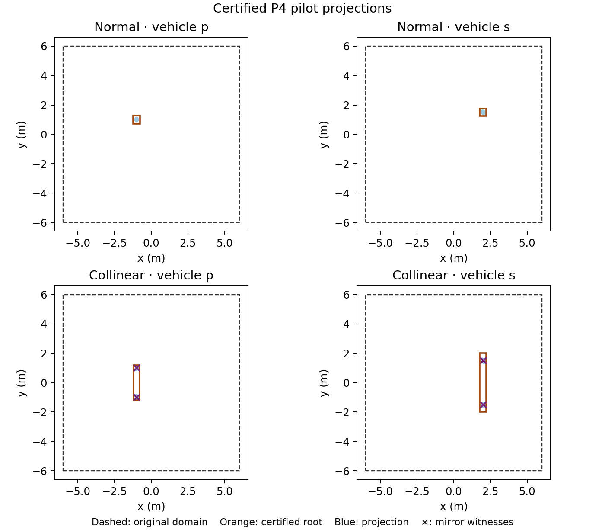

# 单时刻 P4 独立验收

从 main 的 591d19081f0d44436ed7238074252ba999141ea9 建分支。证据取自 #134 的 214ee0f4c52b0ede0bf53368fc06095b623b52b4。批入口逐字节比对固定实现 d3dc0dc8a028de569fa84941cb09ab801c8e5ed8 的检查器及其算术依赖。输入直接取该 A 提交的冻结原观测。

在仓库根目录运行，需 Python 3.10+、Git，绘图另需 matplotlib。首次复现需本地含 #134 的 Git 对象。

```sh
git fetch origin refs/pull/134/head
t=tools/midterm_dual_robot_contract_a/readback
b=docs/research/midterm_dual_robot_region_b/precontraction
python3 "$t/batch.py" 214ee0f4c52b0ede0bf53368fc06095b623b52b4 "$b/LEDGER.csv" /tmp/p4-formal
python3 "$t/figure.py" /tmp/p4-formal/table.json /tmp/chapter6.png
python3 "$t/batch.py" d3dc0dc8a028de569fa84941cb09ab801c8e5ed8 fixtures /tmp/p4-fixtures
```

逐项表见 pilot/table.json，附证据路径、压缩文件 SHA256、输入哈希、叶数、队列和当次运行账本。七例每例两组。批入口从冻结计划核对全部 298 个身份。后续确定性 44 项、随机 240 项均为未执行。两树各自从原观测核验，逐车投影按有理端点和矩形集合核对，允许重复叶投影合并。共线例还验证两组同时镜像的位置都处在四维保留叶内。样例表见 sample/table.json，正常、共线、闭边界和空集均通过包含检查。

包含列验证原域外包。分辨率列要求队列清空且所有 UNDECIDED 叶各轴至多 0.05 m，严格空集满足终止条件。预算列比对当次 CSV、worker 分项账本、墙钟和冻结执行器的 1 GiB 子进程地址空间硬限制，独立核对节点和时间上限。内存依据是执行上限，归档未给出实测 RSS 峰值。样例缺成本，预算为 UNKNOWN。强制停止时两组各有两个队列叶，包含通过，分辨率未达。



**Figure caption.** Certified P4 position projections for vehicles p and s in the normal and collinear pilot cases. Dashed outlines show the original search domains, orange outlines show the certified contracted domains, and blue rectangles show the final outer projections of retained leaves. Crosses identify the two simultaneously reflected joint configurations in the collinear case. Both configurations remain covered in the joint certificate. The contracted searches retained 5,494 joint leaves for the normal geometry and 14,468 for the collinear geometry.

图源为 pilot/table.json 中两条收缩组正式记录。交叉标记使用冻结评价位置及其沿共线锚轴的镜像。图中颜色叠加只作展示，验收使用有理数四维盒。

|机制例|原域 / 收缩组保留叶|包含|分辨率|预算|
|---|---:|---|---|---|
|normal_b0_zero|1582 / 5494|PASS / PASS|PASS / PASS|PASS / PASS|
|near_collinear_b0_zero|4170 / 14178|PASS / PASS|PASS / PASS|PASS / PASS|
|collinear_b0_zero|4270 / 14468|PASS / PASS|PASS / PASS|PASS / PASS|
|empty_in_domain|0 / 0|PASS / PASS|PASS / PASS|PASS / PASS|
|domain_closed_contact|638 / 1650|PASS / PASS|PASS / PASS|PASS / PASS|
|coincident_zero_distance|1646 / 4776|PASS / PASS|PASS / PASS|PASS / PASS|
|forced_budget|2 / 2|PASS / PASS|FAIL / FAIL|PASS / PASS|

由 14 份当次墙钟重算，原域组合计 6.713265 s，收缩组合计 21.855941 s，与 B 的阶段决策汇总一致，未触发扩展。
