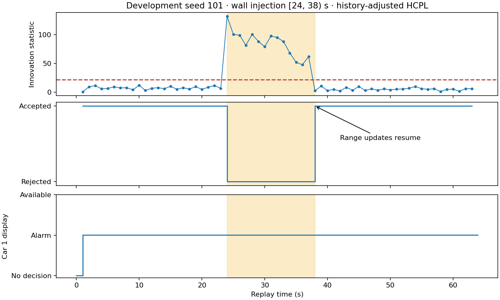

# 第二轮地面逐车 HCPL：完整轨迹、回退与车辆时钟

**在 0.10 m 告警限下，两辆车在八条留出轨迹上均无可用时间。** 每车 512 s 中，503.60 s 显示告警，8.40 s 尚无有效决定。测距检验与下游可用性给出了不同答案：504 个联合历元中有 437 次接受测距、67 次拒绝；接受历元的逐车保护级依然超过 AL。拒绝时发布里程回退位置和检测告警，三种数值 PL 都为空。代码、参数、评分规则及四条开发轨迹在运行留出之前冻结于 **efd9f9560de6d0661f5c3322dfa545515b51594d**。[冻结协议](PROTOCOL.md)

|留出车辆|保护级版本|接受历元 HCPL 范围 (m)|可用 s|报警 s|无有效决定 s|越限且可用 s|车辆采样分母|
|---|---|---:|---:|---:|---:|---:|---:|
|Car1|原式|0.405–0.585|0|503.60|8.40|0|10,240|
|Car1|两轴预分配|0.438–0.634|0|503.60|8.40|0|10,240|
|Car1|历史残余 + 两轴预分配（主）|0.621–0.915|0|503.60|8.40|0|10,240|
|Car2|原式|0.335–0.594|0|503.60|8.40|0|10,240|
|Car2|两轴预分配|0.361–0.645|0|503.60|8.40|0|10,240|
|Car2|历史残余 + 两轴预分配（主）|0.630–0.899|0|503.60|8.40|0|10,240|

每版本使用完全相同的单车采样点。同一车的三行不能相加当作三次独立试验。[逐车表](per_car_holdout.csv)和[逐轨迹表](per_run.csv)保存原始分母。

**从故障到恢复。** 在开发 101 的 wall 场景，注入从 24 s 开始，38 s 解除。24–37 s 的 14 个更新全部被拒，24.05 s 首次显示属于拒绝历元的检测告警。车辆从 1.05 s 起就已因 HCPL 超限显示报警。38 s 重新接受测距，38.05 s 显示新的测距解，记录结束前仍无可用位置。阶跃也在 38 s 复收。渐变在 28 s 拒绝、29 s 复收，解除后的 38–43 s 再次拒绝，44 s 复收。正常轨迹本身也在 28 s 拒绝一次。上述比较均沿用原门限。逐次复收和解除后可用性记录见 [recovery.csv](recovery.csv)。



**TTA。** 主版本在留出中识别出 Car1 128 个、Car2 141 个首次可观察越限事件。所有事件起点当时已显示告警，按 #148 规则 TTA 均为 0，在 1/2/5 s 三档均计及时。持续告警解释了这一结果；这些计数不能证明能在相应秒数内识别新故障。无有效位置时误差未知；起点之后的缺位不会制造新的事件。按每个版本分别导出的 [TTA 表](tta_summary.csv) 和各目录 tta.json.gz 保留事件分母、起点、首次告警与截止分类。

**B2 同车钟对照。** 独立校验 #143 归档的每个 B2 发布点、声明和 FIFO 后，在同一 20 Hz 时间网格和同一当前真值上，Car1 的可用/告警/无有效决定分别为 391.85/63.45/56.70 s，其中越限且可用 135.05 s。Car2 分别为 401.05/54.25/56.70 s，其中越限且可用 161.00 s。B2 使用其自己的发布点、车钟服务时间和子解分离统计量；本比较只涉及服务决定，未比较两种保护半径。[分轨迹 B2 对照](b2_clock.csv)

**验收与计时。** 首轮七项回归通过，t=10 s 两车原式为 0.560967/0.559045 m。[独立 SVD 复算](reference_svd.json)。新增四项确定性测试分别核对正常回归、连续拒绝且异常值不污染后续、迟到帧按缺包处理、过期与位置/声明成对替换。真值仅在 63 个状态判定及 2,560 个车钟采样均生成后进入评分。每个 epochs.json.gz 含源 ID 和接收时间、输入到齐、开始、服务耗时、完成、就绪、首次显示、过期和逐车三个 HCPL；ticks.json.gz 保存显示时的成对位置和声明。本机留出联合历元服务耗时中位数 0.124 ms，范围 0.085–0.682 ms。服务边界不包括事件文件 IO、采样评分、车载网络与屏幕刷新；实际部署时延未测。

**复算片段。** [正常第9–10秒](nominal_excerpt.json)和[墙故障、解除前后](wall_excerpt.json)附带原始 UWB/odom 帧、逐历元输出及首个车钟显示。report.py 从同一轨迹第一帧起重放前缀再对照片段，避免在截取起点丢弃历史。运行时数据只取 B 的已验收输入，完整提交 85fbe8aca47f0b8d25b6b97107e91b8550737195。#143 真值和 B2 对照提交 01e588021e7e3ddd918b1d1fc9561973373758c6。8/8 条配对复用留出、504/504 个联合历元、20,480/20,480 个车钟采样均已核验。此分母只涵盖两个已有种子，不能估计低概率任务风险或验证 0.02 m 剩余偏差物理上界。

## 复现

仓库根目录，Python 3、NumPy；绘图另需 Matplotlib。运行到新目录可保留提交中的实测计时。相同输入和判据可复现滤波，重新计时可能改变显示边界。

```bash
git fetch origin research/round2-ground-b refs/pull/143/head
export OPENBLAS_NUM_THREADS=1
export HCPL_RUNTIME_DIR=docs/research/ground_b_round1/runtime
t=tools/midterm_dual_robot_contract_a/round2
old=tools/midterm_dual_robot_contract_a/ground_hcpl
python3 "$old/test_reference.py" -v
python3 "$old/example.py" --runtime-only --runtime-dir "$HCPL_RUNTIME_DIR" > /tmp/reference10.json
python3 "$old/recompute.py" /tmp/reference10.json /tmp/reference-svd.json
python3 "$t/test_trajectory.py" -v
python3 "$t/stage.py" dev /tmp/round2-replay/dev
python3 "$t/verify.py" /tmp/round2-replay/dev
python3 "$t/stage.py" holdout /tmp/round2-replay/holdout --freeze efd9f9560de6d0661f5c3322dfa545515b51594d
python3 "$t/verify.py" /tmp/round2-replay/holdout
python3 "$t/report.py"  # 从仓内归档重建报告表、片段和图
```

原包读回补验：verify.py 从冻结提交 efd9f9560de6d0661f5c3322dfa545515b51594d 读取 packages.json，从 85fbe8aca47f0b8d25b6b97107e91b8550737195 校验各包清单、几何、事件字节，再按源时标和含端点的一秒截止逐帧比对 ID 与接收时刻。独立读回开发 4/4、留出 8/8。首条非最晚接收时间改动 1 ms、删首秒一条里程后重建输出却声称同一原包，两种篡改均在首历元被拒。原包本身缺帧或迟到仍按实际到达记录处理。验收器和轨迹回归可用 `python3 -m unittest discover -s tools/midterm_dual_robot_contract_a/round2 -p 'test_*.py'` 复验。
