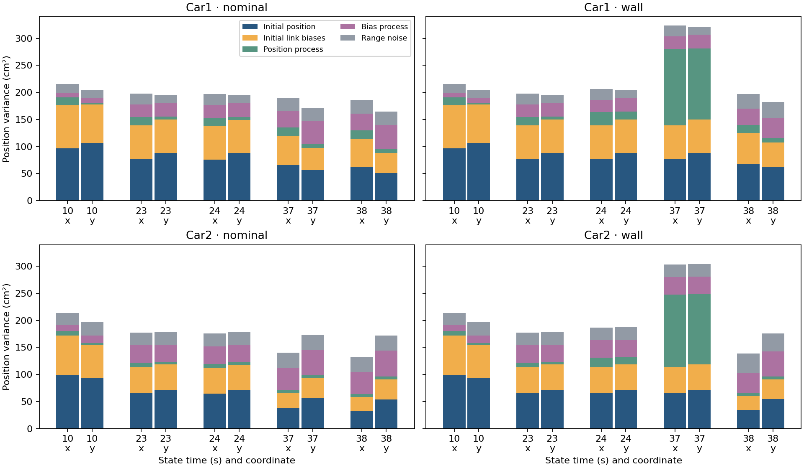

# 为什么冻结的 HCPL 高于 10 cm？

种子 101 的第 10 s，正常与墙故障场景尚未分岔。即使将当次九条测距的确定性剩余偏差界全部置零，两车原式水平高斯项仍为 **0.5282 m、0.5218 m**。此时四个水平轴的方差中，初始位置贡献 44.9%–51.9%，初始链路偏差贡献 30.5%–36.8%；两项在每轴合计 78.4%–86.7%。冻结模型给初始位置和未标定链路偏差的标准差分别为 0.20 m 和 0.30 m，早期观测还不能充分区分位置偏移与链路偏差。上述比例解释的是本模型计算出的方差，并非现场物理误差的归因。

**回退改变了主导来源。** 在墙场景第 24–37 s 的 14 次连续拒绝期间，位置过程噪声逐秒累加，每轴增加 14×0.03²=0.0126 m²。到 37 s，它贡献各水平轴方差的 41.0%–44.2%，同期正常轨迹对应 3.2%–8.2%。38 s 复收后，墙场景该比例降至 3.1%–7.3%。冻结方法在拒绝历元只给回退位置和检测告警；旁列的高斯项用于诊断协方差，当次确定性项和已发布 CPL 留空。



[逐车逐轴表](axis_sources.csv) 含两种场景、五个指定历元、两辆车各两个轴，共 40 行。五个来源及 total_m2 单位为 m²，current_B_m 是本次增益对应的确定性项，history_B_m 含全部接受历史；gaussian_original_m 和 gaussian_split_m 分别按每轴 α=0.01 和 0.005 计算，单位均为 m。图将方差换算为 cm² 以便读数。

## 独立核对方法

只读取冻结估计器 efd9f9560de6d0661f5c3322dfa545515b51594d 和 B 输入 85fbe8aca47f0b8d25b6b97107e91b8550737195 中的 **101_nominal、101_wall**。重放原始传感器后，在冻结滤波器调用几何函数时记录实际 H；直接取其历史传递矩阵最新九列作为本次实际接受增益 K。每步对照冻结归档的创新统计量、接受序列和协方差对角线。未读取评价真值或留出数据。

依次初始化五个完整矩阵为位置先验块、偏差先验块、零、零、零。在 t>1 的预测步给第三和第四项分别加位置和偏差 Q 块；t=1 直接更新调查先验。接受时对每一项施加 C→(I−KH)C(I−KH)ᵀ，并仅在第五项加 KRKᵀ。拒绝时保留预测结果。由于这里 F=I 且模型中的五种源相互独立，其矩阵和应等于原始 Joseph 协方差。两条轨迹共 126 个历元，逐元素检查 13×13 矩阵，最大绝对差 **6.94×10⁻¹⁷ m²**，容差 10⁻¹³ m²。[逐历元核对结果](matrix_checks.csv)

贡献可以在方差层相加。计算保护半径时须先对总方差开根、乘风险系数、加相应确定性项，再合成水平范数。改变 Q、R 或调查精度会改变增益和接受路径；本分解不预测重新调参后的 HCPL。

复现（仓库根目录，Python 3、NumPy、Matplotlib）：

```sh
git fetch origin refs/pull/150/head
git fetch origin research/round2-ground-b
OPENBLAS_NUM_THREADS=1 python3 tools/midterm_dual_robot_contract_a/round3/decompose.py
```

[后续开发灵敏度试验](SCAN_RESULTS.md)在相同 101 输入上重算 16 组先验。首秒之后无一配置恢复 10 cm 服务；最乐观调查假设出现了首秒已越限却声明可用的反例。
