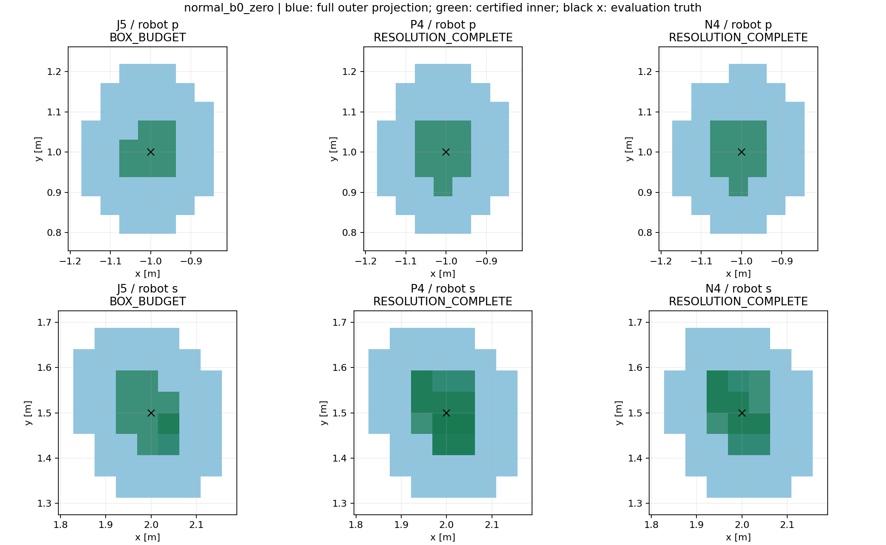
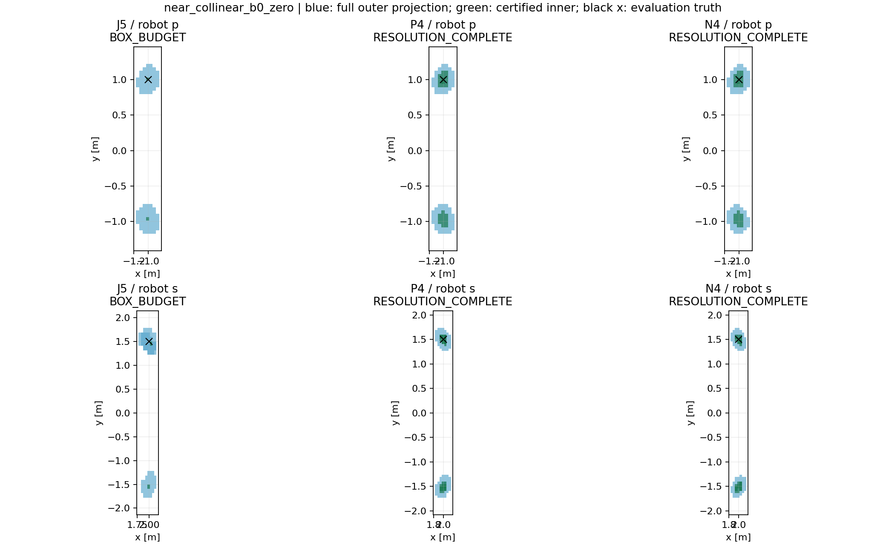
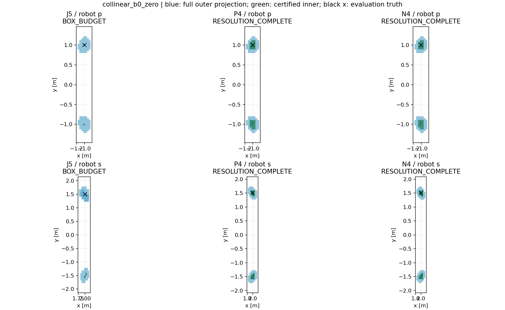

# peer对两辆车的约束

比较同一原始输入上的P4(q9=26)与N4(q8=24)。两车都是未知量；没有把另一车均值当精确锚点。两阈值采用同一总风险口径但不同完整噪声维数，因此添加peer并不保证最终区域单调缩小。

|条件|p面积上界变化m²|p半径变化m|s面积上界变化m²|s半径变化m|
|---|---:|---:|---:|---:|
|normal_b0|+0.004395|+0.000000|+0.006592|+0.000619|
|normal_b3/5|+0.003296|+0.000000|-0.001099|+0.004862|
|near_collinear_b0|+0.008789|+0.001832|+0.027466|+0.010100|
|near_collinear_b3/5|+0.008789|+0.001832|+0.020874|+0.010100|
|collinear_b0|+0.006592|+0.000000|+0.030762|+0.023044|
|collinear_b3/5|+0.006592|+0.000000|+0.030762|+0.023044|

表中为P4−N4，每条件两固定输入的描述均值。正值表示报告的外包量变大，不是证明真实可行集合变大；负值也不等于精确可行区域面积减少。逐case完整跨度、边界及内部/未决数据见RUNS.csv。

peer只通过dist(I9−‖p−s‖,B)引入耦合。当给定联合位置所需的b在B内部时，该行可残差为零；它并不必然收紧两辆车各自边缘。q9比q8大还会增加锚点残差预算，可能抵消这项约束。b在边界和内部的结果必须一起保留，不能只选有收益条件。

冻结后仅用已有输入/结果新增固定符号见证分析（SIGN_WITNESSES.csv）：在原评价位置上分别反射两车的y，区分精确固定联合位置可行/不可行/UNKNOWN，以及有限外包命中。这里真值只用于离线评价，未进入搜索。候选符号象限不等于已经证明拓扑分支数。

共线锚点下，同时反射两车保留锚点与peer距离，是模型真实对称。单独反射可能改变peer距离；有界b是否能吸收差异由可行b内/外界判定。内部盒可提供该象限存在可行点的证据，只有未决候选而没有内部盒时保持未知，不能据此删除。

具体见证：collinear_b0_zero中，P4在两车同时取正y或同时取负y的固定联合点均为FEASIBLE_PROVED；只反射一车的两个固定点为EMPTY_PROVED。N4四种固定点全部可行。P4仍各保留497个跨两车异侧的候选联合盒且无内部盒，不能由固定点不可行宣称整个候选支为空。collinear_b6_zero中，P4四种固定点均可行，体现有界偏差仍可吸收部分peer差异。两车各自的上下镜像投影都保留；联合组合受约束不等于每车边缘明显变小。

域和B是合成假设。没有给任务告警限，本轮只报计算完成状态和区域尺寸，不称任务安全可用率。完整噪声事件、精确投影可行性和有限外包包含在RUNS.csv分别列出。

