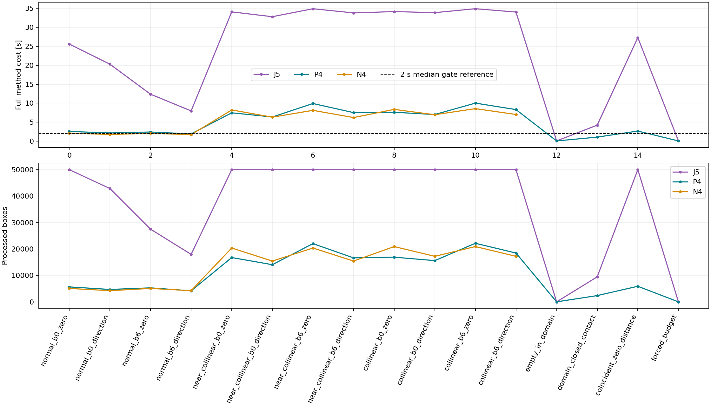

# 确定性正式验证

A来源：e45ca6d5940ff9f28233f03fb3502d5ed7004817。运行冻结：e112b900a97dc92acb08c950e5f65e6e8e515ac8。36项开发检查通过后执行。完整计划44次，实际完成44次；未完成0次。零搜索读回：PASS，检查1134406树节点。逐记录B/A证书结果及全部分母在results/RUNS.csv；本轮没有非线性优化器调用。

|case|J5：结束原因 / 处理盒 / 总秒|P4：结束原因 / 处理盒 / 总秒|N4：结束原因 / 处理盒 / 总秒|
|---|---|---|---|
|normal_b0_zero|BOX_BUDGET / 50000 / 25.602|RESOLUTION_COMPLETE / 5647 / 2.569|RESOLUTION_COMPLETE / 5079 / 2.118|
|normal_b0_direction|RESOLUTION_COMPLETE / 42867 / 20.296|RESOLUTION_COMPLETE / 4693 / 2.170|RESOLUTION_COMPLETE / 4231 / 1.770|
|normal_b6_zero|RESOLUTION_COMPLETE / 27503 / 12.384|RESOLUTION_COMPLETE / 5295 / 2.420|RESOLUTION_COMPLETE / 5079 / 2.069|
|normal_b6_direction|RESOLUTION_COMPLETE / 17957 / 7.979|RESOLUTION_COMPLETE / 4173 / 1.919|RESOLUTION_COMPLETE / 4231 / 1.720|
|near_collinear_b0_zero|BOX_BUDGET / 50000 / 34.082|RESOLUTION_COMPLETE / 16755 / 7.480|RESOLUTION_COMPLETE / 20359 / 8.234|
|near_collinear_b0_direction|BOX_BUDGET / 50000 / 32.810|RESOLUTION_COMPLETE / 14055 / 6.376|RESOLUTION_COMPLETE / 15427 / 6.326|
|near_collinear_b6_zero|BOX_BUDGET / 50000 / 34.911|RESOLUTION_COMPLETE / 22027 / 9.928|RESOLUTION_COMPLETE / 20359 / 8.128|
|near_collinear_b6_direction|BOX_BUDGET / 50000 / 33.808|RESOLUTION_COMPLETE / 16631 / 7.529|RESOLUTION_COMPLETE / 15427 / 6.224|
|collinear_b0_zero|BOX_BUDGET / 50000 / 34.159|RESOLUTION_COMPLETE / 16901 / 7.625|RESOLUTION_COMPLETE / 20909 / 8.376|
|collinear_b0_direction|BOX_BUDGET / 50000 / 33.879|RESOLUTION_COMPLETE / 15593 / 7.027|RESOLUTION_COMPLETE / 17221 / 6.975|
|collinear_b6_zero|BOX_BUDGET / 50000 / 34.914|RESOLUTION_COMPLETE / 22157 / 10.031|RESOLUTION_COMPLETE / 20909 / 8.575|
|collinear_b6_direction|BOX_BUDGET / 50000 / 34.037|RESOLUTION_COMPLETE / 18461 / 8.327|RESOLUTION_COMPLETE / 17221 / 7.035|
|empty_in_domain|RESOLUTION_COMPLETE / 1 / 0.068|RESOLUTION_COMPLETE / 1 / 0.068|不在授权计划|
|domain_closed_contact|RESOLUTION_COMPLETE / 9457 / 4.222|RESOLUTION_COMPLETE / 2369 / 1.068|不在授权计划|
|coincident_zero_distance|BOX_BUDGET / 50000 / 27.304|RESOLUTION_COMPLETE / 5891 / 2.671|不在授权计划|
|forced_budget|BOX_BUDGET / 1 / 0.067|BOX_BUDGET / 1 / 0.067|不在授权计划|

RESOLUTION_COMPLETE表示按照0.05m规则完成搜索；INSIDE盒可提前停止而大于0.05m，因为整盒已认证。BOX_BUDGET等表示未决队列全部保留。预定forced_budget每方法只处理1盒；不把它算入主矩阵意外预算失败。空集不输出伪造半径。

全流程包含B认证、A认证、投影及写盘，实际逐次执行顺序在原始attempt/receipt。未重复计时选最快，零搜索复核成本单列，不替换原计时。每次默认50000盒/30秒搜索、120秒全流程和1GiB。原始A的更宽上限没有被当作扩预算许可。

A归档兼容分母48，其中4个特殊N4为OUTSIDE_USER_AUTHORIZED_PLAN。授权分母仍44，额外4条不执行、不混进实验失败率。原A的empty_in_domain观测被人为改写，其原零噪声标签不再有效；该例噪声事件为NOT_APPLICABLE，可靠域内空集另行核验。

