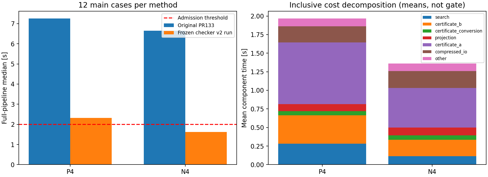
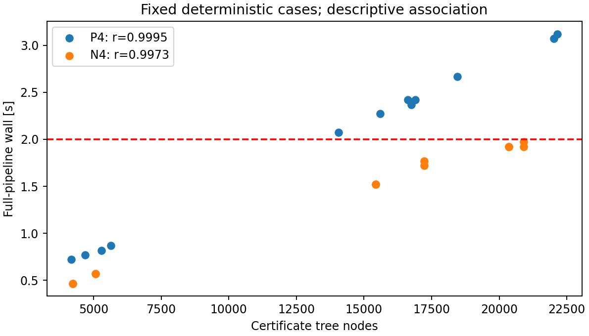

# B检查器V2接入与全流程复验

**本轮已完成新版接入、44项一致性对照、一次44项端到端复验及独立读回。随机准入FAIL，仅因P4全流程中位数2.319769s超过原定2s；随机0/240执行。** 不降低分辨率、不扩大预算、不追加重复计时选择快值。

## 固定版本与保护

- B原始PR133：`5e3579086776725f9330f64eca75b63a21cd661c`。
- A发布提交：`50b592fbd672a1f19075147f53061a5861b3b892`；READY声明的实现提交：`b7b1d99903fa6adcfb6765c0adab57ab3660ae40`。
- A入口SHA256：`67b6966f5904e97b5a5289be4da197acdb19243cf3b605a25bb99ae85517697d`；冻结core依赖SHA256：`12b0618b1e85bfc1c1d965172be868dde9f57d4749aebe14c74187f929ff4466`。
- B本轮运行冻结：`12894b821bf620587e5a4e154d83e23828e6cf4e`。FREEZE文件逐项绑定该Git提交，而非只信任当前工作区。

保留原83个B交付文件、44条原计时、原GATE与全部历史证据，未覆盖；18分片268文件已实际解包核验。A原23个合同文件哈希未变，B中16确定性/120随机输入与A发布数据逐对象相等。所有新输出位于独立checker_v2_20261118目录。详见BASELINE_LOCK、A_SOURCE_LOCK、ORIGINAL_A_CONTRACT_IDENTITY、INPUT_IDENTITY。

## 接入与等价性

A仅替换为其发布的checker_v2.check入口，仍使用原Fraction/isqrt与完整树/队列/投影验证；A自行按绝对兄弟路径加载core，不与B的core同名模块混用。

B新增单调用内精确解析缓存；B投影仍完整重构并检查矩形四角半径，未删除审计。A格式转换对相同投影矩形复用精确算术，但保留每个leaf及面积重复次数，不把B去重面积冒充A格式面积。不跨A/B共享算术结论、不跨输入保留缓存、不读评价真值指导搜索。

44/44旧证书的原B结论、两车区域、完整A证书canonical对象均一致；5种破坏树/队列/投影测试仍被拒绝。A V1已对44份原证书重新检查，V2又检查同一44份，结论、队列与逐车区域全部一致。3个小型合成worker集成测试通过，开发搜索3次，未提前使用正式输入搜索。

B局部零搜索对照合计：精确校验52.123→25.907s；投影及审计46.576→10.431s；证书转换22.757→7.853s。它们是顺序运行的诊断测量，不能替代冷worker全流程准入，也不是多次统计速度保证。原计时与本轮零搜索拆分分别保存在OLD_TIMINGS_PRESERVED、OLD_COST_DECOMPOSITION，未混写。

## 一次性端到端结果和门槛

|方法|主例数|旧全流程中位数(s)|新全流程中位数(s)|规定分辨率|≤2s|
|---|---:|---:|---:|---|---|
|P4|12|7.253344|2.319769|12/12完成|未通过|
|N4|12|6.650937|1.618432|12/12完成|通过|

同原观测、q9=26/q8=24、闭边界、0.05m目标、50000盒/30s搜索、120s全流程/1GiB；强制预算使用原更小上限。沿原case与方法次序，每方法新worker，计时从attempt写入前至receipt持久化后，包含搜索、B校验、A转换、两车投影/审计、A校验、评价和写盘。先前旧数据同口径使用WALL_COSTS；不是worker_seconds或search_seconds。

|阶段|计划|完成|失败|中断|未执行|
|---|---:|---:|---:|---:|---:|
|旧证书拆分/旧A复核|44|44|0|0|0|
|B优化等价对照|44|44|0|0|0|
|A新旧对照|44|44|0|0|0|
|本轮确定性搜索与全流程|44|44|0|0|0|
|本轮结果独立读回|44|44|0|0|0|
|条件随机P4/N4|240|0|0|0|240|

确定性为J5 16、P4 16、N4主例12。旧A兼容48计划中的4个特殊N4仍不在用户授权计划内，不补跑、也不计失败。本轮所有44项证书有效，独立核验1,134,406个树节点；24个P4/N4主例另用精确Fraction检查实际未决盒宽度≤.05m、无pending队列。J5的既定盒预算停止保留队列，属于有效保守外包，不伪称完成同一分辨率。

新44项证书除成本元数据外，与原44项科学内容全部相等，包括树、标签、队列、两车投影和偏差恢复。没有用更小的地区、更粗网格或删除分支换速度。完整状态见PROGRESS、READBACK、ACTUAL_RESOLUTION；GATE明确仅P4超时中位数原因。

本轮正式搜索44次，另有3次开发搜索；对拍、归档读回和函数归因均零搜索。没有运行随机搜索、Calafiore预收缩或两时刻搜索。

## 剩余瓶颈

|12主例合计，秒|P4|N4|
|---|---:|---:|
|搜索|3.361014|1.343100|
|B精确校验|4.583098|2.654470|
|A证书转换|0.672857|0.708027|
|B投影及审计|1.172034|1.276396|
|A V2校验（含A独立投影重算）|9.928481|6.403407|
|结果/证书压缩与持久化|2.646253|2.708704|
|其它全流程开销|0.855946|0.796226|

“其它”是父子进程/receipt等差额；输入解析、A源码加载和评价另有独立列，完整可加和数据在COSTS.csv。A校验一栏包含其独立投影复算，不能把A全部耗时直接叫树搜索。

为区分A内部投影与界计算，另外对三个固定几何的b0/zero条件、P4/N4各做一次零搜索cProfile归因。P4的bounds_parsed累计时间约占check的51–52%，A内部projections约13%；这些是含探针开销的嵌套函数时间，不相加当全流程成本，也不替换门槛时间。B投影及审计主例合计1.172s，写盘2.646s，均小于A/B检查合计14.512s。因此当前优先瓶颈不是单纯投影或I/O。[BOTTLENECK_PROFILE.json]

P4主例节点数与全流程墙钟的描述性Pearson r=0.999455，N4为0.997311。这些固定案例不提供独立统计因果证明，但结合函数归因支持下一项研究减少需认证的节点，而不是继续只优化写盘。[COST_SUMMARY、COSTS]

## 噪声事件、精确可行性、外包命中与区域

|方法|确定性完成|噪声事件true/false/不可用|精确可行/空/UNKNOWN|联合外包命中|Car p命中|Car s命中|
|---|---:|---|---|---:|---:|---:|
|J5|16|15/0/1|15/1/0|15|15|15|
|P4|16|15/0/1|15/1/0|15|15|15|
|N4|12|12/0/0|12/0/0|12|12|12|

空集特殊例噪声事件不可用，不能补为噪声失败或随机miss。各方法共用输入，同例跨方法不是独立试验；这些确定性命中也不是120份随机输入的覆盖率。随机阶段P4/N4各120未执行，事件/精确可行/命中均没有已执行分母，不报0%或100%覆盖。

逐车区域原样保留于REGIONS.csv，包括内部/未决矩形、面积可靠上下界、半径、跨度和边界接触。示例normal_b0_zero，P4两车面积上界为.109863/.123047m²，N4为.107666/.118652m²；near_collinear_b0_zero，P4为.221924/.312012m²，N4为.210938/.276855m²。两车半径与全部分支和旧证书一致。P4/N4分别使用完整9维/8维事件阈值，不能预设协同边缘面积一定减小。

## 结论与复核

保留2秒门槛，随机不准入。下一项提出**认证根域预收缩小规模对照**，具体证书接口、失败回退和14项计划见NEXT_PERFORMANCE_EXPERIMENT；本轮不执行。原单时刻结果仍有效；两时刻必须单独立项。

独立读回使用PR133原B算术/投影/转换重新绑定保存的A证书，再用锁定A V2检查；不依赖b_fast证明自身。便携包实际解包后再次逐文件哈希并复算上述语义、评价和门槛，方法见HANDOFF。静态证书不能独立证明历史时钟真实性；本轮时间来自实际执行的原始账本，不从检查器microbenchmark拼接。
