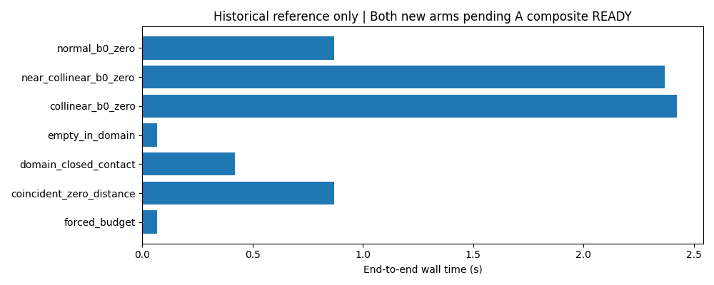

# 七例单时刻认证预收缩对照

截至本次交付，PR131 发布提交 50b592fbd672a1f19075147f53061a5861b3b892 仅有原域检查器 CHECKER_V2_READY 和原始合同。旧实现 b7b1d99903fa6adcfb6765c0adab57ab3660ae40 要求树根等于原始域。缺少的是 A 对原域、八方向证据及子域搜索树共同验收的 READY、实现 SHA、文件哈希及最小样例。本轮 A 实现和 B 正式运行冻结 SHA 均待发布。

|正确性检查|原 P4|预收缩 P4|
|---|---|---|
|独立开发输入的 B 树、逐车区域和评价读回|通过|通过|
|开发八方向的有理数验证|沿用原端点|8 个收缩端点通过，向内篡改被拒绝|
|开发 A 核验|V2 通过|待复合证书接口|
|正式原问题外包含性、镜像、边界、空集、零距离、强制预算|未执行|未执行|

[PLAN.json](PLAN.json) 固定七个案例、输入哈希、组内设置和 14 项顺序，组间交替先后。两组使用同一 Python 与 CPU 亲和性，每项单独启动进程。正式计时沿用 PR133，从持久化 attempt 前计到 receipt 落盘后，涵盖冷启动、预处理、预处理证明、搜索、A/B 检查、投影和写盘。每方向预算 0.5 秒，预处理总预算 4 秒。搜索沿用逐例预算，单项全程 120 秒及 1 GiB。仅允许恢复未启动项。

B 开发候选利用对角噪声模型中的分量界。对每个锚点，距离上界等于观测上端点加上向上舍入的 sqrt(q Rii)。每个坐标方向取四个球支撑界与原域的交集，保存提供该方向界的测量索引。这对应只使用一个锚点约束的方向证据，可能比联合凸优化松。独立读回通过平方不等式验证舍入方向和包含关系。空交集候选回退原域。最终可用的证据格式与验收方法以 A 发布为准。开发运行命令为 `python3 tools/midterm_dual_robot_region_b/precontraction/develop.py`，需要 PR133 的本地 A 源码锁；结果见 [DEVELOPMENT.json](DEVELOPMENT.json)。

|阶段|计划|完成|失败|未执行|
|---|---:|---:|---:|---:|
|七例正式对照|14|0|0|14|
|完整复验|44|0|0|44|
|随机验证|240|0|0|240|

[逐例账本](LEDGER.csv) 的空成本表示尚无计时。下图给出七例 PR133 原始 P4 历史基准。本轮成对耗时、净节省、两车区域差异及故障例判断均待正式执行。

后续以同一案例两组全流程秒数配对，七例合计净节省大于零并且全部独立核验、边界和镜像检查通过，才采用预收缩 P4 进入 44 项，保留原 J5/N4。完整复验沿用 P4 和 N4 各十二主例完成 0.05 m 且各自中位数 ≤2 秒的准入条件。历史中位数分别为 2.319769 秒、1.618432 秒。随机阶段的噪声、联合及逐车命中均无已执行分母。
