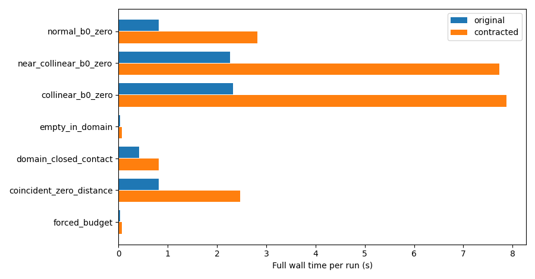

# 单时刻认证预收缩正式对照

七例的 14 次运行与 14 次独立读回全部通过。原 P4 合计 6.713265 秒，认证预收缩 P4 合计 21.855941 秒，多用 15.142676 秒。全部七例的端到端时间均增长。按冻结规则停止扩展。

|案例|原 / 收缩节点|原 / 收缩秒|原 / 收缩 p 面积上界 m²|原 / 收缩 s 面积上界 m²|
|---|---:|---:|---:|---:|
|normal_b0_zero|5647 / 17085|0.817 / 2.822|0.10986 / 0.12363|0.12305 / 0.12573|
|near_collinear_b0_zero|16755 / 47847|2.270 / 7.731|0.22192 / 0.28249|0.31201 / 0.27739|
|collinear_b0_zero|16901 / 48807|2.323 / 7.881|0.21973 / 0.29320|0.32080 / 0.26208|
|empty_in_domain|1 / 0|0.034 / 0.066|0.00000 / 0.00000|0.00000 / 0.00000|
|domain_closed_contact|2369 / 5015|0.417 / 0.821|0.04834 / 0.04938|0.10547 / 0.10676|
|coincident_zero_distance|5891 / 15713|0.818 / 2.470|0.11426 / 0.11944|0.13623 / 0.12573|
|forced_budget|3 / 3|0.034 / 0.066|144.00000 / 0.26822|144.00000 / 0.22353|

面积为包含全部保留叶子的逐车投影面积上界。不同根域改变二分切点，导致未决盒、区域上界和节点数不同。两组分别以原域输入通过 A 核验。五个非空、非强制预算例均增加节点。共线和近共线增加最多，收缩后各超过 4.7 万个节点。严格空集在收缩阶段即可证明，省去原来的一个搜索节点，全流程仍多用约 0.031 秒。强制预算例两组均保留完整队列。零距离例通过，两车闭边界例保留原域边界接触，共线例保留同时镜像见证。各车命中、原边界接触、镜像、队列及区域上下界见 [逐例读回](runs/pilot/decision.json)。[八方向原端点、采纳端点、回退状态及耗时](directions.csv)；[分项计时及全部阶段账本](LEDGER.csv)。

|阶段|计划|完成|失败|未执行|
|---|---:|---:|---:|---:|
|七例正式对照|14|14|0|0|
|完整复验|44|0|0|44|
|随机验证|240|0|0|240|

七例净节省门槛差 15.143 秒。12 主例的 2 秒门槛本轮没有新测量，随机命中和大小统计的已执行分母为零。冷进程总计时包括结果、证明及 receipt 写盘。预处理采用 A 的有理数单行/双行组合产生证据，B 将候选端点向外放宽至微米网格，供原 Decimal 搜索精确表示。A 从原域重新验证所有采纳端点。

七例预处理合计 0.193 秒。A 检查从 2.909 增至 10.662 秒，B 检查从 1.391 增至 3.831 秒。

56 个方向全部获得认证，55 个端点相对原域收紧。强制预算例保持两个方案各 3 个树节点和未决队列，p/s 外包面积上界由各 144 m² 降到 0.26822/0.22353 m²。近共线和共线例中 s 车上界也下降，p 车上界增加。各组仅一次，短案例耗时包含父进程等待子进程退出的调度开销，表中差值描述这次规定计时的观测结果。
