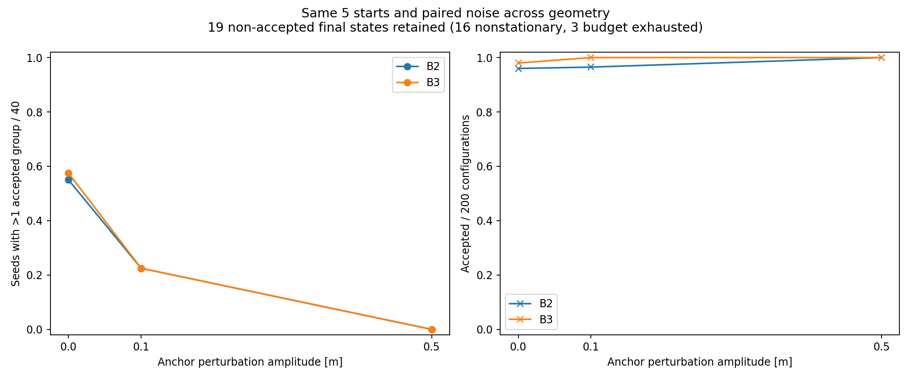
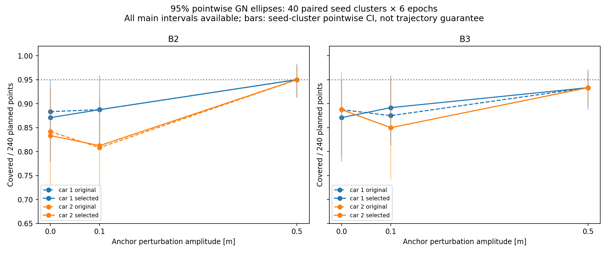
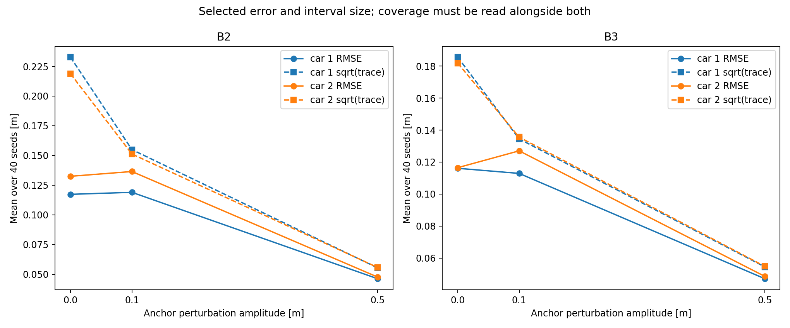
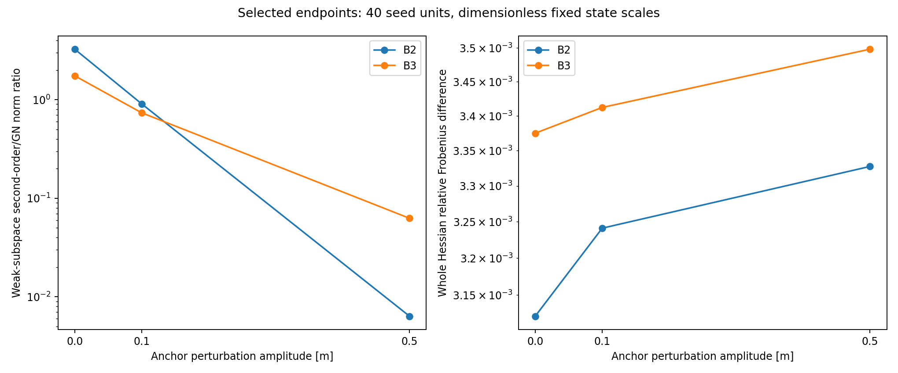
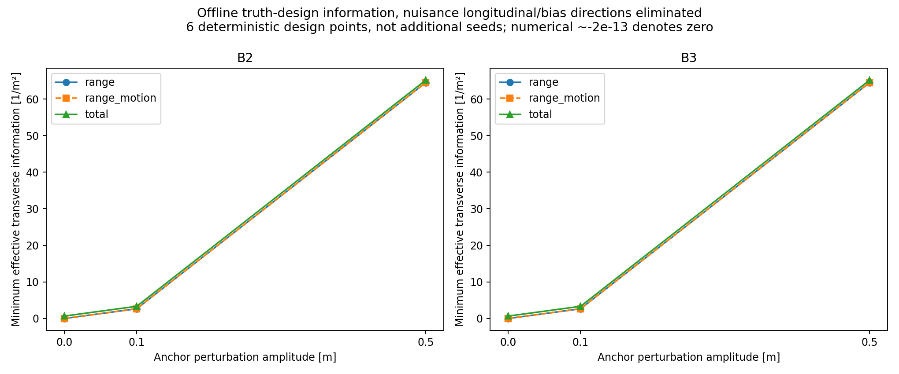

# 共线几何扰动：较强扰动改善明显，轻扰动未同步修复覆盖

本轮支持几何因素对终点歧义和不确定性失准具有重要作用。在噪声、先验、五个实际初值和求解设置相同的配对实验中，0.50m扰动使B2多接受组由22/40降至0/40，两车选优组内95%点覆盖由87.08%/83.33%升至95%/95%，同时区间缩小、误差降低。但0.10m虽减少多组，车2覆盖反而下降，不能声称轻微破坏共线就一定修复覆盖，也不能据一次改善宣称保护级有效。

## 来源与控制落实

固定PR115 b340f6bd05a97ac3f80ea4796d4c317114f508a8；冻结/执行SHA 19a6c6a3ff94d81d9ff905aea6b94a1d31c5070b。源weak锚点确为(-3,0),(-1,0),(4,0),(6,0)，真位置(1,0),(2,0)，survey不变；主轴正向(1,0)、法向(0,1)。按锚点编号[-1,+1,-1,+1]施加0/.10/.50m横向扰动，GEOMETRY_PRECHECK记录全部坐标。

每几何从对应真实距离重新生成测距，peer注入+.3m、测距sigma=.04m、位移sigma=.02m及白化一致，正确固定位置先验sigma=.5m。40seed（301118001–301118040）在4428个已审计文本/压缩证据及字面range中无冲突，审计范围是本地提交refs和新fetch main，不宣称掌握外部未记录执行。

同seed的标准噪声、观测运动、先验中心、真轨迹以及五种实际初始状态在三几何下逐项相同。I1–I4只使用未扰动weak锚点；实际solver receipt再次核验。真值未进入初始化规则或最低代价选择。B2已知受影响peer链路、未知自由常偏差，B3知道注入幅度，仍是oracle参照。

正式120输入、240输入方法单元、1200初始化配置、2400阶段及实际优化器调用；没有追加。最终1181接受、16未驻点、3预算耗尽，0异常/缺失，全部最终状态有限。开发另30配置/60调用，全部接受。nfev合计32814，求解阶段累计约18.09秒（不含IO/分析）。P0/P1不是独立样本。

## 预定主要对比与反例

以下覆盖与尺寸都采用选优接受组内先对成员平均、再对40seed等权平均；每车计划240点、可用240点。组ID仅在单输入内定义，不跨seed当作固定物理分支。

|方法|扰动(m)|多接受组(seed)|车1/车2 95%点覆盖|车1/车2平均RMSE(m)|车1/车2平均95%椭圆面积(m²)|
|---|---:|---:|---:|---:|---:|
|B2|0|22/40|87.08% / 83.33%|.11726 / .13244|.06065 / .05698|
|B2|.10|9/40|88.75% / 81.25%|.11895 / .13647|.04024 / .03926|
|B2|.50|0/40|95.00% / 95.00%|.04620 / .04760|.01407 / .01416|
|B3|0|23/40|87.08% / 88.75%|.11609 / .11648|.04738 / .04644|
|B3|.10|9/40|89.17% / 85.00%|.11290 / .12701|.03419 / .03446|
|B3|.50|0/40|93.33% / 93.33%|.04706 / .04853|.01346 / .01354|

预定主对比0.50m减原weak、B2的配对seed逐项95%区间：

- 多接受组比例差−55个百分点，区间[−70,−40]个百分点。
- 车1选优组内95%点覆盖差+7.917个百分点，区间约[0,17.083]；数值下限−5.55e−18仅舍入误差，不能称车1改善已明确排除零。
- 车2覆盖差+11.667个百分点，区间[2.917,21.667]。

40seed和逐项区间不提供多重比较保证。样本覆盖恰为95%并不证明总体校准；0.50m下B2两车各自覆盖区间约[91.25%,98.33%]、[91.25%,97.92%]。六时刻全部覆盖从车1/2 70%/77.5%变成80%/80%，不应改称轨迹95%保证。

覆盖提升没有靠放大区域：B2选优代表点的平均面积差−.04658/−.04282m²，RMSE差−.07106/−.08485m，完整配对区间见GEOMETRY_CONTRASTS。组内尺寸与代表点尺寸在本数据中数值接近，但定义仍分开。原I0和selected的逐车配对差、99%覆盖、逐时刻覆盖及噪声传播视图均完整保留，未只挑选有利结果。

0.10m是重要反例：多组显著减少并不保证覆盖同步好转，B2车2面积收紧而误差增大、覆盖下降；B3车2亦下降。这里不追加幅度或初值寻找更理想结果。

## 最弱方向与整体Hessian差

选优终点按40seed平均的最弱子空间二阶项/GN谱范数比：B2为3.255→.907→.00636，B3为1.748→.736→.06262。整体Hessian相对Frobenius差却约保持.0031–.0035，并未表现相同幅度改善。因此此次主要变化集中于关键弱方向，整体矩阵范数不能替代方向诊断。比值是无量纲，不是百分比；3.255表示二阶项约为该方向GN曲率的3.255倍。

全部有限端点的基、投影矩阵和数值标签保留。近重根规则与PR115一致；重复特征值的合成子空间路径已验收，实际维数见逐次表。所有本轮端点精确Hessian未检测到负特征值，但未驻点/预算耗尽不因此变成可靠极小，多个组也未被证明为多个局部极小。

## 测距本身的横向信息与运动/先验的作用

信息分析始终沿原单位法向，分别计算前54测距行、74测距+运动行、全部78行。先报告其余参数固定的横向条件信息，再用纵向及B2偏差的Jacobian列空间正交投影消去干扰方向，得到有效横向信息。它们不同，不能把条件块当位置边缘信息。本轮只作投影/秩分析，没有用伪逆把不可辨识方向变成有限区间。

在明确标注的真状态设计诊断中（6个确定性设计点，不增加n）：

|扰动(m)|测距有效横向秩/12|测距有效横向最小特征值(m⁻²)|测距+运动有效横向秩/12|总信息有效横向最小特征值(m⁻²)|
|---:|---:|---:|---:|---:|
|0|0|0|10|.66504|
|.10|12|2.66434|12|3.32944|
|.50|12|64.51739|12|65.18378|

该表的秩及最小值对B2/B3一致，完整矩阵/迹存在方法差异。原共线设计中运动约束相邻时刻差，但不能单独决定每辆车的恒定横向平移；先验补足这两个方向。原测距完整秩B2为13/25、B3为12/24，加运动分别23/25、22/24，总信息满秩；两种非零扰动下测距本身已满列秩。range_motion最小特征值约−2.09e−13是PSD矩阵浮点舍入，按固定SVD阈值属于零方向，不是负物理信息。

保存终点的信息也全部计算，并按原I0/selected、三个组成部分汇总及配对，见information_summary。真状态设计信息只解释本模型的一阶可辨识结构，不能直接代替有噪估计点的协方差或覆盖。总信息满秩不代表非线性、固定先验与选优条件化影响已经消失。

## 数值接受集合是否使解释不清

|扰动(m)|B2接受/200|B2未驻点|B3接受/200|B3未驻点|B3预算耗尽|
|---:|---:|---:|---:|---:|---:|
|0|192|8|196|1|3|
|.10|193|7|200|0|0|
|.50|200|0|200|0|0|

每个输入方法单元都至少有两个接受候选，选优均可用。全部有限与仅接受终点的多组数完全一致：B2 22→9→0，B3 23→9→0。因此组率下降不能只解释为剔除了未接受候选。以每seed所有有限候选等权的95%点覆盖作补充，B2 .50−0差为车1+6.0、车2+11.0个百分点；仅接受候选平均得到相同差值。但候选集合、被选终点与曲率本身是几何影响下的联合结果，仍不能从一次实验把每条机制的因果贡献完全分开。

主I0保留未驻点和预算耗尽的有限终点；全部1200状态与两视图28800二维边缘可计算。未出现不可用不代表一般退化输入都可用；失败/不可用路径和全计划分母仍保留。

## 验收与安全量化边界

2400保存阶段独立重建r/J、代价与梯度，差为0；几何生成恒等式最大误差4.44e−16，实际跨几何初始状态、噪声及控制项完全相同。1536行覆盖分母、96主计数单元通过；240个选优身份及4行主要配对差/区间独立重算差0（组率在两车行重复并非两项独立检验）。3969对组内约束通过。12个预定首seed代表端点解析Hessian差分最大相对误差1.48e−11；6个总信息Schur/逆边缘交叉核验最大相对差8.67e−14。

独占锁在独立进程冲突下拒绝；孤立attempt被拒绝且保留；调用前attempt与2400阶段逐项对应。旧PR115/PR112交付共106项哈希及冻结执行依赖未变，无额外优化、无更换seed或继续迭代。

结论分层：

1. **支持几何因素重要**：在相同噪声、先验和实际初值的控制下，较强扰动增加测距自身横向信息，组率和关键弱方向显著改善，覆盖/误差/区域尺寸有一致的有利变化。
2. **改善不足或未改善**：0.10m并未修复覆盖；0.50m车1覆盖提升区间触及零，B3覆盖仍约93.33%，有限样本不足以证明总体校准。
3. **数值集合变化的限制**：本轮全有限组数支持结果并非仅由数值筛选造成，但接受集合和选优是结果的一部分，不能宣布全部因果机制已分离。固定五初值也不能排除未发现的终点。

最终安全量化研究仍需处理错误先验、噪声/故障模型失配及罕见尾部，而不是把本轮正确固定中心下的局部椭圆直接当作保护级。此次不修改中期正文、不开发保护级算法，不声称HMI或实车保证。

## 图与证据

关键表：[配对主对比](results/contrasts/GEOMETRY_CONTRASTS.csv)、[组内覆盖/尺寸/可用率](results/contrasts/GROUP_SUMMARY.csv)、[覆盖分母](results/summary/COVERAGE.csv)、[全部信息](results/information/ENDPOINT_INFORMATION.csv)、[数值验收](FINAL_CHECKS.json)、[独立交付核验](DELIVERY_CHECKS.json)。
