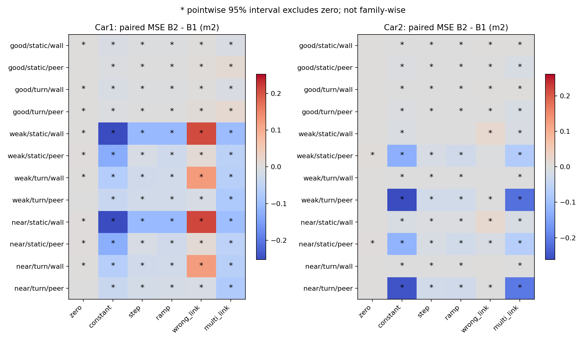
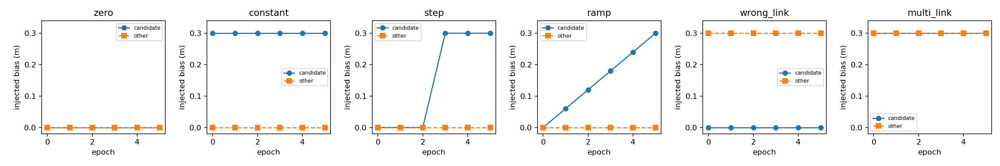
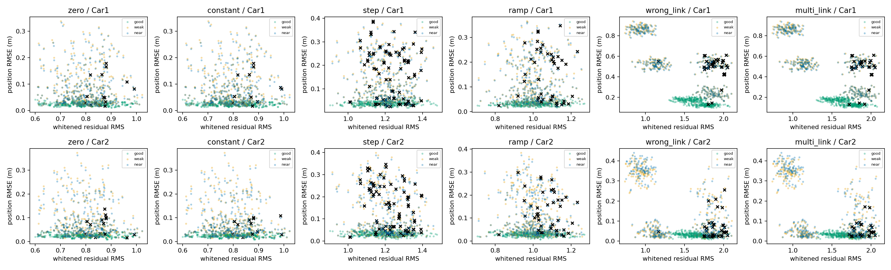
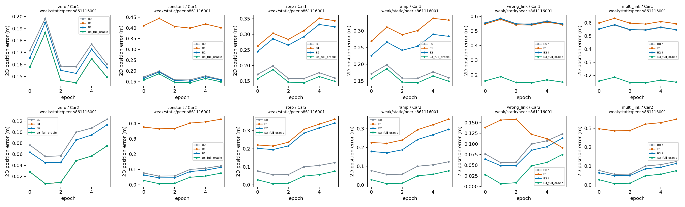
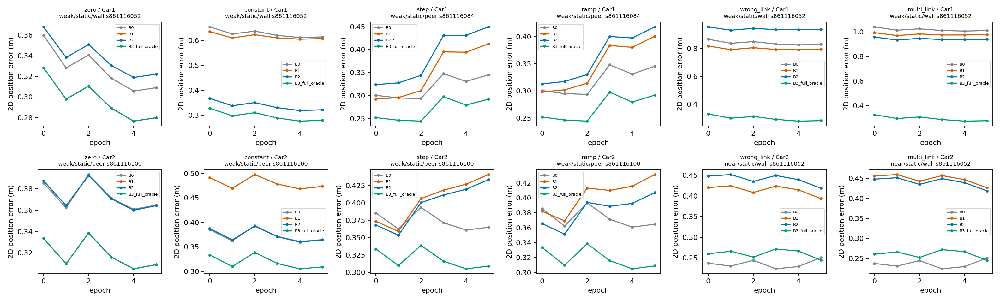

# B端扩展故障压力测试结果

本批全部完成：72条件×100新seed×四方法，7200配对输入、28800方法、57600个持久阶段。全部最终估计有限，缺失0；28419次满足冻结数值标准，367次未驻点、14次达到P1预算。主统计保留全部有限最终解。结论是：**已知单常值链路的收益延续；时变故障只能部分吸收；候选选错或存在额外链路偏差时，数值接受仍可伴随明显位置错误。**

这是阅读原确认结果后设计的新扩展压力测试；协议在本批观测生成前冻结，不能追溯为先前预登记。冻结SHA `41653fff74255a3222b49933947f31c497640e0f`，共同起点 `fba539052f3ce2ed7d2ed35e79ac03198200c680`。原7200方法结果未改、未重放；开发只用已暴露26011601。

## 执行、分母与核验

|方法|计划/有限|数值接受|未接受|Car1 RMSE>.5m|Car2 RMSE>.5m|
|---|---:|---:|---:|---:|---:|
|B0|7200/7200|7121|79|1060|0|
|B1|7200/7200|7169|31|1071|146|
|B2|7200/7200|6976|224|1002|0|
|B3_full_oracle|7200/7200|7153|47|0|0|

无异常、非有限、缺失或数值警告；14个预算耗尽仍保留最后有限估计。每条件独立n=100，不是7200；同seed在各条件共享噪声，车辆/时刻/方法和零注入候选标签不增加独立重复。.5m仅离线诊断阈值。

运行一次收到外部终止信号（退出143，来源未确定），当时资源仍充足。恢复保持同一冻结提交，只补未持久化阶段。事件日志有57600个首次stage-start、2个未落盘stage重试；最终恰有57600个持久阶段，未重算任何已保存成功/失败结果。重试不增加独立样本。完整事件和启动/恢复日志已归档。

独立读回没有调用优化器：7200输入、57600状态的残差、Jacobian、梯度、代价和位置误差最大差均0。可携带压缩分片再次不依赖原目录核验通过。原始r/J/局部信息在Git外保留，文件级SHA在RAW_SHA256中；精简证据保留输入、实际注入、两阶段估计/标量/状态，足以按固定公式重建。

## 1. 常值单链路收益是否延续

constant的12条件×两车共24个B2−B1配对MSE的95%逐项区间全部为负。B2相对B0的24区间有16个为负、8个跨零；对B1改善不等于对独立B0普遍有净收益。B2在constant中没有逐车>.5m，条件平均Car1 RMSE约.0237–.1230m。

zero中24个B2−B1逐车区间有11个为正、13个跨零，未见区间全负。增加自由b并非无代价。区间计数描述相关逐项结果，不是24次独立检验或家族保证。

## 2. step/ramp被吸收多少，剩余结构如何

step、ramp各24个B2−B1区间中均有23个为负、1个跨零；但相对B0各有8个区间为正。B2可减轻被污染的协同目标，但不能保证比不读污染peer的B0更好。

候选注入均值都为.15m，单常数只能消除其均值部分。step去均值RMS=.15m，ramp去均值RMS约.10247m；它们是模型无法仅靠b消除的时间结构。各条件B2平均估计b：step约.0299–.1509m，ramp约.0592–.1509m，不能把b/.15简单称为物理吸收比例，因为位置几何也随优化变化。

|weak/static候选|注入|Car1/Car2平均RMSE m|平均估计b m|候选未吸收注入RMS均值 m|接受/100|
|---|---|---|---:|---:|---:|
|wall|constant|.1189/.1086|.2954|.0145|97|
|wall|step|.1417/.1059|.1445|.1512|94|
|wall|ramp|.1327/.1067|.1449|.1041|97|
|peer|constant|.1230/.1211|.2660|.0407|98|
|peer|step|.2506/.2488|.0300|.1955|79|
|peer|ramp|.2131/.2121|.0592|.1417|87|

“未吸收注入”定义为真实54维注入减去估计b×候选掩码，不包含位置变化和噪声；实际残差另列。因此它是结构性描述，不是残差、真b估计误差或已验证故障跟踪性能。step/ramp不假定存在唯一真实单常值b，不套用真b误差>.1m标签。

## 3. 候选选错是失去收益还是更差

wrong_link下Car1的12个B2−B1区间有10个为正、2个为负；Car2有4个为正、5个为负、3个跨零，显示故障传播与自由参数释放可对两车产生不同影响，不能一概称改善。

B2在wrong_link有501/1200个Car1 RMSE>.5m，其中478个已满足数值接受。weak/static/wall时，真实故障在Car1-anchor1，B2却估anchor0；Car1平均RMSE约.8663m、Car2约.3465m，平均b为−.2050m，100/100均数值接受。允许自由负偏差符合原方法，但错误候选会把状态和b调整成错误模型的稳定解。这里不是简单增加迭代预算能解决的问题。

## 4. 多链路是否突破单偏差模型

multi_link下24个B2−B1区间仍有20个为负，但4个为正；同时B2仍有501/1200个Car1>.5m，其中486个数值接受。相对B1有改善不等于恢复了正确状态。

weak/static/wall的Car1/Car2平均RMSE仍约.8663/.3465m，平均b变为+.0950m；另一真实链路+.3m完全不在b的模型列中。wrong_link与multi_link只相差候选链常数+.3，所以b可整体平移+.3，位置目标等价；两组位置结果近同并不是“成功处理多链路”的新证据。B3_full_oracle知道并减去全部逐测量故障，因此没有逐车>.5m，但这种更强oracle不是可部署方案。

## 5. 小残差与大位置误差能否并存

未设置事后最佳残差阈值。完整残差—位置联合分布及每条件Spearman保留，案例按预冻结的条件内百分位秩差选择。

wrong_link预定秩差规则选出的Car1案例：condition m58、seed861116052（near/static/peer），数值接受，Car1 RMSE=.62543m，白化残差RMS=1.66080。其位置误差在本条件99.5百分位，残差仅2.5百分位。multi_link对应规则选出同seed的m59，读数近同。这里“小”指本条件相对残差秩低，不把1.66事后命名成安全阈值。

zero/constant的同类规则案例虽然也有很大的秩差，位置RMSE仅约.0414m；这也完整保留，不能只选模型失配中最坏的例子来暗示所有小残差都危险。指定seed、最坏逐车误差与秩差案例均列在CASES.json和图中，同时给出全部条件统计。

## 6. 数值未收敛与模型失配的区分

381个未接受是数值分类，包含367个未驻点和14个P1预算耗尽，不被静默接受。另一方面，B2的1002个Car1大误差中964个已经数值接受；它们主要来自wrong_link/multi_link，不能解释成只是求解器未收敛。相反，step的弱静止peer更容易未驻点，但其误差与结构残留应分开记录。成功满足1e-5只说明该目标的数值状态，不保证目标与真实故障相符，也不证明全局最优。

## 证据与限制

PER_RUN共28800行；SUMMARY保留288个条件方法组；PAIRED_INTERVALS按固定seed91327062、10000次配对重采样；FAILURES含数值失败或离线误差超阈值，NONACCEPTED仅数值未接受。区间为95%逐项区间，无多重比较家族保证。每种注入的1200方法行跨场景复用100个seed，不能当作1200独立事件估风险。

仅六时刻、已知房间坐标位移、固定候选、指定Gaussian噪声与survey。未开发新算法，未检测故障/切换链路，不能推论长期动态跟踪、检测延迟、实车性能、HMI风险或保护级。后续噪声失配探索另有协议、种子、冻结提交与报告，不混入本批结果。
