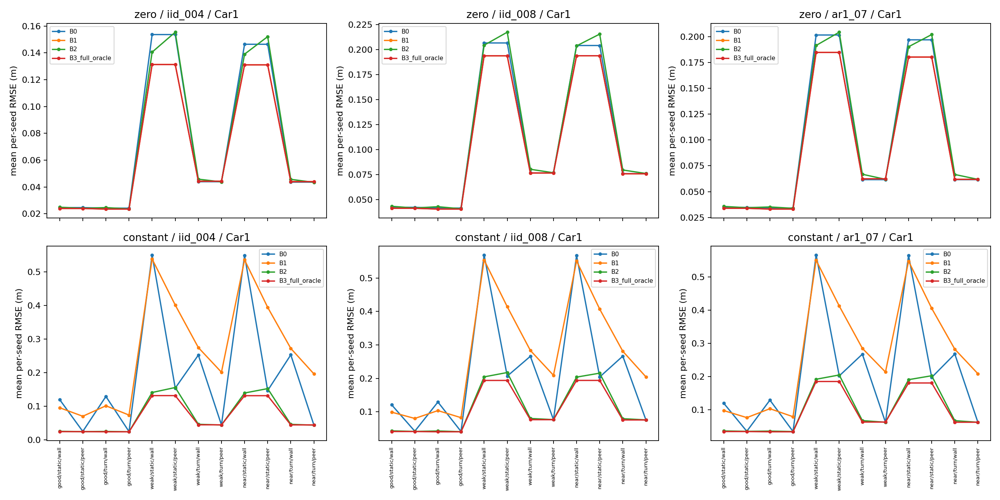
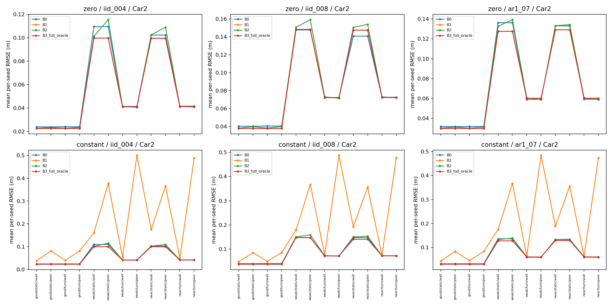
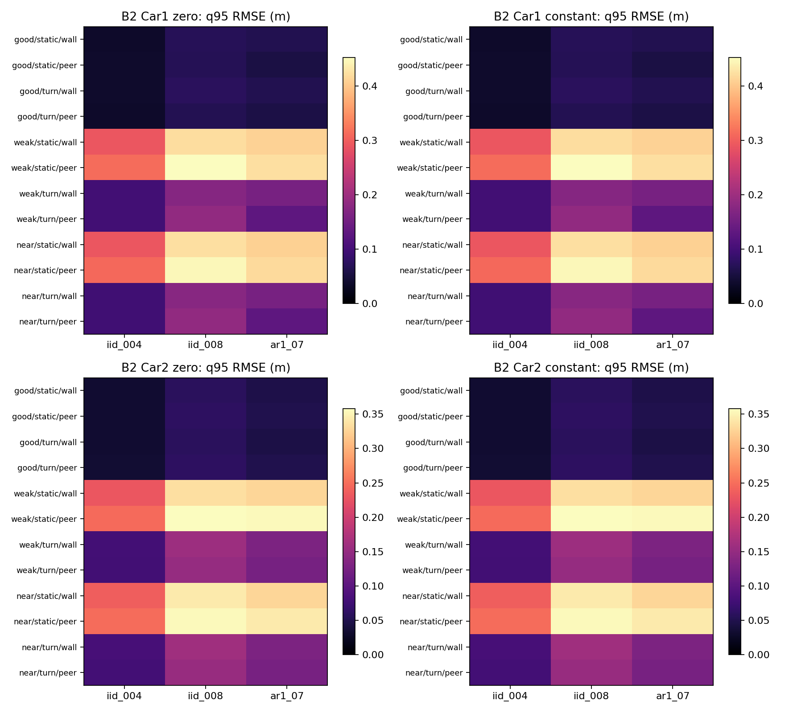
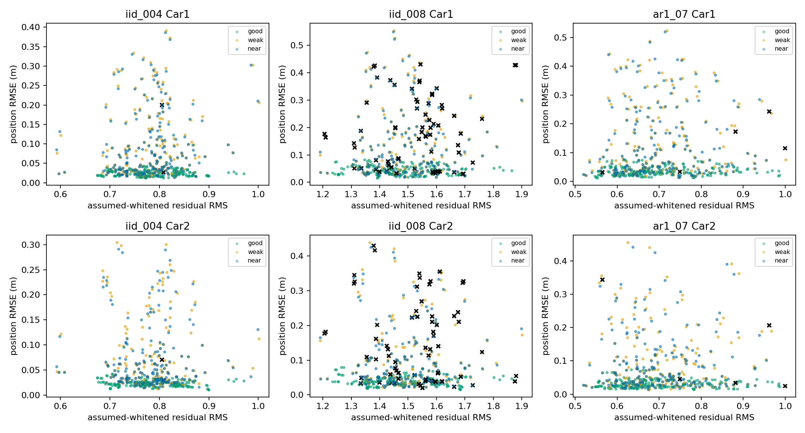
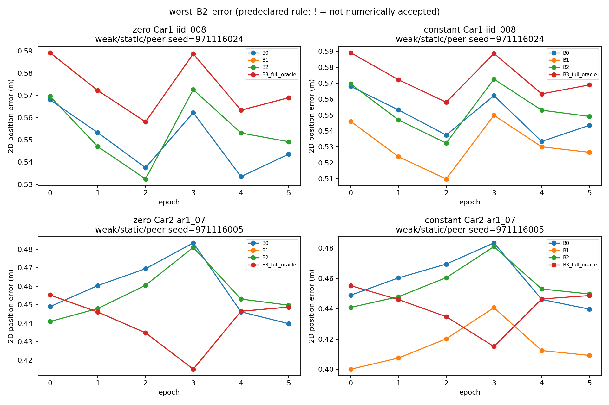
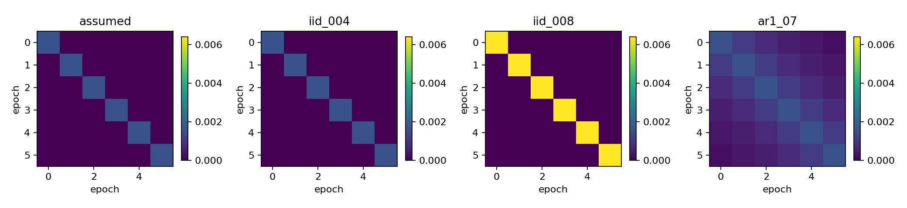

# 独立噪声失配探索结果

全部完成72条件×50新seed×四方法：3600输入、14400方法、28800阶段。冻结 `54ac42b60a11a0666e8840cf5bd8417a02a677e1`，执行135秒、原始目录约369MiB，无中断或重试。**实际测距方差增大和时间相关性都会使误差加大；数值接受不能替代位置正确性；相关噪声甚至可同时降低残差、抬高位置误差。**

本批在原故障压力测试及其读回完成之后独立设计、冻结、生成。不能与第一批合称早已预登记的大实验。第一批配置、源码快照、结果和统计未改。此处iid004也是本批50个新seed，噪声配对差只在本批内部计算，不拿第一批100个seed代替配对基准。

## 完成、数值分类和全分母

14400个最终估计全部有限，缺失/不可用0。14047数值接受，333未驻点，20达到P1预算；无异常、非有限或数值警告。P0另有6个预算耗尽，均按原规则只继续一次P1，最终分类另算。没有增加P2或改变容差。所有有限解进入主误差统计，接受子集另列。

|实际噪声|方法|计划/有限|数值接受|Car1 RMSE>.5m|Car2 RMSE>.5m|
|---|---|---:|---:|---:|---:|
|iid .04|B0|1200/1200|1190|90|0|
|iid .04|B1|1200/1200|1192|83|46|
|iid .04|B2|1200/1200|1197|0|0|
|iid .04|B3_full_oracle|1200/1200|1189|0|0|
|iid .08|B0|1200/1200|1138|84|0|
|iid .08|B1|1200/1200|1134|88|47|
|iid .08|B2|1200/1200|1083|8|0|
|iid .08|B3_full_oracle|1200/1200|1134|8|0|
|AR(1)|B0|1200/1200|1200|78|0|
|AR(1)|B1|1200/1200|1198|85|36|
|AR(1)|B2|1200/1200|1192|4|0|
|AR(1)|B3_full_oracle|1200/1200|1200|8|0|

这些1200行包含24条件复用同50seed，不能当1200独立事件。独立重复单位始终是每条件的50seed。zero/constant与候选标签间还存在目标等价，不能叠加为额外独立支持。.5m只是离线诊断阈值，不是安全界；越阈次数不会随噪声严格单调，不能据某个合计下降宣称风险改善。

## 1. 逐车误差及尾部变化

相对本批iid004，预定的逐seed配对MSE噪声差有每方法24基础场景×两车=48个95%逐项区间：

|方法|iid008：正/跨零/负|AR1：正/跨零/负|
|---|---:|---:|
|B0|47/1/0|46/2/0|
|B1|44/4/0|44/4/0|
|B2|48/0/0|48/0/0|
|B3_full_oracle|48/0/0|48/0/0|

因此本样本中B2和oracle在所有基础场景的两车平均MSE都表现出增加。48区间相互相关、仅逐项95%，不是家族保证。全部384条噪声配对比较在NOISE_CONTRASTS.csv；全部方法、条件的MSE、RMSE均值、中位、q90/q95/q99/max在SUMMARY.csv，不按结果筛场景。

以既定弱几何/静止/peer/zero为说明（每格n=50，均值与q95单位m）：

|方法|实际噪声|Car1平均RMSE/q95|Car2平均RMSE/q95|
|---|---|---:|---:|
|B0|iid004|.1537/.3199|.1096/.2514|
|B0|iid008|.2068/.4539|.1476/.3586|
|B0|AR1|.2015/.4249|.1363/.3508|
|B1及B3|iid004|.1313/.2749|.0998/.2306|
|B1及B3|iid008|.1940/.3943|.1482/.3305|
|B1及B3|AR1|.1846/.3989|.1276/.3201|
|B2|iid004|.1554/.3134|.1155/.2476|
|B2|iid008|.2176/.4530|.1590/.3582|
|B2|AR1|.2042/.4236|.1392/.3541|

zero时B1与B3目标相同，故同值；并非两个独立算法证据。B2的额外自由b也会吸收部分噪声、改变位置解。B3在本批只知道真实注入偏差，仍假设独立sigma=.04，没有知道真实噪声或修正权重，所以不能消除噪声失配的影响。

## 2. 数值接受与大位置误差

B2在iid008有8行Car1>.5m，AR1有4行，12行全部数值接受；B3在两种失配下各8行也全部数值接受。跨条件相关，不能当独立风险样本。

按冻结“逐车最坏B2误差”规则，zero案例n31、seed971116024（weak/static/peer、iid008）Car1 RMSE=.55414m，已数值接受；constant相应n34位置几乎相同。Car2最坏为n32/n35、seed971116005、AR1，RMSE=.45572m，也数值接受。它们说明接受只是给定错误噪声模型目标的数值判据。iid008的B2总未接受117/1200，而AR1仅8/1200，但不能据此认为AR1的位置误差更可信。

## 3. 残差—位置误差关系

上述weak/static/peer/zero的B2平均白化残差RMS：iid004=.78181、iid008=1.50521、AR1=.70694。AR1比iid004残差更小，Car1平均RMSE却由.15545增至.20425，q95由.31335增至.42363。残差仍按估计器错误的独立sigma=.04白化；相关噪声中的平滑分量可被状态拟合，低残差不能解释为校准良好。

完整联合分布图及每条件每方法逐车Spearman在RESIDUAL_ERROR.csv。没有事后设置最有利残差阈值。按冻结的百分位秩差规则，zero/constant的Car1选择n01/n04、seed971116050：误差.07440m（条件内97百分位），残差1.24357（3百分位）；这是低相对残差/高相对误差，却并非>.5m的大误差。保留这个不夸张的案例，与最坏误差案例并列，不能把秩差自动当作严重故障证据。

## 核验与覆盖率分析所需证据

开发20000独立噪声块的协方差最大误差/边缘方差=.00632，首项跨链路相关绝对值最大=.01784，均满足提前固定门槛。AR1首项经验标准差=.03987m，创新标准差=.0285657m；并未把创新sigma错设为边缘sigma。

正式读回独立重建3600输入、28800状态，不调用优化器；残差/J/梯度/代价/误差最大差均0。噪声另用AR闭式展开核对，压缩分片再次独立验收完整通过。输入、实际噪声、注入、完整配置、两个阶段估计、数值状态、原始J及重建测量顺序均保留，足够后续覆盖率方法在另行冻结后使用。这里尚未做覆盖率推断或保护级设计。

六时刻AR(1)仅为相关噪声初步探索，不代表长时间实测相关结构。没有新定位算法、权重修正、实车性能、HMI风险或保护级保证。结果交给A验收，不依赖A新接口。
