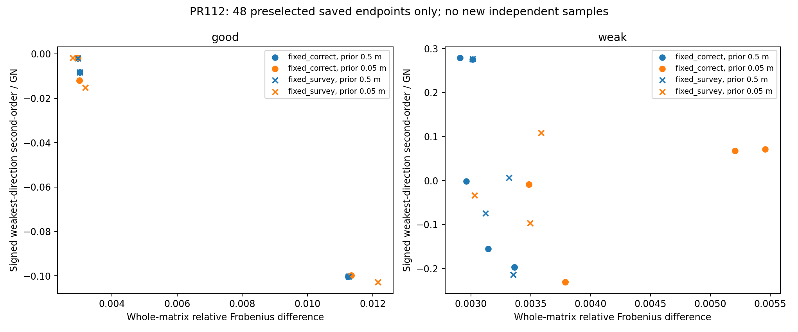
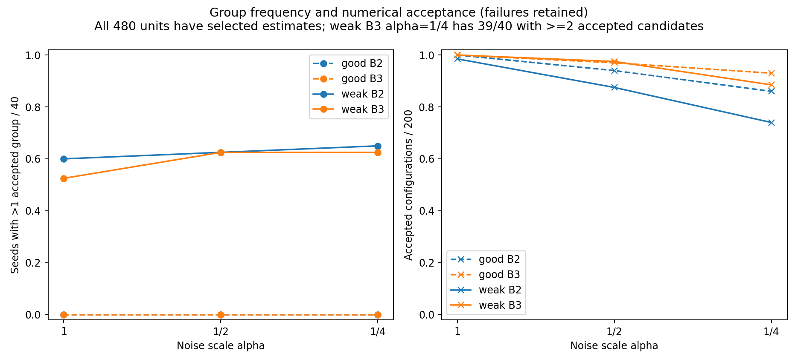
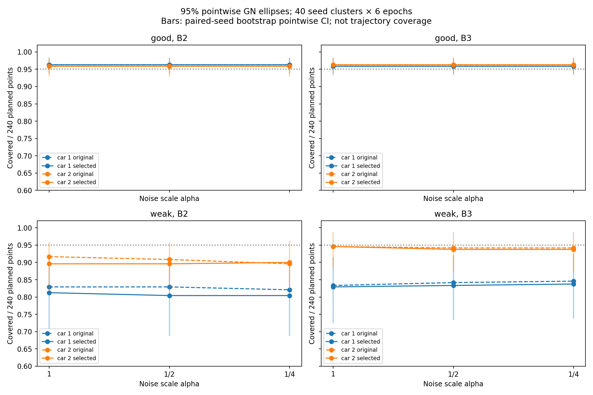
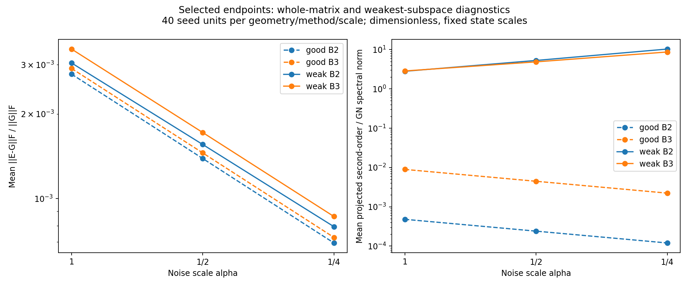
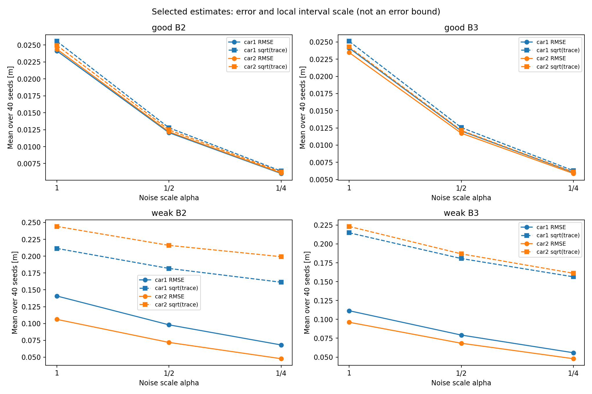

# 噪声缩小没有消除本轮弱几何终点歧义

完整实验不支持“降低噪声后，多接受终点组频率与组内欠覆盖一起改善”。弱几何B2在α=1、1/2、1/4时，多接受组分别为24/40、25/40、26/40；两车选优组内95%点覆盖基本不变。位置误差减小，但不能因此宣称区间得到校准。good对照始终只有一个接受组，覆盖随α基本保持。

## 来源、时序与数量

固定起点PR112 cc3861bf054f96f88c381eb07f6f89b81ebf2618；先读其协议、报告、交接、决策与数学实现。旧48代表终点诊断无优化完成后，审计本地全部提交refs及新fetch的main，共4252个去重文本/压缩证据blob及字面range，无291118001–291118040冲突。该范围不宣称掌握未记录的外部执行。

冻结SHA c88571f51d7165f568847c9338005ddf4880addb，执行SHA e97f94e7824f6bc5450319b59d14d501b8482418。240新输入、480输入方法单元、2400方法初始化配置；P0/P1记录4800、实际调用4800，未追加。全部2400最终有限，2232数值接受、168未驻点，0预算耗尽/异常/缺失。开发60配置/120调用另计。nfev共55953，阶段耗时累计约31.01秒，不含生成、IO和分析。

同seed跨几何/噪声水平使用完全相同标准正态数组；测距σ=.04α、运动σ=.02α，估计器白化同步缩放。static、peer +.3m、正确固定位置先验σ=.5m保持，B2已知受影响peer链路，B3知道注入幅度，仅为理想参照。初始化不读取真值选择方向或最优解，I0调查点积分观测位移、I1–I4沿用原规则。先验中心正确是设计条件，不是实际可获得真值的声称。

## 旧48代表终点：弱方向与整体范数不同

旧PR112整体尺度化Hessian相对Frobenius差为0.00280–0.01216，即0.28%–1.22%。然而弱几何代表点的最弱GN方向上，残差二阶项/GN曲率为约−23.09%至+27.86%。good代表点相应约−10.28%至−0.18%。正负均保留，不把整体小范数当作所有方向近似准确。

分层细节如下，每格含B1/B2/B3原/选优共6个代表终点，来自固定同一seed；不是6个独立样本。

|几何|中心|先验σ(m)|弱方向有符号修正范围|
|---|---|---:|---:|
|good|正确|.5|−10.03%～−0.20%|
|good|调查|.5|−10.03%～−0.20%|
|good|正确|.05|−9.98%～−0.18%|
|good|调查|.05|−10.28%～−0.18%|
|weak|正确|.5|−19.68%～+27.86%|
|weak|调查|.5|−21.36%～+27.62%|
|weak|正确|.05|−23.09%～+7.08%|
|weak|调查|.05|−9.63%～+10.86%|

所有48点的近重根判定维数为1，额外合成重复特征值的旋转测试验证子空间指标不依赖基选择。这里不跨条件追踪不稳定特征向量，不推广到旧3600个全部候选。

缓存入口仅打开NPZ一次、9个数组各解压一次，用约0.75秒（包含哈希读取）核验6144覆盖行、720选优身份及全部3600候选误差/失败计数，数值差0。旧文件及旧哈希完全未改。该耗时只记录本环境，不是跨机器基准或强行声称固定加速倍数。

## 新实验的组率、覆盖和误差

下表均使用40seed；覆盖为选优组内先按成员平均再按seed平均，每车等权点分母240，可用240。所有480单元有选优候选。当前组内覆盖与选优代表点的覆盖数一致；不能因此认定跨seed的组是同一物理分支。

|几何/方法|α|多接受组(seed)|95%点覆盖车1/车2|选优平均RMSE车1/车2(m)|
|---|---:|---:|---:|---:|
|good/B2|1|0/40|96.25% / 95.83%|.02413 / .02438|
|good/B2|.5|0/40|96.25% / 95.83%|.01206 / .01219|
|good/B2|.25|0/40|96.25% / 95.83%|.00603 / .00610|
|weak/B2|1|24/40|81.25% / 89.58%|.14084 / .10615|
|weak/B2|.5|25/40|80.42% / 89.58%|.09805 / .07194|
|weak/B2|.25|26/40|80.42% / 90.00%|.06818 / .04779|
|weak/B3|1|21/40|82.92% / 94.58%|.11145 / .09616|
|weak/B3|.5|25/40|83.33% / 93.75%|.07919 / .06834|
|weak/B3|.25|25/40|83.75% / 93.75%|.05575 / .04786|

good/B3三尺度也均0/40多个接受组，车1/2点覆盖保持95.83%/96.25%。其余99%点态、逐时刻、六时刻全覆盖、固定先验噪声视图及原I0结果均在完整表中，不只保留有利指标。

预定主对比weak/B2、α=.25减1：多组率+5个百分点，配对seed95%区间[−7.5,+20]个百分点；车1组内95%点覆盖差−0.833个百分点，区间[−2.083,0]；车2差+0.417个百分点，区间[−1.667,+3.333]。没有明确的共同改善。40seed不足以排除小效应，也不应将区间触及0解释为等效性证明。

原I0与选优的配对也不保证改善：weak/B2、α=.25时，选优减I0的车1RMSE为+.00190m（逐项区间[.00056,.00356]m），点覆盖差−1.667个百分点（[−5,0]）；车2RMSE差+.00101m，区间包含0。完整PAIRED表保留各尺度与两车结果。

误差变化与覆盖变化不等价。weak/B2车1RMSE配对差−.07266m，逐项区间[−.08584,−.05985]m；但覆盖没有提高。六时刻全部覆盖B2车1为65%、62.5%、62.5%，车2均77.5%，与点态80%–90%不能混称。pointwise95%椭圆并不保证轨迹95%。

## 全部数值标签与可用分母

|α|计划配置|接受|未驻点|预算/异常/缺失|
|---:|---:|---:|---:|---:|
|1|800|797|3|0|
|.5|800|752|48|0|
|.25|800|683|117|0|

主原I0表保留有限未驻点状态；选优按协议只在接受候选内选最低代价，未用真值。所有单元至少有一个接受候选；weak/B3、α=.25仅39/40有至少两个接受候选，其余条件均40/40。不能将候选接受率下降解释为成功消除分支；固定物理梯度门槛在更强白化下的数值敏感性是额外限制。没有放宽门槛或继续迭代。作为描述性补充，weak/B2全部有限终点的多组数为24/40、27/40、29/40，比仅接受口径略高；它也未呈现组歧义消失，但未驻点组不能被当作可靠驻点。

全部2400终点总信息满列秩，1e-6/1e-8/1e-10/1e-12阈值判秩一致；两视图共57600二维边缘可用。无不可用不代表一般退化情况都可用；代码保留不可用和失败原因路径。所有新终点的精确Hessian未检测到负特征值，仍不等于穷举证明全局最优。

## 整体局部近似改善，最弱方向并未同步改善

选优终点按40seed平均：

|方法/几何|指标|α=1|α=.5|α=.25|
|---|---|---:|---:|---:|
|B2/weak|整体相对Frobenius差|.003041|.001558|.000794|
|B2/weak|最弱子空间相对二阶项谱范数|2.806|5.296|10.329|
|B3/weak|整体相对Frobenius差|.003409|.001719|.000863|
|B3/weak|最弱子空间相对二阶项谱范数|2.859|4.874|8.697|

弱方向数值是无量纲比值，不是百分比单位；例如10.329意味着二阶项范数约为该方向GN曲率的10.329倍，而不是10.329%。其分母本身很弱，均值受较大比值影响；全部逐次值保留，所有候选最大约52.11。不能拿整体范数下降宣称局部Gaussian近似在关键方向变好。

解析几何事实：weak设计锚点与两车真位置共线。在真位置处，测距对横向坐标的一阶导数为零；对非零水平距离d，距离局部展开含y²/(2|d|)。这说明普通一阶局部线性直觉在该设计下有局限；当前估计点的先验及数据总信息仍可满秩。该事实与结果相容，但尚未单独证明它造成了全部欠覆盖。

## 验收、修正记录与限制

保存状态4800阶段重算代价/梯度差0，独立冻结目标r/J差0；噪声标准数组跨尺度完全相同，生成恒等式最大误差4.44e-16；实际白化receipt、初始化参数依赖、480个选优身份通过。24个预定首seed原/选优Hessian的中心差分最大相对误差2.39e-11。3072行覆盖分母逐行核验；192个主覆盖单元另做计数，差0。

分析验收修正过缺少distance别名及从30seed脚本沿用的点/候选分母常数。修正仅涉及新分析入口，旧结果和本轮输入/求解状态未变；从保存数组重算表图，未新增优化。早期中间表留Git外，不作为交付证据。最终分母为40seed/240点/200配置，并有显式不等式和计数检查。

结果支持：weak设计的组歧义在本次有限降噪范围内没有消失；精度提高不必伴随覆盖改善；整体矩阵范数不能替代最弱方向诊断。未支持：分支消失导致覆盖修复；也不能确认唯一的高阶非线性原因。α变化同步改变数据对固定先验的相对信息，I0由带噪位移积分也变化，数值接受集合亦变化。固定五初值、组阈值和条件化选优不足以分离这些因素。所有推断为逐项、无多重比较保证；无实车、保护级、HMI或罕见风险保证。

## 图与证据

精确结论对应[主对比表](results/contrasts/NOISE_CONTRASTS.csv)、[覆盖表](results/summary/COVERAGE.csv)、[组率表](results/summary/BRANCH.csv)、[逐终点曲率](results/readback/WEAK_CURVATURE.csv)、[失败表](results/summary/FAILURES.csv)、[最终核验](FINAL_CHECKS.json)。
