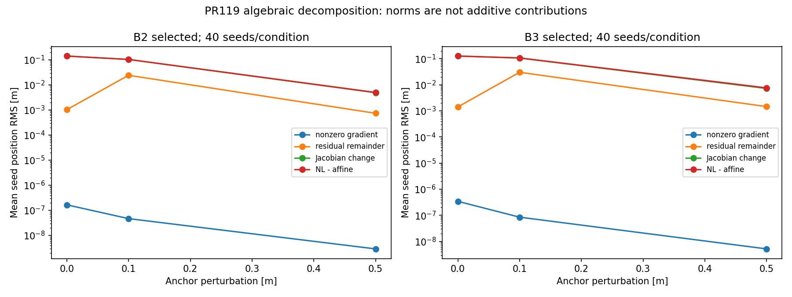
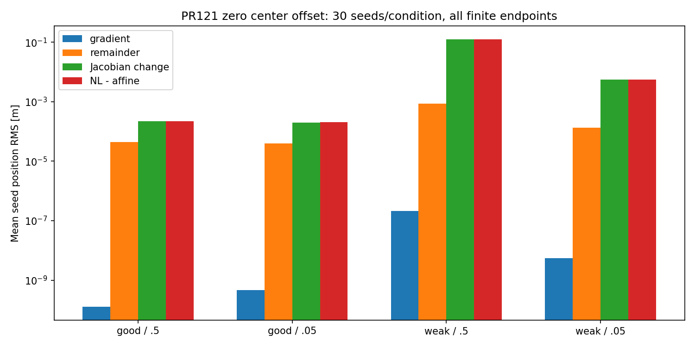
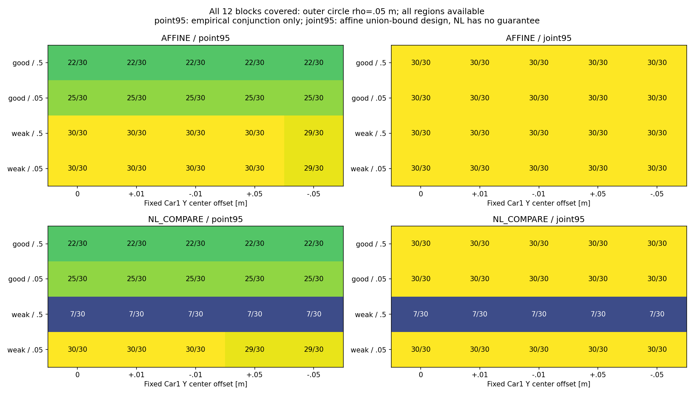
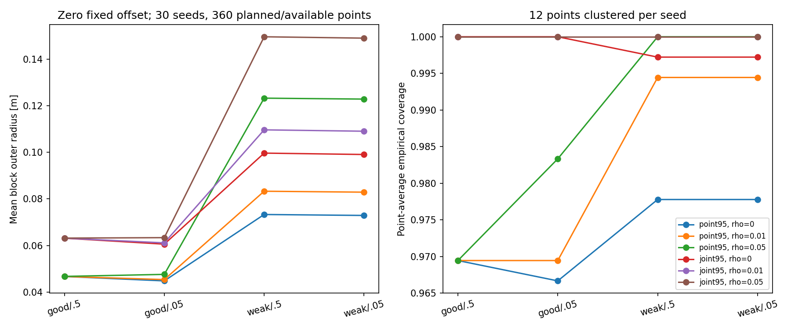
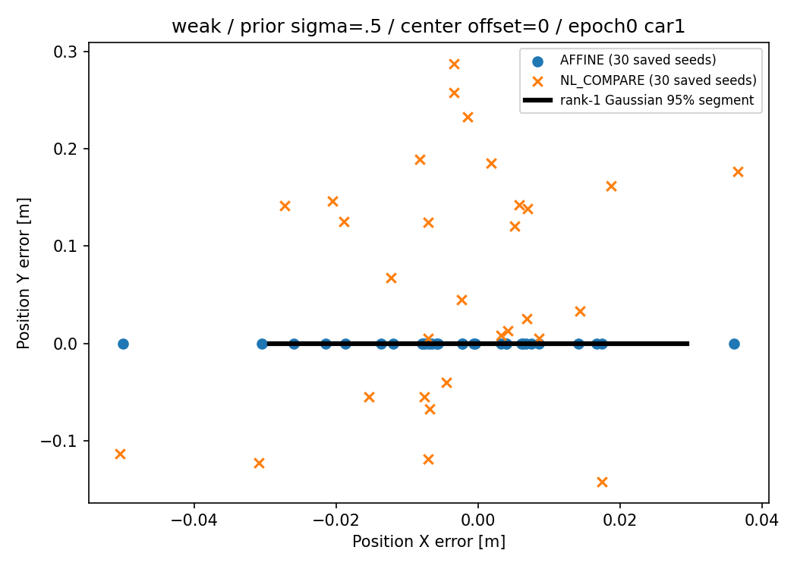

# 非线性误差来源分解与退化Gaussian区域验证

本轮解释了已有端点的两类差异：弱几何、弱先验下，非线性与仿射**位置**差主要表现为Jacobian变化与残差耦合的响应；**偏差状态**差主要表现为残差非线性余项。非零数值梯度项不能删，但在本批端点中的绝对响应远小于典型非线性差。该代数分解不是独立因果贡献，也不能区分尚未发现的分支与局部高阶效应。

PR121首时刻的数学缺口已在固定仿射模型内补齐：唯一状态解可以对应秩1随机边缘，用支持子空间和χ²₁构造线段；不需要ridge。完整六时刻联合风险分配区域已给出并验收。但其非线性移植出现明确反例，不能称保护级或非线性风险保证。

## 来源、执行与分母

共同起点：`f9c27436836b814afdea47945887015dcb55fca5`。分析合同先提交：`8659412f0988a5cec95a118702287b8994ea379f`。本轮为已暴露结果上的事后机制分析，未重写历史预登记口径。没有新观测、非线性优化器调用、Monte Carlo或随机测试；置信区域分位数是解析χ²分位数，不是仿真新增样本。

|批次|计划/实际最终端点|接受|未驻点|预算耗尽|每条件独立seed|
|---|---:|---:|---:|---:|---:|
|PR119|1200 / 1200|1181|16|3|40|
|PR121|600 / 600|596|4|0|30|

全部最终状态有限，全部同目标仿射设计满列秩；B2为25维、B3为24维，不混用偏差模型。PR119保留I0、原selected、全部有限、接受候选及选优组；候选先在seed内平均。PR121保留全部有限和接受子集。两批seed不同，没有合并为配对实验。表中经验2.5/97.5百分位是seed分布描述，**不是均值置信区间**；没有按时刻或初值放大n。

## 位置差：数值梯度、残差余项与Jacobian变化

各项是解H0 v=b后的状态贡献，不是右端项的原始梯度范数。下表为每seed的12位置块RMS再跨seed平均，单位m；三项范数不可相加。PR119为selected，PR121为全部有限、中心偏移0。

|来源/条件|梯度项|残差余项|Jacobian变化项|合成NL−仿射位置差|
|---|---:|---:|---:|---:|
|PR119 B2，原weak|1.65e−7|.001019|.139857|.139861|
|PR119 B2，扰动.10m|4.67e−8|.023980|.102411|.102770|
|PR119 B2，扰动.50m|2.90e−9|.000734|.004844|.004964|
|PR119 B3，原weak|3.42e−7|.001419|.126448|.126463|
|PR119 B3，扰动.50m|5.14e−9|.001462|.007246|.007612|
|PR121 good，sigma=.5|1.28e−10|.000044|.000217|.000222|
|PR121 good，sigma=.05|4.60e−10|.000039|.000199|.000203|
|PR121 weak，sigma=.5|2.15e−7|.000854|.125052|.125056|
|PR121 weak，sigma=.05|5.55e−9|.000135|.005593|.005596|

在原weak真值，测距横向导数为零，运动及先验残差本身是线性的，所以J0ᵀη没有直接横向数据投影；横向位置差可通过ΔJᵀrN显现。这解释的是本恒等分解下的结构，不等于“η与非线性无关”。几何改变会同时改变J0、η、ΔJ、残差及所选端点，不能把上述均值当互相独立的干预效果。

PR119 B2扰动.10m时，位置抵消指标均值约.203，原weak约.00671，.50m约.133；说明有的条件下两项部分抵消更明显。完整有符号向量、两两余弦和弱子空间投影均保留。最弱子空间的合成差范数（缩放坐标）B2为.48439→.25556→.02577；不把近重根强行比较成唯一特征方向。

### 不能只用原始梯度或接受标签解释

全部接受端点梯度响应的位置RMS最大值：PR119约1.62e−6m、PR121约9.00e−7m；PR119预算耗尽端点最大约2.91e−6m。未驻点与预算耗尽仍按原标签保留，不能据小响应改判接受。典型weak/.5差约.1m，故在这些已保存端点处，残余梯度不能单独解释如此大的NL−仿射差；这不推断继续优化后会如何变化，也不声称所有数值失败都无害。

### 偏差状态呈不同分解

PR119 B2 selected的有符号平均NL−仿射偏差差为−.026636、−.017129、−.002578m，对应残差余项均值−.026653、−.016897、−.002597m。PR121 weak/.5、零中心偏移，偏差差均值−.025244m，残差余项−.025261m，Jacobian变化项约+.0000174m。逐端点绝对量及有符号量分别保存，避免跨seed符号抵消掩盖大小。B3没有此参数，相关列为空。

### 与覆盖、区域及终点组的联系

PR119原结论仍保留：多接受组B2为22/40→9/40→0/40；.50m区域收紧且覆盖改善，与本轮NL−仿射差降低相符。仅.10m时差异有所下降，却没有同步修复车2覆盖；因此“更接近仿射”也不能孤立当作覆盖校准的充分条件。原weak仿射横向首时刻被固定中心锁定，而.10m的微弱测距横向信息引入新的随机响应，仿射误差并不必然单调下降：B2 selected对应的仿射位置RMS均值为.03279、.17364、.04992m。此数值是固定先验噪声传播现象，不是新噪声或错误读取。

PR121 weak/.5全部五个中心偏移的差异均值约.11685–.13899m；零偏移30端点全部接受。强先验使差异大幅减小，但同时改变数据/先验信息比例，不能将其全部归为分支消失。ASSOCIATIONS.csv给逐条件、逐方法、逐口径、seed聚类后的差异/旧曲率覆盖/尺寸/组数的描述关联；常量组数不强行输出相关系数。没有跨批合并，也没有用这些关联证明因果方向。

## 首时刻奇异区域：补齐数学定义，保留历史证据

PR121 600输入×12位置块=7200个唯一边缘，其中600块为weak首时刻秩1，6600块秩2，实际无秩0。秩0通过确定性测试。首时刻随机y为0由仿射运动链解析证明，数值G/T与解析响应最大差7.24e−15，扣除固定均值后的支持距离最大1.17e−14m。此扣除只为验收，没有改估计中心。

新表包含两个模型（AFFINE、NL_COMPARE）、两套风险口径及四种候选，共115200逐点记录，全部可计算；9600条为重复视图下的秩1记录，105600条秩2。历史PR121的4800条NONPOSITIVE_OR_SINGULAR_MARGINAL记录原样保留，不能将新定义倒写成旧实验已经完成了完整区域。

噪声支持集必须同时满足支持条件与χ²_r二次型。独立检查拒绝了每风险口径600个NL_COMPARE支持外点；仿射也各有240个支持外点，均源于rho0不能包含非零固定偏移，不能据此否定集合内定理。外包圆可能覆盖支持外误差，这是集合外包的保守性，不是遗漏支持检查。

## 点态与双车六时刻联合

点态每块α=.05；联合每块α=.05/12。联合保证通过并集界成立，不依赖车间或时间独立。理论仅限固定仿射设计、正确Gaussian噪声、同一个δ属于同一个四维球Dρ。rho=.05涵盖本批全部预定偏移；rho0/.01及集合外情况也完整报告，不挑有利子集。

以下为零中心偏移、全部30seed，noise_support为退化定义后的噪声集合，circle为rho=.05外包圆。区域全部可用，每条件360点；完整轨迹分母30。

|条件/模型|点态噪声集合点平均覆盖|点态噪声集合12块全覆盖|联合噪声集合12块全覆盖|联合circle全覆盖|联合circle平均半径(m)|
|---|---:|---:|---:|---:|---:|
|good/.5 AFFINE|95.56%|18/30|30/30|30/30|.06315|
|weak/.5 AFFINE|95.28%|20/30|29/30|30/30|.14968|
|weak/.05 AFFINE|95.28%|20/30|29/30|30/30|.14909|
|weak/.5 NL_COMPARE|29.44%|0/30|0/30|7/30|.14968|
|weak/.05 NL_COMPARE|79.44%|0/30|0/30|30/30|.14909|

PR121全部20条件的AFFINE联合rho=.05圆均30/30完整覆盖；weak/.5的NL_COMPARE在五种偏移下均仅7/30。strong条件非线性即使位置接近仿射，首时刻小的横向变化仍可能离开秩1支持，因此不能用支持集合直接继承保证。圆更宽可以掩盖这点，不能据圆覆盖良好证明误差退化Gaussian。

联合设计有明显尺寸代价：零中心偏移weak/.5、rho=.05平均半径从点态.12330m增至联合.14968m；good/.5从.04670增至.06315m。高覆盖是外包与风险分配的保守性，不是错误，更不能以30/30外推罕见失效风险。所有表分列全计划、子集、可用、覆盖及全计划有效覆盖；接受子集只是补充。

## 验收

- 源快照5211个文件在分析前后SHA一致；两批原SHA256SUMS通过。
- 1800端点保存代价/梯度最大差0；600仿射保存状态最大差0；240个PR119选优及组数独立重算一致。
- 恒等分解状态重建最大差1.72e−14m；方程归一化后向误差最大2.17e−12；最大κ(J0D)=140.244，κ(H_scaled)约19668。敏感秩检查保留。
- 未缩放QR独立贡献向量差最大1.22e−14m，合成恒等式最大差1.29e−14m。
- 115200逐点覆盖与半径、28800逐seed/车汇总独立重算一致；最大半径差2.78e−17m。支持内/外、rank0/1/2、边界、旋转、单位、有界偏移、联合预算确定性测试通过。
- 运行时禁止进入scipy.optimize/观测生成器，实际新优化器调用0、新观测0；所有分析只读保存状态与直接矩阵求解。

## 决策边界

已有解释：首时刻奇异源于固定中心与共线测距的线性结构；位置和偏差的NL−仿射差有不同的代数主导项；正常数值接受不等于局部Gaussian有效。

尚不能区分：有限初值之外的分支、路径上高阶非线性、端点选择与几何变化的独立因果份额；本恒等式不给未观测扰动域的余项界。新区域解决仿射数学缺口，不解决非线性区域证明。

下一阶段可继承支持集合与联合风险分配的严格语义、保存端点的分解验收和不掩盖退化的可用性规则。真正的非线性区域仍需对明确扰动域证明余项/分支控制，或采用有证明的全域外包噪声事件反演；不能把本轮最大经验余项当确定界。

