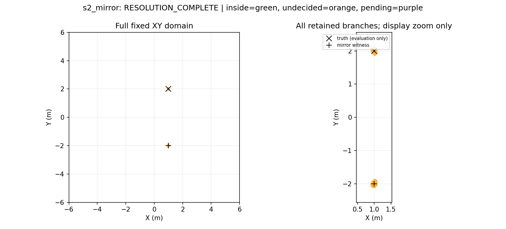
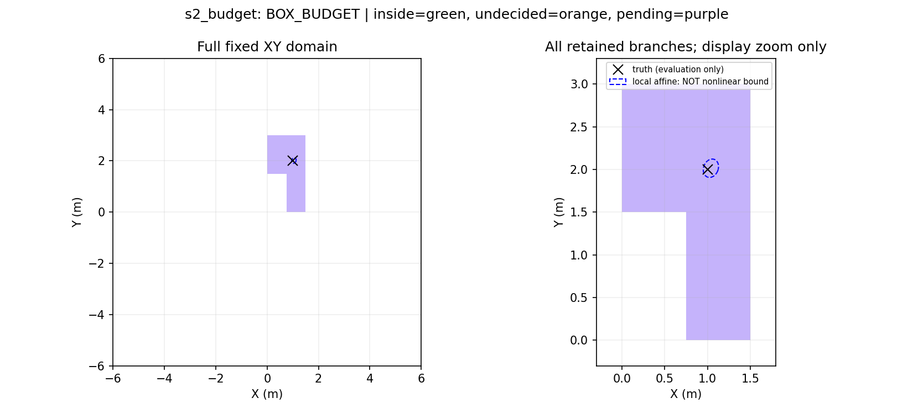

# 非线性测距置信集反演：低维原型报告

本轮形成了一个可读回核验、保留多解的条件性外包原型。数学保证由完整测量噪声事件进入参数集合，再经XY投影及外包组成；计算保证来自区间下界与完整分割树，而不是局部端点椭圆、有限初值或网格未发现解。

共同来源f9c27436836b814afdea47945887015dcb55fca5已包含PR118/119/121。初始冻结e5c1d6e1ee83b99859a5c099281efd95b90d1d26；读回域字符串格式修复及显式复用计划冻结888912f64a7a3b8cd33a24fb7c5394255e1c1dce。初始5例原始输出保留且字节不变，修复后仅新增余下3例搜索。详见REVISION，不将已暴露案例说成重新独立确认。

## 1. 数学包含关系是否成立？

成立，但条件必须写全：固定真参数属于事先声明Ω、完整四条测距生成模型正确、R=.04²I₄已知、输入表示区间包含真实读数。q=9.488的精确有理数证书给出χ²₄尾概率小于.049994406，因此完整噪声事件具有至少95%概率。该事件蕴含真参数属于反演集合；反演集合被保留盒并集包含，XY投影及全外包圆继续包含真位置。

这里不减去状态维数，也不把固定b赋予随机分布。阶段2的b只作用于预定第4条测距，范围[−.6,.6]m为显式仿真假设；它不是先验中心偏移δc。固定已知参考车位置是降维假设，不是完整双车未知位置定位。若真实b或位置在框外、噪声协方差错误、其他链路另有偏差，当前条件性结论不覆盖这些情况。

八例是预先指定的确定性机制检查，不用于估计95%覆盖率，亦不构成轨迹、HMI或实际月面安全保证。研究仍服务于安全量化目标，但本轮候选区域不命名为已验证保护级。

## 2. 实现何时保持外包？

在给定有效有限输入和本轮算术合同下，仅当可靠区间下界大于q才剔除盒。计算用40位Decimal定向舍入，平方根用整数平方根上下界，独立检查器用更细尺度的精确Fraction区间重复认证。二叉树每次分割覆盖父盒，所有内部、分辨率未决、异常未决及预算队列均保留。因此即使预算不足，输出仍是域内外包；它可能很宽，不能把“可认证”与“可用”混为一谈。

独立读回检查所有9840节点及2140个已分类叶证书，没有仅抽查几个点。区域大小由精确有理数面积界和顶点半径证明给出。上下文非有限/异常进入保守未知路径；未持久化的硬中断没有外包证书，attempt阻止自动重跑，不伪报空集。代码和单元测试不是形式化软件认证，仍依赖Python整数/Decimal运行时正确性；版本及文件哈希已记录。

## 3. 多解和预算中止的代价

二维和三维镜像案例均保留上下两支，而全外包圆半径约2.133m；两个小区域之间的空白也被圆包入，说明单圆表达可能远比盒并集保守。对称中心处局部Jacobian秩亏，本轮单点仿射比较不可用，不能用ridge或删支得到小椭圆。

预定16盒中止例留下3个队列盒，XY面积上界3.375m²、圆半径约1.677m；同输入完整预算例的面积上界约.060425m²、半径.146836m。没有再增加预算重跑中止例。两个边界案例保留真参数并触及相应域边界；这仅提示结论受域假设限制，有限框不能证明框外不存在其他解。

不一致观测例由根盒下界立即证明域内空集。它表示数据与本轮集合事件不一致，不是定位误差为零，也没有可用半径。所有状态均完整报告，见RESULTS。

## 4. 加入未知偏差的成本

good处理盒数207→2687，约13倍；mirror为461→5741，约12.45倍。对应搜索时间约.0114→.1361秒、.0257→.2916秒，所有非强制案例在50000盒/60秒预算内完成。累计搜索9837盒、约.5052秒，不含独立认证、IO与绘图，也不是系统实时性基准。

三维good、mirror的投影面积上界相对二维分别增加约57%和72%；这同时受额外未知量与区间依赖膨胀影响，不能将上界增长全解释成精确统计区域增长。保存细分盒可分别研究这些因素。此规模下计算可接受，但2→3维已显著增加工作量，不能据此外推25维或六时刻窗口可行。

## 5. 验收、修复与交付

13项开发测试最终通过；单位转换夹具的冻结前舍入问题已保留失败日志。冻结后一次根域字符串身份错误使批次停止，已修复为有理数值比较、重新冻结并只复用已有五例。区间求解核心、原输入、阈值、分辨率和预算没有修改，也没有补跑有利/不利结果。

全部8例各搜索一次，非线性优化器调用0，没有25维模型或Monte Carlo。便携结果包含输入、真值评价、完整状态树、未决队列、原始/修订冻结身份、精确投影界及检查日志；无需重复搜索可验收。只新增指定tools/docs目录，未改历史定位器、旧证据、中期正文或月球目录。

