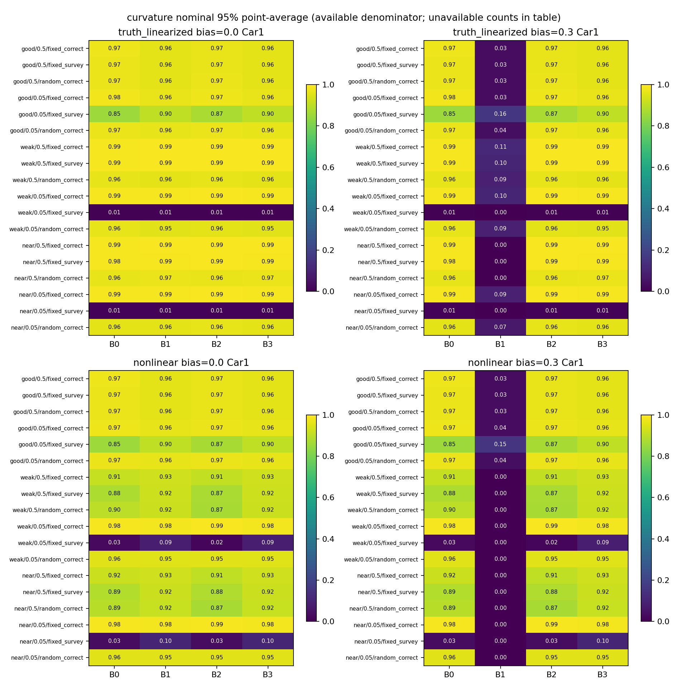
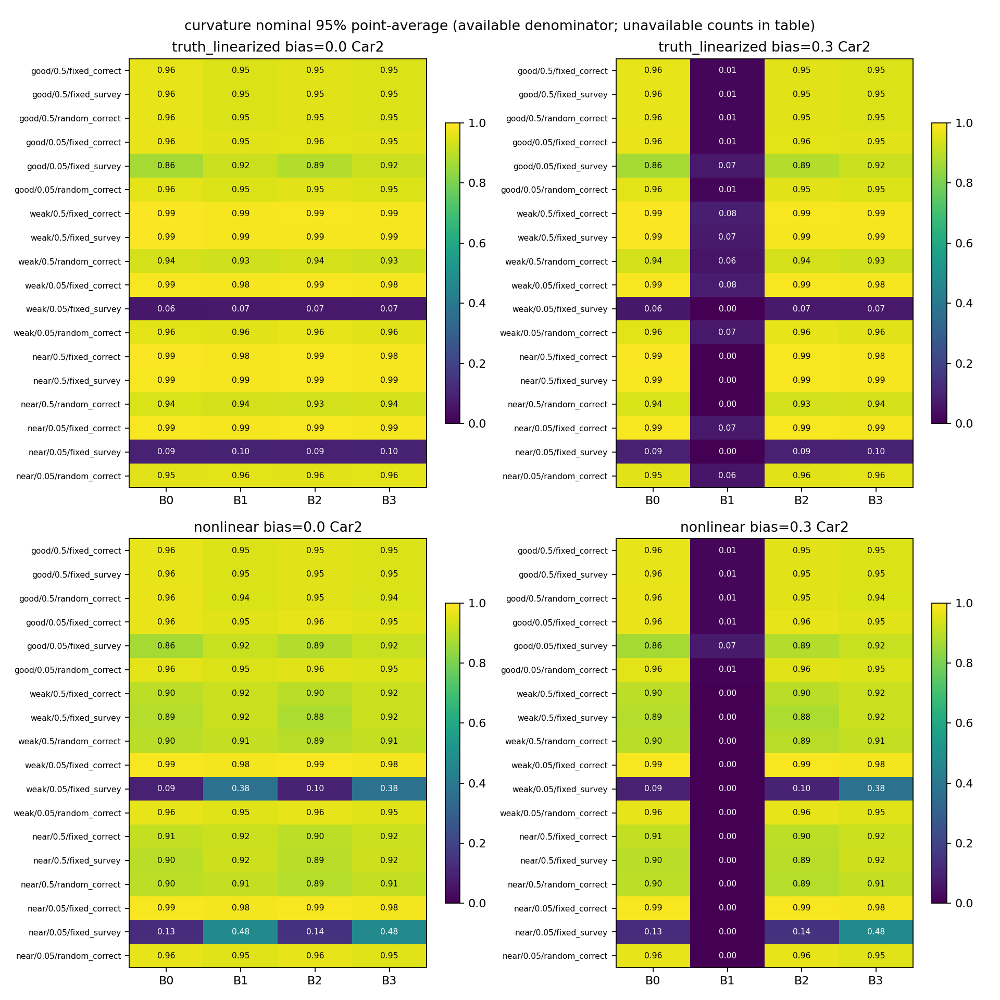
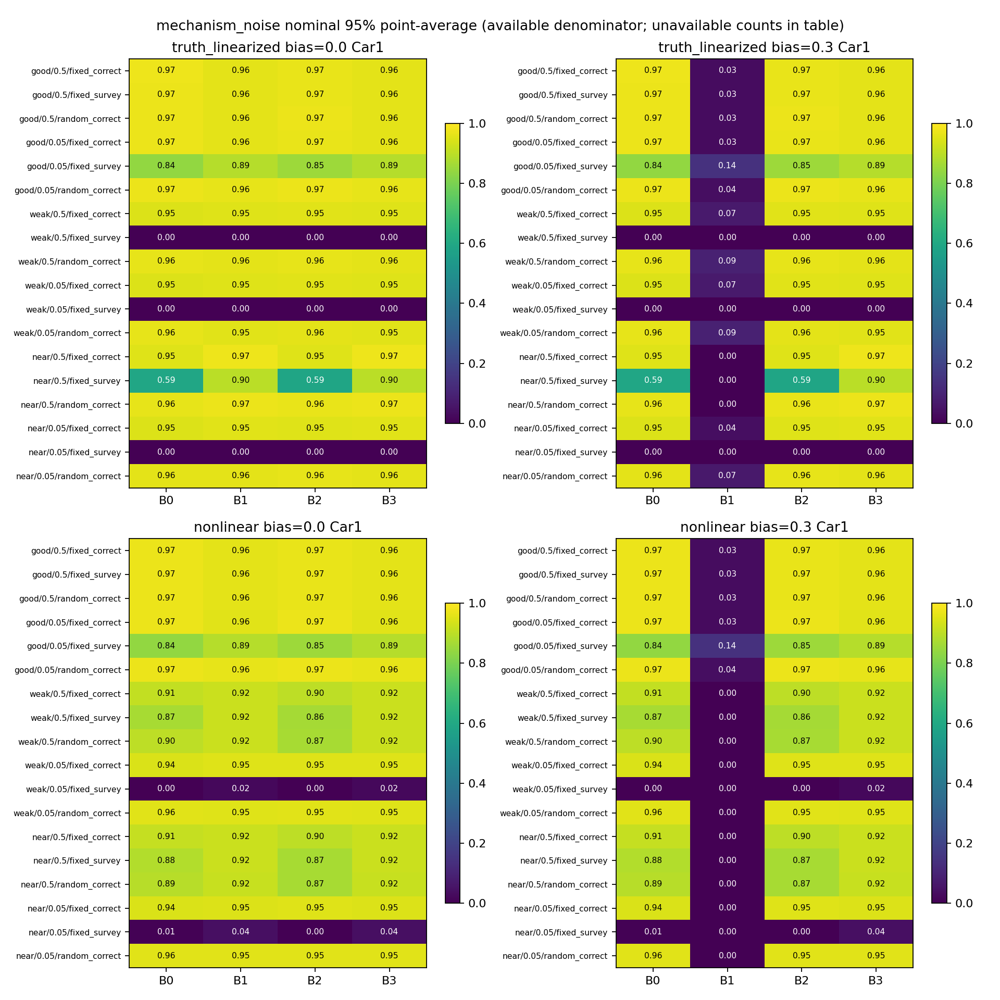
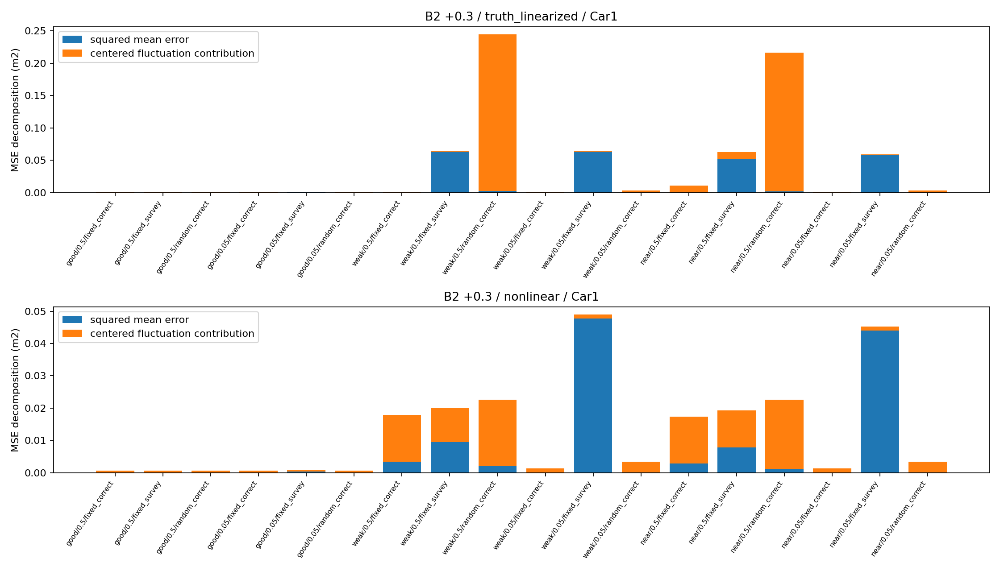
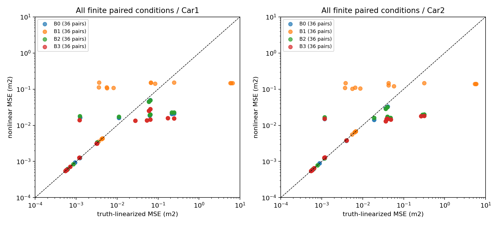

# 先验中心、生成机制与非线性近似：B端受控对照

**结果支持两条并行解释：固定错误强先验足以产生显著偏移和严重欠覆盖；去掉这一错误后，弱几何的非线性局部近似仍可能欠覆盖。正确中心不是普遍解决方案。** 强度效应依赖中心机制，误差降低也不等于覆盖改善。

这是阅读PR106/107之后设计的新批次，只在本批观测生成前冻结。起点764064f224ada7e793430bd47f5122a14b8d1f30，冻结5223d08ed219bafeb092df6f598b842308dee33e。只新增本任务目录，未修改历史结果、原冻结数学目标、公共后端、论文或硬件配置。

## 实际完成与核验

36条件×100新seed=3600配对输入，四方法分别完成14400非线性运行和14400条“真值处线性化诊断参照”。后者不是部署算法、不是额外随机样本、没有P0/P1优化过程。原始数据501MiB、正式计算172秒；43200个持久阶段（非线性28800+直接线性14400）全部完成，无中断、重试或覆盖。每条件独立n=100。

|方法|非线性计划/可用|非线性接受|非线性未驻点|线性计划/可用/直接核验通过|
|---|---:|---:|---:|---:|
|B0|3600/3600|3586|14|3600/3600/3600|
|B1|3600/3600|3595|5|3600/3600/3600|
|B2|3600/3600|3563|37|3600/3600/3600|
|B3|3600/3600|3591|9|3600/3600/3600|

非线性总接受14335、未驻点65；最终异常、非有限、预算耗尽、缺失、不可用估计均0。主统计保留65个未接受的有限解，覆盖另列接受/未接受子集。未见某类失败不意味着罕见风险已得到保证。B0在本批删去peer，因此peer故障不进入其目标；B1保留peer却漏建模偏差；B2已知候选peer并估一个自由常b；B3知道真实注入作补偿。

开发48个fixed_survey方法回归的残差/J/终点差0；中心/初值/随机流检查通过。SVD与正规方程交叉最大协方差差9.58e-14、增益差1.90e-13。三个独立流的开发经验跨相关最大.00560。人工异常、非有限、预算、B0失败、P1跳过、恢复、拒绝覆盖及全分母汇总通过，人工数据不进入性能统计。

正式无优化器读回重建3600输入、43200状态；残差最大差2.22e-14、J差0、梯度范数差2.70e-12以内、MSE差8.89e-16以内，直接线性解恒等式差2.23e-16以内。压缩分片再次独立核验通过。所有总状态信息均满秩；两种视图、两类方法合计691200个二维块中，6400个固定中心weak线性对照的t0噪声传播块奇异，按预定规则不可用，其余684800可用。它们不是总解秩亏，也不是优化失败；没有伪逆填出有限二维椭圆。95/99共享这些可用性，不因名义级别改变。

首次只读统计因反复解压数组效率低而中止，目录/日志保留；使用新增analyze_cached入口一次读入数组后调用原冻结分析函数。10份数组逐元素一致，开发1597920个共有输出单元完全一致。冻结源码、公式、参数、观测、结果均未修改，没有因效果补跑。见ANALYSIS_IO_NOTE。

## 1. 正确线性对照是否符合解析预期

J=[A;L]，K=(JᵀJ)⁻¹Jᵀ，以SVD实际计算。曲率逆C=KKᵀ；固定中心波动C_fixed=K_dK_dᵀ，随机正确中心加K_pK_pᵀ后得到C。固定错误中心及B1漏建模注入则进入mu，二阶矩是C_noise+mu muᵀ，不能把mu当零均值噪声。

线性估计逐记录满足e=K(−r_true)，不是仅做均值“看起来接近”。全部线性坐标经验均值与解析均值的最大差为2.63个解析标准误（排除解析方差为零的确定方向）；逐点经验中心方差trace/解析trace范围.770–1.384，反映100seed的有限抽样波动，不能要求经验方差精确等于公式。开发独立toy的经验95%覆盖.94869，解析.94810。

正确指定的随机中心线性组（B0/B2/B3及无故障B1）曲率椭圆理论点态覆盖恰为95%；本批条件—车辆点平均经验范围92.83%–97.17%。固定正确中心使用相应噪声传播、在二维块可用时，理论95%，经验范围94.50%–97.33%。不是将固定中心也套用C的随机先验解释。

固定正确中心若仍采用统一候选曲率逆C，可以保守。例如weak、B2+.3、sigma=.5的曲率95%椭圆，解析点平均覆盖98.56%，线性经验99.00%/99.17%；理论本来就不是95%。sigma=.05的解析值98.32%，经验99.17%/99.00%。完整解析二维Gaussian积分（含固定mu）见LINEAR_ANALYTIC_COVERAGE，原始协方差和mu见ANALYTIC_REFERENCES；不是对formal样本拟合噪声或再调阈值。

## 2. 固定错误中心能解释多少偏移和欠覆盖

下面为预定weak/peer+.3、B2条件；所有组保留100seed，曲率逆名义95%点平均覆盖每车分母600，但CI单位是100seed。所有36个B2条件（含零注入）列在[B2_FULL_MATRIX.md](B2_FULL_MATRIX.md)，全部四方法和两个视图在完整表中。

|sigma|中心|线性Car1/Car2 MSE m²|非线性Car1/Car2 MSE m²|线性覆盖|非线性覆盖|
|---:|---|---:|---:|---:|---:|
|.5|fixed_correct|.001224/.001166|.017877/.016724|99.00%/99.17%|90.67%/89.50%|
|.5|fixed_survey|.064239/.040288|.020135/.017324|99.00%/98.67%|87.33%/87.83%|
|.5|random_correct|.244438/.315371|.022563/.019899|96.33%/93.50%|86.83%/89.33%|
|.05|fixed_correct|.001217/.001160|.001265/.001234|99.17%/99.00%|98.83%/98.83%|
|.05|fixed_survey|.064287/.040322|.048938/.032185|.67%/6.67%|1.83%/10.00%|
|.05|random_correct|.003236/.003963|.003345/.003788|96.00%/96.17%|95.50%/96.33%|

强survey的Car1非线性MSE=.048938，其中跨seed均值误差平方的六时刻平均=.047726（约97.5%）；Car2对应.032185与.031086（约96.6%）。这是均值偏移主导，不只是随机波动。固定正确中心、同权重同初值时，Car1 MSE降至.001265；survey−correct配对差=.047673，95%逐项CI [.045531,.049913]。覆盖差为−97个百分点，CI [−98.83,−94.83]个百分点。

线性对照已经出现强survey严重欠覆盖：Car1/Car2解析点平均约.395%/4.907%，经验.67%/6.67%，不需要依赖非线性求解失败才能产生。非线性该组100/100数值接受，覆盖却仅1.83%/10%，因此不能归咎于未驻点。near的强survey非线性覆盖也只有3.33%/14.17%；good对应87.00%/88.67%，并非只有精确共线才受影响。

但错误中心不能解释全部：weak的温和survey线性曲率覆盖仍近99%，非线性却87%上下；固定正确中心也有下一节的差距。不能把所有欠覆盖都量化归因于同一个固定偏移百分比。

## 3. 中心正确后是否仍欠覆盖

weak、sigma=.5、B2+.3、fixed_correct：非线性Car1覆盖90.67%，seed簇CI [86.00%,94.67%]；Car2为89.50%，CI [83.67%,94.67%]。同输入线性为99.00%/99.17%。Car1非线性−线性MSE差=.016653，CI [.012609,.021084]；覆盖差−8.33个百分点，CI [−13.00,−4.33]个百分点。

仅看98个数值接受seed，覆盖仍90.48%/89.46%，并未恢复标称。near同机制覆盖90.50%/90.00%；这些条件共享seed，不能叠加为独立样本。good同机制为96.67%/95.33%，线性与非线性几乎相同，说明局部近似的适用性明显依赖几何。

random_correct、sigma=.5的weak非线性覆盖86.83%/89.33%，而同机制的线性协方差正好包含prior波动，理论95%。所以漏掉prior随机性也不是这个非线性缺口的唯一解释。

曲率95%的点平均与六时刻全覆盖不能互换：weak fixed_correct .5两车全覆盖仅78/100、82/100；fixed_survey .05为0/100、0/100；random_correct .05为85/100、86/100。它们均不是轨迹级95%保证。

## 4. 强度影响依赖中心机制

同一weak、B2+.3、Car1的sigma .05−.5配对MSE变化：

|机制|平均差m²|95%逐项配对CI|
|---|---:|---:|
|fixed_correct|−.016612|[−.021003,−.012591]|
|fixed_survey|+.028803|[+.025421,+.031969]|
|random_correct|−.019218|[−.023658,−.015057]|

正确强先验在本理想诊断中压低弱方向误差；错误强先验加重固定偏移，区间却更窄。随机组改变sigma同时改变先验观测精度及权重，不能当成固定中心/固定观测的纯权重效果。

全部预定B2逐车MSE比较（包含全部几何、零/.3及相应强度/机制），按区间正/负/跨零或常量的描述性计数：survey−correct为16/0/8，random−correct为20/0/4，强−弱为12/20/4，非线性−线性为6/26/40。它们共享seed且有目标等价，不能把这些区间数量当独立检验或家族保证。四方法全部比较均保留，不以此挑选最优机制。

random−fixed_correct加入的是先验生成随机性，当然会增加某些误差波动，不是算法变差。两组若混用同一种频率协方差解释，就会误读区间。B2偏差亦受影响：weak+.3强survey的偏差均值误差−.06938m、曲率95%偏差覆盖45/100；强fixed_correct为−.00193m、96/100；强random_correct为−.00382m、97/100。偏差和位置覆盖不要求同步变化。

## 5. 尚不能单独归因的差异

真值处一阶模型在weak的横向测距导数为零，但非线性距离仍有二阶变化。线性random_correct .5的Car1 MSE=.24444，非线性仅.02256，后者误差更小却覆盖更低。这反例说明“线性参照有正确覆盖”不等于它在所有方面更优；它是解释传播假设的理想诊断，不是替代部署算法。

非线性与线性差异同时包含高阶曲率、数据改变Jacobian、可能的符号/局部分支、固定survey初值与数值残留。本批没有多初值分支枚举、精确Hessian传播或独立二阶模型实验，不能逐项分离因果贡献。65次未驻点另列；接受子集仍欠覆盖排除了“全部仅由未驻点造成”，却不证明所有接受解均为全局最优。

也不能把correct机制当现实中已获得真值先验。六时刻、固定peer候选、静止、已知独立Gaussian的结论不外推长期动态、实车、HMI或保护级。100seed没有建立罕见风险保证。

## 6. 下一步方向

应首先明确实际survey误差及其固定/随机机制，避免把错误强prior当正确零均值噪声；同时针对weak/near保留局部近似失效研究，因为中心正确后仍有受控缺口。不是在现有数据上调大sigma或改阈值求覆盖。建议及仍缺证据见DECISION_MEMO。

交付PER_RUN包含28800行诊断记录，两个类型分开；FAILURES为65条非线性未接受。COVERAGE包含95/99、逐点/点平均/全时刻、全部/接受/未接受子集与不可用原因。MOMENTS包含均值、中心协方差、MSE恒等式、95/99尺寸；BIAS_COVERAGE与PAIRED_COMPARISONS单独提供。精简输入/状态分片、原始文件哈希和无优化器验收入口见HANDOFF。
