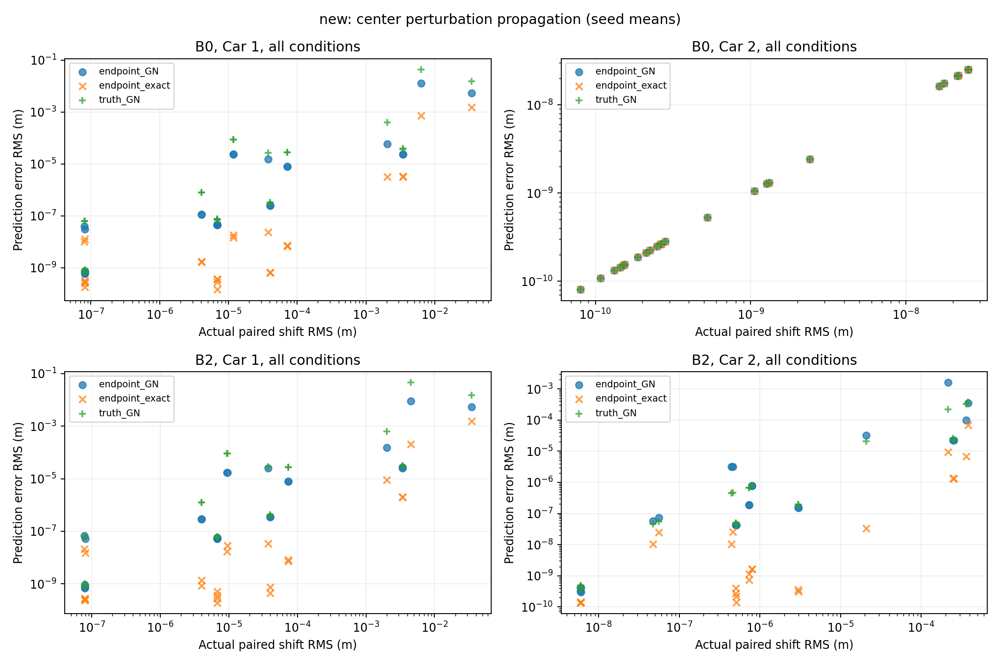
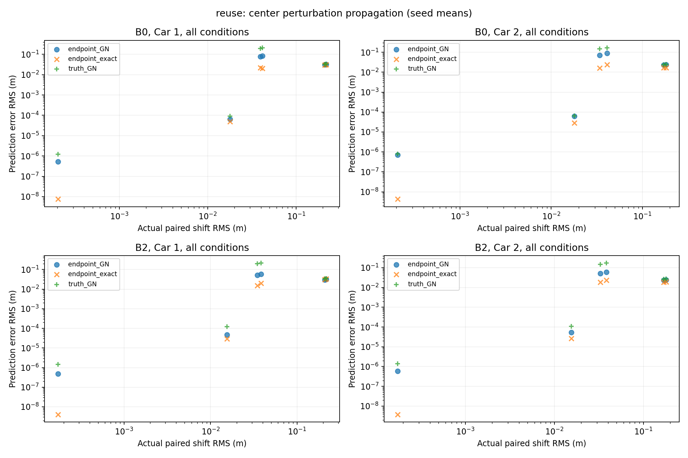
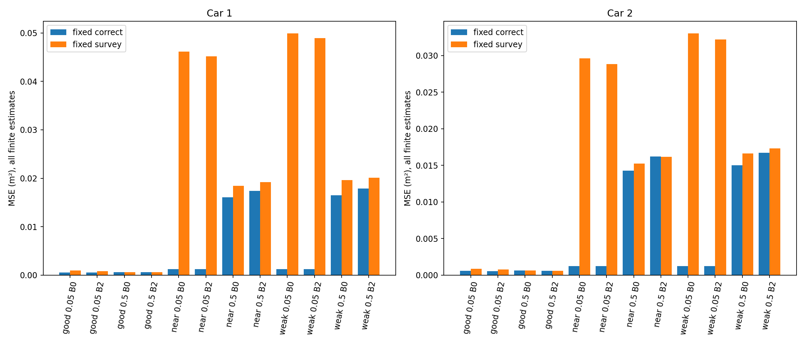

# 先验误差与偏移传播分析报告

## 结论

1. **实际四维位置先验精度依据不足。** 仓库有人工停车点、天线安装和卷尺距离记录，但缺少可对应当前先验中心的工具校准、同点独立重复读数、坐标系实现误差及四维相关性。操作者“1–2cm”自报估计不是已经证实的标准差或可信上界。不能据此把本仿真的 sigma=.5/.05m 或5cm误差球赋予实车含义。
2. **固定偏移可以通过明确的局部传递矩阵解释两车位置偏移。** 本轮独立检查了符号、二阶残差项和线性恒等式。GN近似在弱几何某些方向上明显偏离；精确 Hessian 改善小扰动解释，但不保证大扰动仍适用。
3. **不是一个统一的有效半径。** 良好几何表现稳定；弱几何受先验强度、扰动方向、传递效应大小及局部分支影响。5cm某些条件匹配良好，另一些跨车方向明显失准；0.1mm导致的实际状态变化可小到数十纳米，有限优化停止误差足以污染相对误差。不能据此宣布“所有5cm内线性化可靠”。
4. **下一步优先补齐已有测量资料的误差解释，同时研究带确定偏移项的保守局部不确定性表达。** 弱几何还需非线性余项/分支证据，不能靠把先验调强或直接把曲率逆当保护级解决。

## 执行与完整分母

冻结提交 `027a4693a2039c7534b8ffef070f12435aec04fd`，冻结前真实优化器调用0。冻结后新增24条件×20已暴露seed×2方法=**960方法运行**，480配对输入，**1920阶段/优化器调用**；952接受，8有限但未达驻点门槛，全部960有可用估计。异常、非有限、预算耗尽、警告均0。所有终点保留，不调阈值、不重跑失败择优。

另只读复用**1200对** PR109 fixed_correct→fixed_survey 结果，涉及2400端点记录：基准1192接受、目标1190接受，全部有限。重复引用的新面板基准960/960接受。这些是比较记录数，不是新独立随机样本；每新条件n=20、每旧条件n=100。

恢复完整目录新增优化器调用0。独立归档读回重建5280个可用状态记录（含新P0、两侧端点及重复引用），PER_PAIR/SUMMARY与原始目录读回逐字节相同。此计数包含重复端点，不能作统计n。总优化器计时约9.43秒，最大单阶段0.019秒以内；原始独立目录约26MB。真实失败表与人工失败检查严格分开。

## 测量依据与四类误差

完整13项清单及文件SHA见 [EVIDENCE.md](EVIDENCE.md)、EVIDENCE_INVENTORY.json。较新的11月1日停车点记录补充了较早审计，但仍不能给出可信误差界。例如B点直接车间距离2.37m，而XY计算2.330944m（高度修正前差3.89cm），两者均原样保留；此差额不能直接估计XY先验标准差。9月27日“approximately .01m”是天线间标量卷尺测量说明，也不能转换为两车四维位置误差。

- 锚点坐标：历史测量复用，缺测量不确定度；误差进入距离几何。
- 机器人/tag初始位置：房间坐标人工参考及survey中心；误差进入先验中心。
- 安装外参：底盘/odom/天线参考点及旋转，记录跨日期有变化；不能直接与全局位置中心等同。
- 测距偏差：UWB观测链路残差与本模型自由b；不是位置先验误差。

原survey固定向量、sigma=.5/.05、fixed_correct/random_correct和本轮5cm范围都是仿真或理想诊断假设。没有建立它们与平台实际误差的统计标定关系。

## 数学核验

见 [MATH.md](MATH.md)。中心扰动δc按(Car1X,Y,Car2X,Y)排列，单位m；r_prior=(Ex−c)/sigma，因此∂g/∂c=−Eᵀ/sigma²，状态灵敏度为正号 H⁻¹Eᵀ/sigma²。GN用JᵀJ；精确H另有Σr_i∇²r_i。固定偏移μ=Tδc与中心随机协方差分开，MSE二阶矩还含μμᵀ。

8个基准/方法组合的精确H对梯度中心差分最大相对差1.3892e−11，中心扰动符号检查最大绝对差2.621e−9，独立QR/SVD传播恒等式最大差1.388e−17；原残差/Jacobian回归通过。核验依赖独立差分，不只是同公式互相比较。真值GN是离线理想参照，不能解释为当前带噪估计器的精确导数。

## 新面板：大小、方向与失效

下表完整列出B2两种几何、两种强度、两种方向的+5cm条件；每行n=20。两车量分列；误差为逐seed向量相对误差均值，夹角也是逐seed均值，不能从均值向量反推。完整±0.1mm及B0/GN/真值GN在结果CSV中。

|几何|sigma(m)|扰动轴|车辆|实际位移RMS均值(m)|精确预测相对误差均值|夹角均值(°)|预定一致计数/20|
|---|---:|---|---|---:|---:|---:|---:|
|good|0.05|Car1 X|Car1|0.0033774|0.00059021|0.015896|20/20|
|good|0.05|Car1 X|Car2|0.00025447|0.0052253|0.24273|20/20|
|good|0.05|Car1 Y|Car1|0.003376|0.0005989|0.016407|20/20|
|good|0.05|Car1 Y|Car2|0.00024864|0.005308|0.24543|20/20|
|good|0.5|Car1 X|Car1|3.9635e-05|1.1071e-05|0.00033624|20/20|
|good|0.5|Car1 X|Car2|3.0164e-06|0.00010374|0.0052184|20/20|
|good|0.5|Car1 Y|Car1|3.969e-05|1.9089e-05|0.00075301|20/20|
|good|0.5|Car1 Y|Car2|2.9831e-06|0.00012424|0.0061042|20/20|
|weak|0.05|Car1 X|Car1|0.0019945|0.0044294|0.24261|20/20|
|weak|0.05|Car1 X|Car2|0.0003632|0.019363|0.9291|20/20|
|weak|0.05|Car1 Y|Car1|0.03494|0.043629|0.29397|20/20|
|weak|0.05|Car1 Y|Car2|0.00038165|0.22434|10.134|4/20|
|weak|0.5|Car1 X|Car1|3.717e-05|0.00097214|0.038839|20/20|
|weak|0.5|Car1 X|Car2|2.0863e-05|0.0017899|0.031895|20/20|
|weak|0.5|Car1 Y|Car1|0.0045352|0.02925|0.022192|18/20|
|weak|0.5|Car1 Y|Car2|0.00021624|0.030794|0.45731|19/20|

一致口径在冻结协议中预定为相对误差≤10%且夹角≤5°，只用于描述，不是算法验收门槛。强先验weak、Car1Y+5cm的Car2实际RMS位移仅0.000382m，精确预测误差RMS约0.0000678m；相对误差均值22.4%、夹角10.13°，20对全部数值接受。这说明局部线性误差不能全部归为未收敛。

weak、sigma=.5、Car1Y+5cm时，Car1精确预测相对误差约2.93%，GN约234.9%；Car2精确约3.08%，GN约2131.6%。残差二阶项在某些弱方向不可忽略。对Car1Y+0.1mm，强先验weak的精确误差均值Car1约0.0113%、Car2约0.205%；然而弱先验weak的Car1X+0.1mm，实际RMS位移Car1约8.02e−8m、Car2约5.55e−8m，绝对预测误差约1.52e−8/2.47e−8m，相对差明显放大。不能只用相对差把这类例子认定为模型分支切换。

B0理论上Car1中心不传到Car2；本面板Car2实际位移RMS的最大条件均值2.52e−8m以内，体现有限求解停止扰动。零预测的夹角未定义，表中为空而不是填0或强行记一致。B2跨车耦合确实存在，但估计b自由并不意味着所有位移都可被吸收。

## 已有survey偏移：逐车误差与均值

以下全部是旧结果复用，不新增观测、不重跑旧仿真。good/weak的四维中心偏移范数约.4272m，near约.4168m，不能把它们说成实车测得误差。B2，每条件100seed：

|几何|sigma|车辆|correct MSE(m²)|survey MSE(m²)|survey误差均值X(m)|survey误差均值Y(m)|精确预测相对误差均值|
|---|---:|---|---:|---:|---:|---:|---:|
|good|0.05|Car1|0.00056401|0.00084345|0.009211|0.010612|0.0018809|
|good|0.05|Car2|0.00056623|0.00078466|-0.0094258|-0.00734|0.001693|
|good|0.5|Car1|0.00060642|0.0006069|0.0023012|0.00063354|2.3769e-05|
|good|0.5|Car2|0.00060482|0.00060462|-0.00041666|0.0017462|2.1819e-05|
|near|0.05|Car1|0.00127|0.045199|0.0044331|0.20956|0.14774|
|near|0.05|Car2|0.0012348|0.028823|-0.0028933|-0.16629|0.1071|
|near|0.5|Car1|0.017407|0.019239|0.00017043|0.088198|0.27697|
|near|0.5|Car2|0.01622|0.016167|0.001694|-0.061468|0.20755|
|weak|0.05|Car1|0.0012648|0.048938|0.0042285|0.2183|0.14915|
|weak|0.05|Car2|0.0012337|0.032185|-0.0027592|-0.17611|0.10337|
|weak|0.5|Car1|0.017877|0.020135|9.8858e-05|0.097036|0.29965|
|weak|0.5|Car2|0.016724|0.017324|0.0017431|-0.073427|0.22491|

强先验weak的两车MSE从约.001265/.001234上升至.048938/.032185m²，均值主要沿Y偏移约+.2183/−.1761m。对应目标减基准MSE的逐项95%seed配对bootstrap区间约[.04532,.04990]和[.02920,.03266]m²。错误中心解释了显著系统偏移，但不等于把所有残差或所有欠覆盖都归因于先验。

good旧survey偏移的精确预测平均相对误差≤.19%；weak/near强先验约10–15%、弱先验约21–30%，且尾部更差。端点GN在weak/near弱先验的平均相对误差约2.6倍。真值GN、端点GN与精确H三者在完整表及图中同时呈现；不能把精确H在大扰动下仍失败说成公式符号错误，也不能单凭这些结果证明一定发生解分支切换。

## 数值与统计限制

主统计包含全部有限最终估计；ACCEPTED_PAIR_SUMMARY另列两端均接受子集和全计划分母。ALL_ENDPOINT_FAILURES同时列基准/目标失败，FAILURES是目标失败表，重复基准行表示比较出现次数而非不同失败个体。没有有效估计时为null/空列，不补零。归档人工缺失检查只改变一个B0终点，保留960分母及其他方法，不混入本报告性能统计。

每条件按seed独立，跨条件共享seed，不将两车/六时刻/方法视为额外样本。MSE差区间逐项、无家族保证，探索性既有seed不可写成独立确认。精确导数所需局部光滑、孤立驻点、同分支条件未被全局证明；GN与精确H都不是非线性误差包络。结果只覆盖选定方向与幅值，5cm球的公式也仅为给定模型/集合下局部线性表达，没有保护级、HMI或部署安全保证。

## 图和验收入口

图包含所有对应条件均值；不只展示有利轨迹。完整逐次数据、失败表、条件摘要和配对区间见results；复核命令见README/HANDOFF。独立验收不调用优化器。
