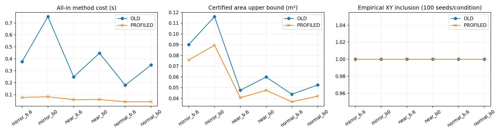
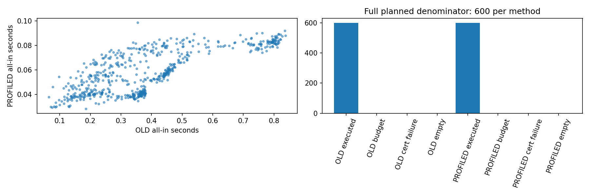

# 成本与区域：加速成立，不能误读面积上界

主比较均为同输入、同XY域、同q=9.488、同XY目标.025m；旧b分辨率.025m，新b为解析存在消元。每条件100seed，交替两法执行顺序。全流程成本包括搜索、独立认证、投影/评价、压缩IO、attempt/receipt及哈希，不丢弃失败或预算单元。本批随机阶段实际无失败/预算中止；确定性强制中止另保留。

## 随机条件的全流程配对

|条件|旧均值秒|新均值秒|旧/新|新−旧秒及95%配对区间|
|---|---:|---:|---:|---|
|normal / b=0|.34745|.03990|8.71|−.30756 [−.31372,−.30044]|
|normal / b=.6|.17864|.03916|4.56|−.13948 [−.14840,−.13017]|
|near / b=0|.44704|.05910|7.56|−.38794 [−.39536,−.38006]|
|near / b=.6|.24807|.05693|4.36|−.19114 [−.20453,−.17764]|
|mirror / b=0|.75282|.08179|9.20|−.67104 [−.68477,−.65588]|
|mirror / b=.6|.37650|.07598|4.96|−.30052 [−.32274,−.27799]|

2000次seed配对bootstrap、固定重采样seed，区间逐项、不作家族保证。加速比是两均值之比，不是报告其单独置信区间。计算环境、实现与给定分辨率限定该结果，不能声称一般维数或实车时限保证。边界b=.6时旧法工作量本就减少，因此相对加速较小；不能将跨b成本变化全归给消元。

## 没有省略的成本

600次各方法累计秒数：

|成本|OLD|PROFILED|
|---|---:|---:|
|搜索|85.314|11.886|
|首次独立证书认证|110.547|17.723|
|压缩结果IO|28.363|3.261|
|全部方法调用墙钟|235.053|35.284|

剩余差额包括投影/离线评价、身份与记录写盘等。认证比搜索更耗时；如果只报盒数或搜索秒数，会掩盖重要成本。阶段总墙钟270.78秒包含方法调用之外的日志/循环开销。后续全量零搜索读回142.59秒、精确并集补充12.37秒、最终打包2.16秒另行列出，均未隐去。随机启动至便携归档完成墙钟866.76秒，未超总预算。

## 面积上界下降不等于位置集合缩小

|条件|旧平均面积上界m²|新平均面积上界m²|两法共同的精确输出并集面积m²|共同平均圆半径m|
|---|---:|---:|---:|---:|
|normal / 0|.052454|.042050|.042050|.141361|
|normal / .6|.043846|.036777|.036777|.134771|
|near / 0|.059854|.047499|.047499|.607502|
|near / .6|.047527|.040562|.040562|.597103|
|mirror / 0|.116038|.089495|.089495|2.138149|
|mirror / .6|.090121|.075707|.075707|2.137686|

旧三维保留盒投影后可能重叠，去掉完全重复矩形后仍有部分或嵌套重叠，其面积和只是上界。新二维保留叶本身内部不重叠，因此同一计算式在本批恰为输出并集精确面积。独立有理数扫线证实全部626对（26确定性、600随机）的完整闭XY并集相同，对称差面积严格为0。这个结论是本批输出事实，不把有限外包相同当成任意算法/预算下的定理。

数学证明的是精确C_I的投影等价；有限外包可以比C_I宽。未知偏差的真正几何可行性、区间依赖与.025m终止误差仍然存在。mirror单圆覆盖两支之间空白的宽度是表达的额外保守性；near未决负支不能全部归成真实歧义。没有把消元当作增加传感信息。

