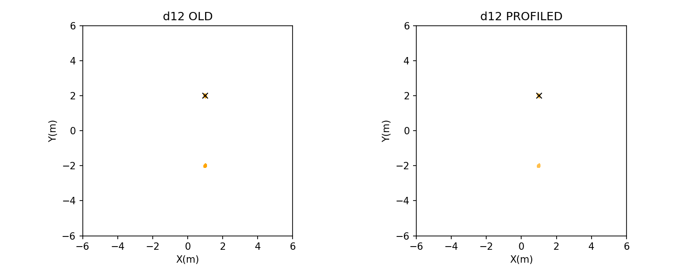
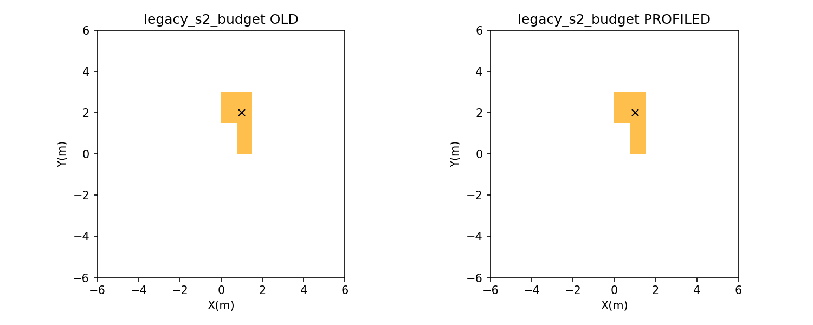

# 确定性比较与阶段三门槛

冻结SHA：`7fa34bf382698c60945039ca7d06690a5658ee3c`。开发11项测试通过；两轮开发测试使用独立合成小例、没有使用随机验证seed。阶段二完成26输入、52方法记录，其中PR124旧八例只读复用，实际新搜索44次。没有重复搜索历史八例。

52条证书和预定包含/镜像/空集/预算判据均通过，GATE为PASS。全量独立读回检查69864树节点，搜索调用0，耗时约5.26秒。原八例的旧阶段1是已知偏差二维，旧阶段2才是三维；记录中的old_state_dimension保留这一差异。

## 新增18输入的公平配对

三几何×b=0/.6×三固定噪声方向。观测、模型、域、q、XY分辨率一致；旧b分辨率.025m，新法对整个B解析消元。每行3个确定性输入的描述均值，不作随机置信区间。

|几何/b|旧处理盒|新处理盒|旧全流程秒|新全流程秒|旧/新耗时|
|---|---:|---:|---:|---:|---:|
|normal/0|2689.67|235.67|.37517|.03977|9.43|
|normal/.6|1372.33|232.33|.19115|.03922|4.87|
|near/0|3067.00|323.67|.43888|.06028|7.28|
|near/.6|1614.33|304.33|.23652|.05387|4.39|
|mirror/0|5719.67|511.67|.79140|.08372|9.45|
|mirror/.6|2897.00|473.00|.40249|.07813|5.15|

全流程包括独立认证、压缩结果、attempt/receipt写盘和哈希，并非只比搜索。阶段二总体墙钟9.61秒（包含历史结果读回）；历史旧八例缺少当时认证和IO时间，因此不把其旧搜索秒数纳入本轮总耗时加速比。

## 反例与边界

- 原s1_empty两法均证明域内空集，没有伪造中心或半径。
- 原s2_budget两法均在16处理盒中止，各保留3个队列盒；没有为了获得小区域扩大预算。
- 原两个边界案例以及新b=.6条件保留应有可行位置；已知偏差按退化区间处理。
- 原镜像及新增mirror条件的预定两支位置均保留，不选真值支。
- 开发中的零剩余预算、相切单点、区间观测存在量词、端点夹紧、假时钟超时、删队列及伪造OUTSIDE标签测试通过。数值异常继承PR124的未知盒保留规则，本轮正式没有触发该状态。

通过全部门槛后直接执行了冻结随机阶段，没有等待其他端或追加开发输入。

## 位置输出的进一步只读核对

冻结后描述性精确并集核算发现，26对确定性输入的新旧闭XY盒并集全部相同，圆也相同。主表面积上界差异来自旧三维投影的重叠表示；不是消元后真实可行域变小。该补充没有改求解或阈值，见POSTFREEZE_ANALYSIS与UNION_AUDIT.csv。

