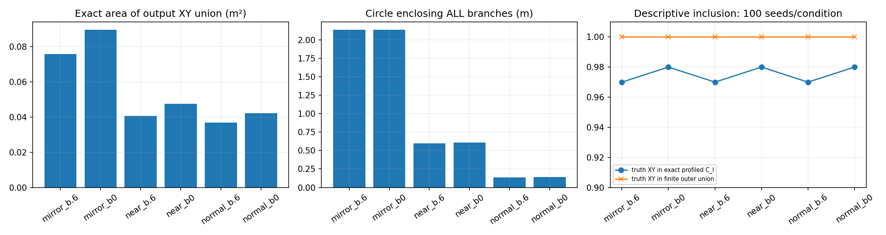
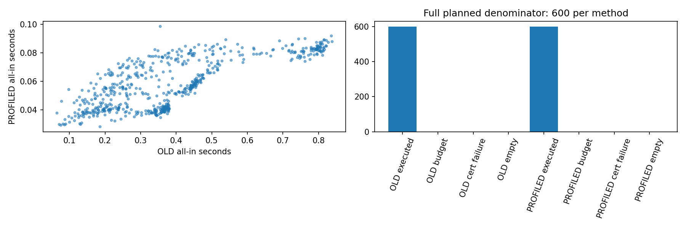

# 固定随机验证

阶段二GATE通过后执行同冻结SHA的600个完整观测输入、1200次计划方法运行：3几何×b=0/.6×100seed，旧三维与新二维配对。全部输入、seed、阈值、域、分辨率和预算在搜索前冻结，没有根据包含率调节。

## 全计划分母与预算

|项目|OLD|PROFILED|
|---|---:|---:|
|计划/执行|600 / 600|600 / 600|
|未执行|0|0|
|证书通过|600|600|
|证书失败/数值失败|0 / 0|0 / 0|
|搜索预算中止|0|0|
|证明整个位置区域为空|0|0|
|有限外包包含真位置|600|600|
|处理盒总数|1668714|207144|

上述600是六条件合计执行量，**每条件独立样本仍为100seed**。同seed跨条件/方法配对，不能按600个独立重复解释覆盖。1200方法运行不是1200个独立随机输入。

执行、在线认证和逐次归档的阶段墙钟270.78秒；单次最大搜索时间OLD .3071秒、PROFILED .0332秒，均低于5秒，未达到50000盒。包含进一步全量独立读回、描述分析与便携压缩包完成的墙钟为866.76秒，仍在7200秒全阶段预算内；其中也包含协调/等待时间，不当作纯计算基准。没有未运行清单中的残留任务，没有补seed或重跑失败。

全量独立读回1200条记录PASS，检查1875858树节点，耗时142.59秒，搜索/优化器调用0。完整记录、attempt、receipt、墙钟日志和输入哈希在便携分片中。库存表1200条均COMPLETED。

## 包含率不能直接解释成罕见风险验证

六条件两方法均为100/100外包包含真位置，Wilson逐项95%区间约[96.30%,100%]。这是本批经验描述，不是“真实覆盖=100%”，更不验证罕见HMI风险。四维生成噪声事件在各条件都是96/100（同seed噪声共用，所以不是六次独立事件统计）。噪声事件之外，位置投影仍可能包含真值，符合理论的单向蕴含关系。

保存的可行b恢复进一步区分精确C_I与有限外包：

|几何|b|真位置处证明存在可行b|真位置处证明无可行b|有限外包包含|
|---|---:|---:|---:|---:|
|normal|0|98/100|2/100|100/100|
|normal|.6|97/100|3/100|100/100|
|near|0|98/100|2/100|100/100|
|near|.6|97/100|3/100|100/100|
|mirror|0|98/100|2/100|100/100|
|mirror|.6|97/100|3/100|100/100|

“真位置处无可行b”不是整个位置区域为空；它只检验该固定位置。2–3个点仍被未决盒外包包含，直接说明有限分辨率的保守性。这个区别来自预存的固定位置重建结果，未追加搜索。该表作为冻结后描述补充，不冒充新增预登记检验。

## 区域与分支

600对闭XY外包精确并集均一致，圆半径逐输入也一致。两法本批产生相同输出集合，同时新法显著节省计算；不能仅凭主面积上界不同宣称新法更紧。

normal的平均全外包半径约.135–.141m；mirror约2.138m，主要由保留两支并用单圆包住二者的间距决定。near约.597–.608m：每个b条件有23/100输出出现负Y候选盒，但只有1/100有负Y内部盒作可行性证明。其余候选究竟为很窄的真实分支还是有限区间未决，当前证据不能区分；没有细化或追加求解去追求更好结果。

严格mirror下100/100保留负Y候选，b=0/.6分别有99/97个输入含负Y内部盒；共线测距本身具有反射对称，真实几何歧义不能被消元消除。没有内部盒不能证明分支不存在。

