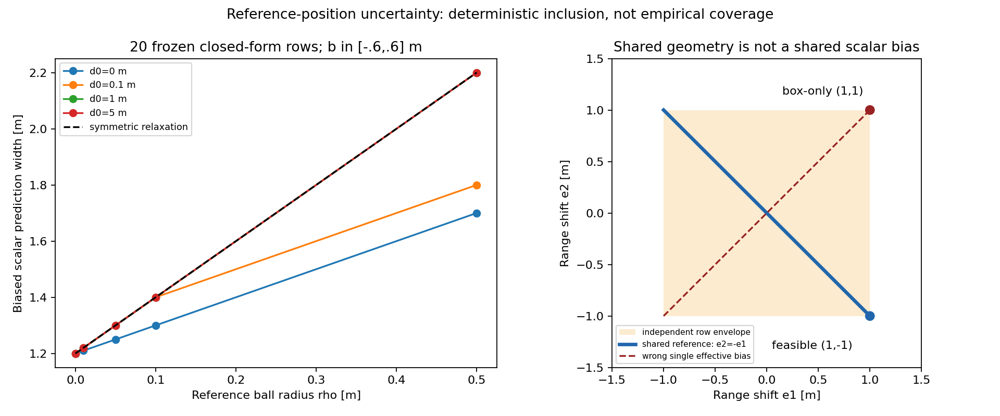

# 确定性验证报告

固定来源30f9379249a4e695acf75910c40862a770e6f4ce。协议、数学合同、输入和执行代码先在`c190f072d7fd844aa1fc96fb09492faa2ece9256`冻结，然后执行正式验证。没有新的随机观测、Monte Carlo、非线性优化或区域搜索；没有重跑PR121/123/124。

## 完成数与失败口径

- 正式计划20项，实际20项，PASS 20、意外FAIL 0。
- 其中10项为COUNTEREXAMPLE_CONFIRMED：错误主张被反驳，不是定位成功或覆盖样本。
- 固定闭式敏感性矩阵20行全部保存，独立读回20行通过。
- 独立读回20项检查通过；不把读回重复计为40个独立验证例。
- 冻结前仅1个helper开发例：首尝试F包装函数分母参数缺失抛TypeError，修复后同例通过；失败与修复在DEVELOPMENT.md保留，不算正式失败，也未改变正式输入/阈值。
- 5442个固定来源tracked文件在执行及读回前后SHA一致，7个冻结执行/协议文件哈希一致。实际optimizer/search/random调用均0。

## 全部检查与判据

|ID|检查|实际结果|结论类别|
|---|---|---|---|
|T01|rho=0回A0|距离像[5,5]|恒等式通过|
|T02|参考球边界|d0=5,rho=1，端点距离4与6均达到|范围边界通过|
|T03|平行误差|距离变化−1m，Lipschitz界取等|界紧例|
|T04|垂直误差|新距离平方26；变化sqrt(26)−5≈.09902m，非零且<1m|拒绝把一阶零投影当精确零误差|
|T05|零/近零距离|d0=0,rho=.1，像[0,.1]；近零下界仍0|无需Jacobian，非负截断正确|
|T06|偏差和参考边界|d0=2,b=.6,rho=.1，预测2.7m；原上界2.6会遗漏|扩宽的单行必要性|
|T07|共享参考与独立盒|真实(3,1)满足距离和4；盒还允许不可能的(3,3)|独立逐行松弛确有额外保守性|
|T08|错误共用扩宽b|同一真实参考误差要求有效偏移(1,−1)|单个β不能表达，错误模型非保守|
|T09|域外真值|p=(7,0)在[−6,6]²外；零噪声也不被域内集合包含|域条件不可省略|
|T10|相关R误作I|rho=.9、ε=(1,−1)：正确二次型20，错误独立型2，阈值6|错误白化事件不是原噪声事件|
|T11|重复信息|同一标量观测复制后真实方差1，误报1/2；重复R奇异被拒绝|独立融合造成过度自信|
|T12|无独立风险组合|100个等概率抽象原子上失包含集合互斥：联合.95，乘积误报.9506|联合界紧例，非Monte Carlo|
|T13|m/mm|距离/偏差×1000、R×10⁶，二次型均5|单位不变|
|T14|有理旋转+平移|变换前后距离平方均26|坐标不变|
|T15|空集|负10m锚点读数给单行二次型下界62500>9.488|域内空集，无有限误差半径输出|
|T16|不可辨识|无锚点共同平移、共线同时镜像、距离+b混淆均成立|不由行数证明唯一性|
|T17|白化与维数|R=LLᵀ有理精确，白化向量(1,−2)，平方和5|随机维数仍2，不减状态维数|
|T18|固定b与随机误差|固定均值(.3,.3)，b的随机协方差0；错当零均值噪声二次型112.5|固定共享偏差不等于相关随机噪声|
|T19|数据相关交叉项|ε=Z、δs=−Z时总方差0；忽略交叉项误得2|不能随意保留或累加原协方差|
|T20|阈值与联合预算|χ²4旧阈值尾上界.0499944；新示例10.72尾上界.0298978|加参考风险后须重配总事件|

T11是解析Gaussian标量例：半径2的原区域真实覆盖约.95450；复制信息误按独立后半径变sqrt(2)，真实覆盖约.84270。数值来自闭式erf，不是Monte Carlo，也不是本平台的实测覆盖率。T10说明错误相关模型的事件判定可反转，不单靠一个向量宣称具体总体欠覆盖率。

T20使用81项正项Taylor部分和给exp的有理下界，进而给χ²4尾的严格上界；小数仅展示，完整分数在T20.json。αs=.02时，旧q=9.488给联合覆盖下界约.93000559；采用事先冻结的示例q=10.72并分配αε=.03后下界约.95010224，可保守表述≥.95。不要求参考事件和噪声事件独立，不将其乘积作为证书。风险预算仅为数学例子，没有批准平台指标。

## 20行敏感性矩阵

名义距离d0∈{0,.1,1,5}m，参考半径rho∈{0,.01,.05,.1,.5}m；固定b∈[−.6,.6]m。精确球标量距离像宽度为d0+rho−max(0,d0−rho)；加入b后增加1.2m。对称松弛宽度统一1.2+2rho。

例如d0=0、rho=.5时，精确有偏差预测范围[−.6,1.1]宽1.7m，对称松弛[−1.1,1.1]宽2.2m，多放宽.5m；d0≥rho时两者标量区间相同。即使单行区间相同，多行联合共享结构仍可不同，不能把单行精确性当全局联合精确性。所有范围随rho单调不减，包含零参考误差退化情形。

这里的“精确”只指固定p、参考球和独立b区间的标量距离像；不是已计算双车位置置信区域或一般S的精确距离极值。有限矩阵用于展示，三角不等式与集合包含证明在MATH，不以20行替代全域证明。

## 当前可证明与尚不能证明

已证明的条件性内容：A1联合模型的噪声事件包含、参考球距离像、逐行区间的保守外包方向、A2不需独立的联合界、正定R完整白化维数。实际例的精确有理证书与独立读回通过。

额外假设下才成立：参考集合确实包含真实位置；A2有同采样总体的有效覆盖证书；R与Gaussian噪声模型正确；域、偏差、表示区间与故障候选覆盖真实情况；计算外包不漏任何分支。没有这些依据，公式仍可计算，但概率保证不能被宣称成立。

平台尚无本轮证据支持：实车参考位置确定误差球或真实αs、全工况R及尾部、连续同步/天线外参界、共享b范围和持续性、任务风险及告警合同。已有静态记录/视频候选的具体价值与缺项见ASSUMPTION_REGISTER；未把经验最大误差升格成确定界。

本轮没有实现5维双车求解器、两时刻搜索或一般相关R的可信区间计算。下一阶段最小接口与结束标准已给DUAL_ROBOT_NEXT_SPEC；负例并未导致调整定义或追加实验。
