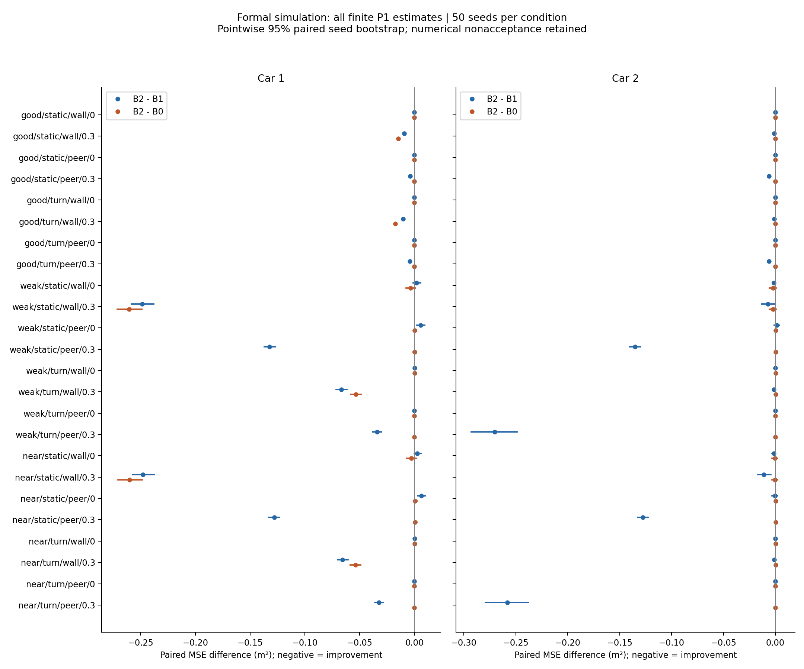
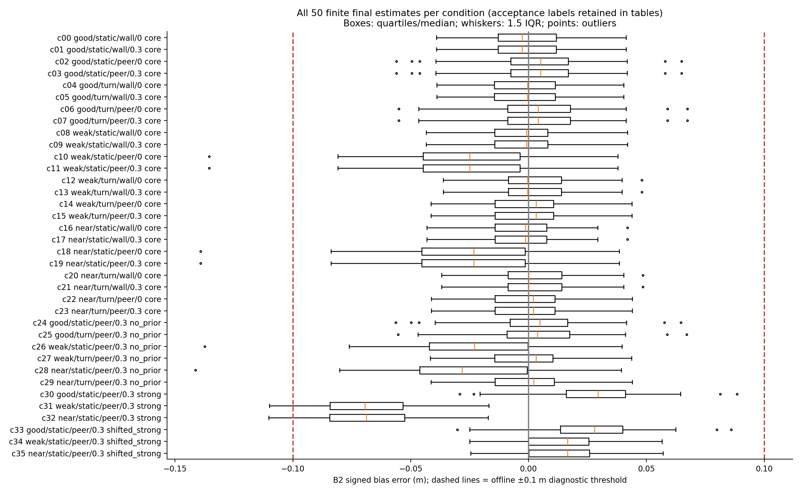
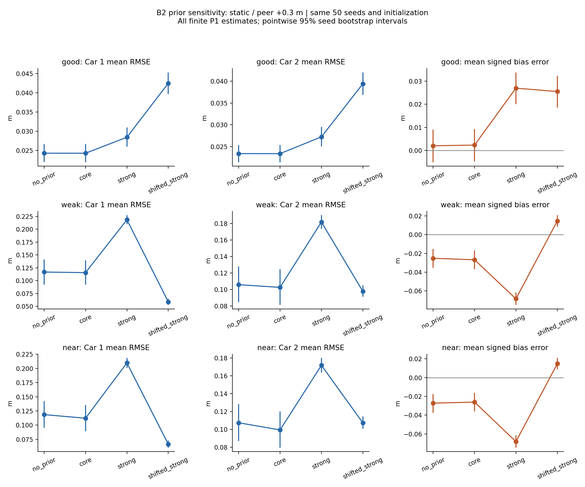

# 冻结正式仿真：A端独立执行与读回

已按B冻结SHA `6317e977572b4e8fb8282211485356562ddc62d2` 完成全部36条件×50新seed×四方法，共7200次方法运行、1800配对单元和14400个P0/P1阶段。缺失0、全部有限最终估计；7175次满足冻结数值接受标准，25次NOT_STATIONARY完整保留在主统计。没有重跑、换seed、改阈值或中途效果筛选。本结果支持**已知受影响链路、指定简化模型内的条件性改善**，不支持“增广无代价”或“协同总优于独立定位”。

先验收后执行：验收记录先提交于 `8e9850fbbedd73116b93273a98b700b6d91eb077`；正式执行在另一个保持B冻结HEAD的独立checkout，2026-11-16 13:51:41–13:54:22 UTC，约161秒（含落盘，不是实车实时性指标）。完整配置、协议及50个seed在验收目录保存；运行前未生成正式观测，执行后741216001..741216050全部标记已暴露。

## 数值、误差与分母

|方法|计划/完成|有限最终估计|数值接受|未驻点|Car1 RMSE>.5m|Car2 RMSE>.5m|偏差误差>.1m|
|---|---:|---:|---:|---:|---:|---:|---:|
|B0 独立|1800/1800|1800|1787|13|70|0|不适用|
|B1 协同不增广|1800/1800|1800|1799|1|65|111|不适用|
|B2 单常偏差增广|1800/1800|1800|1791|9|0|0|14|
|B3 已知幅值补偿|1800/1800|1800|1798|2|0|0|不适用|

无异常、非有限、预算耗尽或P1跳过。25个未驻点终点梯度范围1.0024e-5–2.2281e-5，门槛仍为1e-5，不能四舍五入成通过；见NONACCEPTED.csv。P0有5774次未驻点、1426次接受，P1后25次仍未驻点。所有P1均由ftol/xtol或二者停止，没有gtol=1e-14停止；“接受”是冻结1e-5的数值分类，不是达到1e-14或全局最优证明。

两车**联合**位置RMSE>.5m计数为0，但逐车存在表中的超阈值，不能用联合平均掩盖单车失败。B2的14条偏差超阈值是1800方法行中的计数，多条件共用seed且0/.3配对，不是14个独立故障。数值接受与离线误差阈值独立；没有因为误差更好而选解。

每条件每方法全分母n=50，主误差与有效配对n=50；数值双方接受子集通常少于50，单独保存，仅补充使用。独立重复单位始终是50个seed，不是车辆、时间点、1800条件单元或7200方法运行。

## 1. 无新增偏差时，增广有何代价

core的12个零注入条件中，B2−B1的24个逐车MSE配对区间有6个完全在正侧、18个包含0，没有区间完全在负侧。该计数描述相关的逐项区间，不是24个独立假设的联合检验；未作多重比较控制。

代表性代价（MSE单位m²，95%逐项配对seed bootstrap）：

|零注入条件/车|B2−B1均值|95%区间|
|---|---:|---|
|good/static/wall，Car1|0.00004113|[0.00000018, 0.00008506]|
|good/turn/peer，Car2|0.00005614|[0.00001599, 0.00010352]|
|weak/static/peer，Car1|0.005809|[0.002294, 0.009410]|
|near/static/peer，Car1|0.006429|[0.003032, 0.009958]|

weak/near静止peer的Car2以及weak/near转弯peer的两车区间包含0，不能凭均值符号称改善或变差。零注入时B2仍估计候选链自由b；增加自由参数可能损失信息并放大弱方向波动。这里是经验误差结果，不用局部协方差定理替代误差比较，也不能证明所有无偏差情形无损。

## 2. 已知受影响链路下，是否改善逐车定位

core中12个+.3m条件的24个B2−B1逐车MSE区间全部低于0，支持在这些固定条件下相对未建模偏差的协同B1改善。用全部有限终点，没有筛数值成功子集。

下表为peer+.3m、survey sigma=.5m，数值为50个seed的**逐seed二维RMSE的均值**，单位m，不是sqrt(平均MSE)。配对区间使用逐seed MSE差，不能从表中RMSE相减替代。

|几何/运动|B1 Car1/Car2|B2 Car1/Car2|B0 Car1/Car2|
|---|---|---|---|
|good/static|.0660 / .0810|.0243 / .0234|.0244 / .0238|
|good/turn|.0697 / .0811|.0241 / .0235|.0243 / .0239|
|weak/static|.3896 / .3877|.1156 / .1026|.1139 / .1013|
|weak/turn|.1872 / .5161|.0434 / .0409|.0436 / .0410|
|near/static|.3827 / .3762|.1122 / .0993|.1090 / .0963|
|near/turn|.1827 / .5045|.0432 / .0412|.0434 / .0414|

**对B1改善不等于优于B0。** 同一core+.3m范围，24个B2−B0逐车区间只有9个低于0，其余15个包含0。尤其peer注入时B0不使用该受影响观测，已经可达到接近B2的误差；“修复被偏差污染的协同目标”不能自动称为“协同对独立定位有稳定净收益”。完整D与B2−B1及双方接受子集见SUMMARY.csv。

## 3. 弱/近共线下位置和偏差误差如何变化

core静止peer+.3m下，good两车RMSE均值约.024/.023m；weak为.116/.103m，near为.112/.099m。B2有符号偏差均值分别为+.00231、−.02677、−.02612m；weak的95%区间[−.03610,−.01756]、near为[−.03563,−.01678]，负偏移跨本批新seed保持。

偏差MAE分别约.0184/.0334/.0327m；RMSE约.0244/.0427/.0426m。weak与near静止各1/50出现|b误差|>.1m，最大约.1355/.1392m，不能隐藏尾部失败。所选转弯peer+.3m后weak/near两车位置RMSE约.04m，偏差MAE约.016m，平均有符号偏差约−.00056m；这个特定设计的运动改善了估计条件，但不是“任何转弯保证可观”的定理。

near满秩不能保证精度好；weak一阶整体秩亏也不等于单b结构性不可辨识。当前有墙面观测，与PR99删除全部墙面的peer-only结构反例不同。本轮没有把秩亏强行正则化，也没有用终点局部满秩否定解析退化结论。

## 4. 先验中心与强度是否持续改变结果

同seed、同观测和同初值，只改变位置prior。静止peer+.3m中将sigma从.5收紧至.05：good/weak/near的B2平均有符号偏差变为+.02693/−.06837/−.06821m，三几何两车MSE均增加。weak两车RMSE均值由.1156/.1026升至.2184/.1817m；near由.1122/.0993升至.2097/.1716m。强先验不是自动更准确，原中心本就有误差。

固定sigma=.05，仅把中心增加冻结delta后：weak/near的平均偏差从约−.068m变为+.0146/+.0148m；配对估计偏差变化约+.0830m，其95%补充区间分别[.07912,.08677]、[.07914,.08675]。good的位置误差则继续变大。不能据此事后挑选更接近真值的中心；所有中心都按事先冻结方案保留。

去掉弱sigma=.5 prior相对core时，good和weak两车位置MSE差的补充区间包含0；near两车为正。并非每一种先验改变都得到同样强或同方向的效应。PRIOR_CONTRASTS.csv给出同seed差值与区间：这些跨条件对比是按冻结bootstrap规则计算的**补充描述性分析**，不是新增预登记主端点或独立确认批次。

## 5. 哪些开发观察得到支持，哪些不能延伸

得到本批新seed支持：已知单偏差链的增广相对被污染B1的改善；弱/near静止peer的偏差和位置敏感性；此处转弯设计改善weak/near估计；有误差强prior能够持续改变甚至恶化估计。这些是指定条件的逐项结论，不能转成全场景或每seed必然改善。

未得到支持的强表述：无新增偏差时增广无损；B2对B0具有普遍净收益；固定继续一次即可所有数值接受；弱/near局部可辨识就保证小误差。25个最终未驻点和14条B2偏差超阈值均保留。PR99某具体开发失败比例或PR100单seed共同面板的“全部≤1e-5”不能直接照搬：本轮seed、prior设计和固定P1协议不同，不能宣称复现了那些具体比例。

零/.3的B2位置几乎相同也不是新故障泛化证据：已知活跃链路、无bias prior时，观测常数平移可由b平移吸收，这是目标函数代数性质。B3使用真实幅值，是理想oracle，不是部署方法。

## 独立复核与统计边界

B冻结verify重算14400状态通过；A独立向量化残差/Jacobian及离线指标读回全部通过，残差、Jacobian、梯度和误差最大差0。A独立汇总与B冻结汇总144组、1332项指标摘要及区间完全一致。仓库内轻量压缩证据保留1800输入和14400阶段估计/状态/标量，能够不重新定位重算；完整r/J/协方差及冻结完整汇总放Git外并有文件级SHA。

所有主区间按固定seed91327061、10000次seed重采样；同seed配对差先相减，n=50，全有限分母。区间为95%逐项percentile区间，无家族多重比较保证。跨条件共享噪声和seed，车辆/时间点/方法不是独立样本；不据“24个区间”声称24倍样本量。均值区间不等于个体误差界、尾部风险或覆盖率保证。

可用于中期报告的表述：在预先冻结的六时刻双车XY仿真中，完成36条件、50个新seed的四方法配对验证。已知受影响链路且有+.3m注入时，core条件下B2相对B1逐车MSE的95%逐项配对区间均为负；零注入时存在增广代价，弱几何和有误差先验仍影响估计。全部有限最终估计被纳入，25/7200未达数值驻点门槛未被剔除。

局限：房间坐标位移观测比未知航向实车里程计更强；只有单常值偏差、已知链路、两种运动、指定Gaussian噪声与survey；几何族还改变起点。不是实车验证、未知故障识别、罕见风险保证或完好性认证，局部协方差不是保护级。
