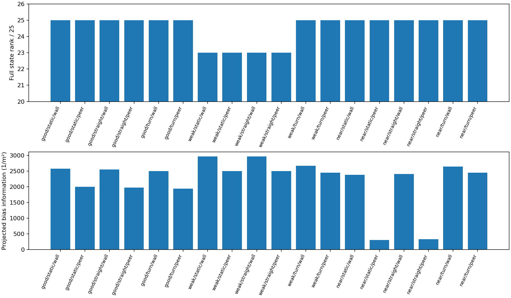
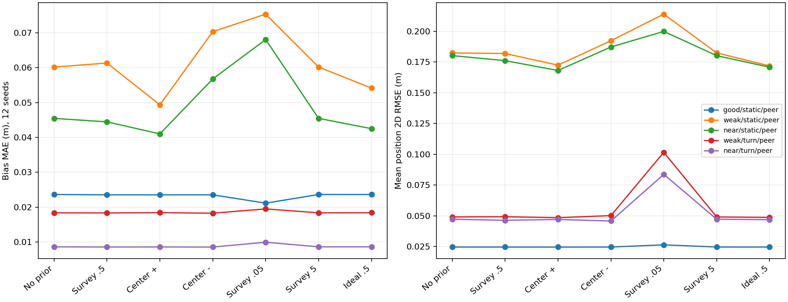

# P-S1b 结论、证据与限制

原共线静止/直行的整体状态线性化秩亏，**不等于单个测距偏差不可辨识**。独立复核的测量秩为13/25、测量+运动为23/25；完整数据+运动零空间的偏差分量范数为墙链路8.30e-16、车间链路1.27e-15。两条零方向是两车各自的恒定横向一阶不可见位移。偏差由观测提供非零局部信息，不需要先验才能填补偏差方向。加入初始位置先验使整体达到25/25，并不意味着这部分信息来自观测。

18个主场景均具有正的局部偏差有效信息；良好几何、此处所选转弯场景的含噪估计较稳定。共线/近共线静止、直行的车间偏差会受有限噪声、横向位置误差、局部极小值及先验影响。**局部可辨识、有限噪声下准确、对先验不敏感，是三个不同判断。** 明确删除所有墙面观测的peer-only负对照才表现出真正的位置—偏差混淆：数据+运动秩21/25，偏差零空间分量范数0.9853，有效信息约1.17e-27 m^-2；此时先验确实补充缺失信息。

## 信息来源与可复核判据

状态按时刻排列 `[x1,y1,x2,y2]×6,b`；每时刻8条墙测距加1条peer。wall仅Car1到锚点0加b；peer仅车间测距加b，二者分别运行。位置尺度1m、b尺度0.1m；噪声白化后矩阵记J，计算J D的奇异值。数值阈值为smax×1e-8，同时保存1e-6/1e-10/1e-12的秩敏感性，数据+运动各场景在这些阈值下秩一致。完整零空间为V[:,rank:]，物理向量为D V；保存全部列而非只取最弱一列。测量仅peer的6×25矩阵也使用完整V，避免丢掉隐含的19维零空间。

消去位置时用未做状态缩放、已白化矩阵 `[P,q]`。对P做SVD，截断阈值为其最大奇异值×1e-8，取非零左奇异向量U，`I_b=||q-U(Uᵀq)||²`。这等价于对位置扰动作最小二乘消元，支持奇异位置块；没有求逆PᵀP，也没有小正则。位置谱、阈值和与lstsq残差的差异全部保存。1/sqrt(I_b)只是该真值线性化的局部噪声尺度，不是非正则场景的有效置信区间或保护级。

|场景|测量秩|测量+运动秩|加sigma=.5先验秩|数据+运动I_b (m^-2)|加先验I_b|
|---|---:|---:|---:|---:|---:|
|weak/static或straight/wall|13|23|25|2968.750|见完整表|
|weak/static或straight/peer|13|23|25|2500.000|2500.222|
|near/static/peer|25|25|25|305.066|1727.603|
|near/straight/peer|25|25|25|331.441|见完整表|
|weak/turn/peer|23|25|25|2450.452|见完整表|
|near/turn/peer|25|25|25|2452.251|见完整表|
|good/static/peer|25|25|25|1998.050|见完整表|
|peer-only负对照|6|21|25|约0|1.997|

完整76条分表包含全部18主场景+1负对照的三种信息来源，以及复现PR97强先验sigma=.05的第四列组。原几何和轨迹与PR97函数逐元素核对一致。近共线锚点为(-3,0),(-1,.01),(4,-.01),(6,.02)m；两车初始为(1,.01),(2,-.01)m，轨迹公式不变。不能因为near满秩就称其精度良好；其静止peer的有效信息反而明显低于精确共线线性化。这不是结论矛盾：精确共线处横向导数恰为零，而近共线处微弱横向列可以参与消去偏差影响；秩变化点的线性近似并不均匀。

## 局部线性退化不等于全局不唯一

共线横向扰动在雅可比中不可见，但有限横向扰动会二阶改变测距。CHECKS.json保留eps=.1/.01m的线性变化0及实际非零变化；因此零空间不能直接当作有限状态等价类。

对于本批无噪声主模型，另有几何论证：good/near的wall故障车仍有3个非共线无偏锚点，可以唯一解出XY，再解b；peer故障时两车各自4个无偏锚点同理。weak下无偏共线锚点距离平方差确定x，任一无偏距离确定y²；静止/直行真值y=0，因而y唯一。weak转弯的t0仍在y=0，精确房间坐标位移又固定后续各点，因此数据+运动在所给无噪声观测下唯一。此论证不推广到任意离线轨迹、未知航向或含噪代价面的全局凸性。

负对照给出真正的全局反例：把Car2整条轨迹沿初始相对方向平移0.2m，同时把b从.3改成.1m；所有peer测量及运动观测保持不变。两个完整状态和数值差保存在CHECKS.json。没有墙面约束时，直线/共同转弯也不能仅凭“在运动”就解除常相对距离与b的混淆。

无噪声主场景54个无先验初值拟合中，near/static/wall及near/straight/wall的minus初值停在非零残差局部解：位置RMSE约.01566/.01502m，b误差约5.29e-5/5.49e-5m，cost约5.76e-5/6.17e-5。求解器返回成功不构成全局最优证明；这也不是b不可辨识的证据。

## 噪声、先验和初始化分别变化

协议冻结后共2717次拟合：19场景×(1无噪声+12种子)×11变体。噪声直接加到测距和位移观测；经验标准差.039941m/.019997m，与配置.04/.02相符，所有种子噪声逐项重建一致。各变体共享同一份观测。12个seed是统计重复单位，场景共享seed身份，不把2717次拟合或时间点当独立样本；这里只给开发描述，不报告总体风险保证。

主先验中心是CONFIG中固定的有误差survey坐标，并非truth中心。初值由同一survey加配置偏移、积分带噪运动形成；优化函数不接收truth。无先验与sigma=.5先验各取三个初值；center±仅改中心；strong/weak_prior仅改sigma=.05/5；ideal_truth_center为sigma=.5的明确理想对照。没有偏差先验、非负约束、正则补丁或按结果选sigma。中心/强度对照初始状态相同已逐项核对。

下表均为gaussian、base初值，位置为两车全部点欧氏误差RMSE的12种子均值；偏差为MAE。失败定义：solver不成功/非有限；位置RMSE>.5m；|b误差|>.1m；并集另列。所有失败均保留。

|场景/先验|位置RMSE均值 m|偏差MAE m|偏差失败/12|求解器失败/12|
|---|---:|---:|---:|---:|
|good/static/peer，无|.025|.024|0|0|
|weak/static/wall，无|.161|.013|0|0|
|weak/static/peer，无|.182|.060|2|0|
|weak/static/peer，survey .5|.182|.061|2|0|
|weak/static/peer，survey .05|.214|.075|2|0|
|near/static/peer，无|.180|.045|2|0|
|near/static/peer，survey .05|.200|.068|0|0|
|weak/turn/peer，无|.049|.018|0|0|
|near/turn/peer，无|.047|.009|0|0|
|peer-only，survey .5|.462|.785|12|0|
|peer-only，ideal .5|.178|.067|4|0|

“near强先验没有>.1m失败”并不意味着总体变好，其平均偏差误差和位置误差均更大。完整SUMMARY同时给逐车位置、偏差均值/MAE/RMSE和四类失败计数与比例。主矩阵2574次拟合全部solver成功、位置未超过.5m，但44个配对变体行有偏差超阈值；这些不是44个独立事件。负对照143次拟合中7次到300次函数评估上限，均记录；无先验的平移自由度及距离—偏差混淆可造成极大状态/负偏差，不能被平均表隐藏。该负对照没有物理边界，极大数值不是实际设备行为。

PAIRED_SUMMARY把三个因素分开。静止peer中，中心plus与minus造成的偏差估计绝对差均值：good .0000142m、weak .03494m、near .02877m、peer-only .32758m。固定中心从sigma5改到.05的对应差：good .02592m、weak .02812m、near .04321m、peer-only .60567m。这说明观测支持b与“任意强先验都不影响b”并不等价。无先验plus/minus初值的偏差差均值为weak .01285m、near .01474m，同时位置估计差约.296/.305m，反映有限噪声下的不同位置分支；不能把它写成先验中心变化。

## 失败解释与检查

BIAS_DECOMPOSITION逐行保存 `b误差 = 活跃测距噪声均值 − 活跃几何距离误差均值 + 活跃残差均值`。无b先验时，一阶驻点应使最后一项接近零。weak/static/peer无先验base的12种子均值分别为噪声+.0034416m、距离误差+.0635312m、b误差−.0600896m；最大驻点残差2.23e-7m。这里位置横向估计改变车间距离，b吸收了这种几何误差；“真值处b零空间分量为零”并不保证非正则有限噪声估计达到局部sigma=.02m。与此相反，peer-only在无噪声下已经有不同b的精确等价状态，是结构性不可辨识。

A1：19场景、truth/off-truth两点、两差分步长，共76项雅可比检查，包含测量、运动和先验组合，最大误差9.2443e-10，小于冻结2e-8阈值。PR97旧几何/轨迹/测量/解析雅可比一致性通过。A3/A4：完整零空间残差、正交性及SVD投影和lstsq消元交叉检查通过。A6/A7：247份观测噪声精确重建；2717行逐车/位置/b误差、独立循环计算的代价和失败标记全部读回通过，最大数值差0（同环境）。checks保存实际执行日志，不抹去环境搭建失败说明。

限制：小型6时刻25维已知房间坐标位移模型；运动噪声按独立轴设计，没有真实轮里程计未知航向、相关噪声、边缘化或多偏差。真值处的秩/信息不能当作在线拒判阈值；拟合终点的数据偏差信息另存PER_RUN，需结合噪声和先验敏感度解释。所选转弯改善了本设计位置条件，但不是一般定理。12个开发seed不支持现场性能或安全结论，未比较生产后端增广收益、未修改论文或实车配置。
