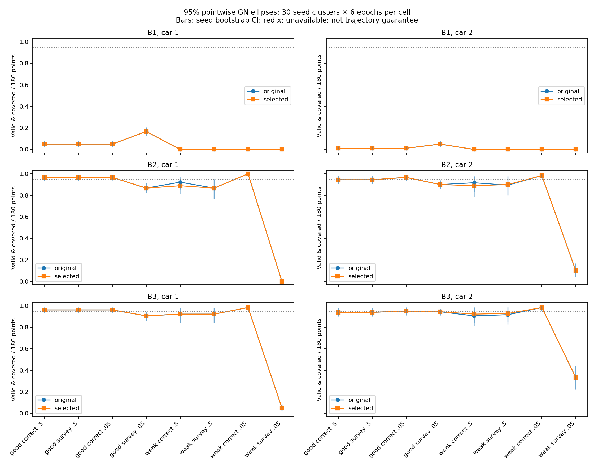
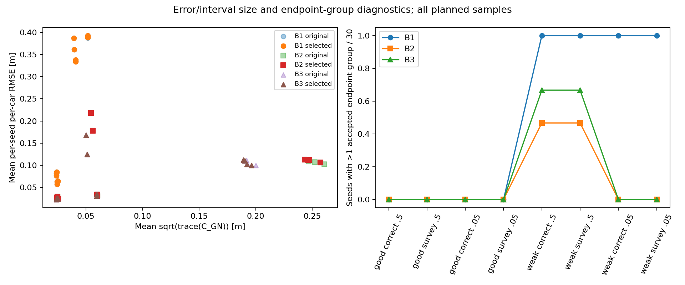
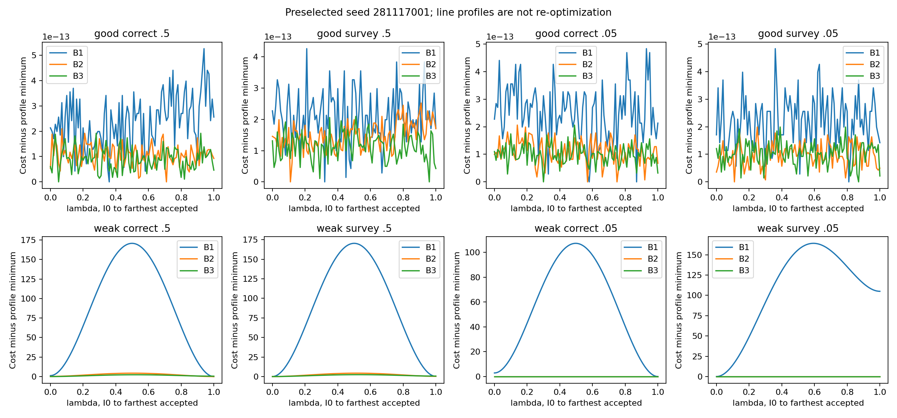

# 弱几何、初始化与局部曲率覆盖：结果报告

本轮支持“弱几何存在初始化相关的不同终点”，但不支持“最低代价多初值即可修复覆盖”。在正确中心、弱几何、先验σ=0.5 m下，B2的选优后95%点覆盖两车均为88.89%；不同终点是可见现象，不是已经确认的全部欠覆盖原因。

## 设计、来源和执行

从PR109已审查SHA c51411433d30dc379bd69cf5fb20a11e196b7182出发，只读PR108已审查SHA 41ba0d3a6e69897ef6330cc9ad218253c7fb80ea的矩阵解释。完整读取PR109的README、REPORT、PROTOCOL、HANDOFF、DECISION_MEMO、B2_FULL_MATRIX及配置、adapter/math_model/run/readback与冻结core。81项源哈希匹配，3600源输入身份唯一，原完整批次14335接受/65未驻点。选取240保存输入，未生成噪声。

协议与seed先提交，再实现并在保存开发输入冒烟，随后完整执行。三个方法为B1未增广、B2已知peer链路的自由常偏差、B3知道注入幅度的理想参照。三种反射和0.5 m平移由公开锚点与原初始化生成；先验、观测、目标与停止标准不动。I0不重跑。

新增2880配置完成，P0/P1记录5760，优化器调用5760；最终2873接受、7未驻点。保存原720配置中719接受、1未驻点。3600候选均有有限最后状态，8个未驻点保留；720个输入方法单元均存在接受候选。开发另12配置/24调用，不混入分析。新增nfev合计51292，原保存配置合计11992；新增四初值的函数求值成本约原单初值的4.28倍，五候选总约5.28倍。新增求解阶段耗时合计32.34秒（不含IO/分析；旧耗时来自另一执行，不能作精确加速对照）。

## 不同终点与近代价解

良好几何的四条件×三方法×30seed，全部只有一个接受终点组。弱几何σ=.5时，正确/调查中心下B2各14/30个seed有多个接受组，B3各20/30；弱几何的B1在四个先验条件均为30/30。正确或调查中心、σ=.05时B2/B3均未观察到多个接受组。这里使用冻结的1cm位置/偏差、代价绝对+相对容差；不是对所有可能初始化的穷举，也未证明多个局部极小。

预定首seed p18-s281117001、B2：I1与I2均接受，最大位置差0.57219 m，偏差差0.12094 m，目标代价差0.018299。满足预登记“近代价不同位置”规则。该现象在p18 B2为1/30；p19 B3为2/30；其余单元未触发此较宽近代价规则。多个候选对属于同seed，不能把13个触发对称为13个独立例子。精确数值见PAIRS.csv。

选择初始化编号变化564/720，多数只是数值舍入级代价排序；因此“选择了新编号”不等于“换了物理解”。分组和位置距离比编号更有解释力。

## 原结果与多初值最低接受代价

下表每车分母都是30seed×6时刻=180，可用也是180；数字为95%曲率椭圆点覆盖，两个车不是独立样本。

|条件|方法|原车1/车2|选优车1/车2|
|---|---|---|---|
|good，正确，σ=.5|B2|96.67% / 94.44%|96.67% / 94.44%|
|weak，正确，σ=.5|B2|92.22% / 91.67%|88.89% / 88.89%|
|weak，正确，σ=.5|B3|92.22% / 90.56%|92.22% / 92.22%|
|weak，调查，σ=.5|B2|86.67% / 89.44%|86.67% / 90.00%|
|weak，正确，σ=.05|B2|100.00% / 98.33%|100.00% / 98.33%|
|weak，调查，σ=.05|B2|0.00% / 10.00%|0.00% / 10.00%|
|weak，调查，σ=.05|B3|5.00% / 33.33%|5.00% / 33.33%|

B1的未建模+0.3 m偏差不可忽略：弱几何所有条件原/选优两车均0%覆盖；good正确σ=.5仅5.00%/1.11%。良好几何降低了初始化歧义，却不能自动消除模型失配欠覆盖。

p18 B2选优后逐车平均RMSE从0.1027/0.1070 m变成0.1061/0.1123 m。配对差为+0.00340/+0.00525 m；逐项seed bootstrap95%区间分别[-0.000061,0.00734]、[0.00155,0.00977] m。车2区间尺度sqrt(trace)平均减少0.00580 m，区间[-0.01200,-0.00126] m。较低代价可能同时有较小局部尺度和较大真值误差；未用真值纠正选择。点覆盖配对差-3.33/-2.78个百分点，其区间均包含0边界，不能据此宣称总体覆盖必然恶化。上述多项比较无同时推断保证。

## 相近终点组内是否仍欠覆盖

在p18 B2的选优接受组中，先在每seed内平均成员，再跨30seed平均，两车仍为88.89%（160/180个等权点）。组内共114成员，但独立n仍是30。逐项seed区间为车1[81.11%,95.56%]、车2[78.33%,97.22%]，包含95%；这是样本欠覆盖，不是高置信度证明总体覆盖低于95%。B3相同口径两车92.22%。局部非常接近的终点没有使本样本的覆盖恢复到名义水平。

更严格的“五候选均接受且仅一组”p18 B2子集只有15个seed，其有效点覆盖车1 89/90=98.89%、车2 85/90=94.44%。按协议不足20个有效seed，不给条件覆盖CI；全计划有效且覆盖仅89/180、85/180，不能与30seed全样本当作公平提升。此条件化子集反而说明，现有样本不能将剩余欠覆盖完全归于单一机制。

## 曲率与代表诊断

所有3600终点的总白化Jacobian满列秩；1e-6、1e-8、1e-10、1e-12相对阈值判秩一致。满秩不是高覆盖保证。位置先验消除了本轮总信息秩亏，不表示无先验的数据本身可辨识。

预定首seed全部24单元的原/选优48个终点，精确Hessian没有检测到负特征值；尺度化精确与GN差异的整体相对范数为0.00280–0.01216。差分最大相对误差3.0e-11，SVD曲率与独立正规方程逆最大相对差1.30e-14。整体范数较小不能保证最弱方向二阶项可忽略；仅检查这些代表点也不能证明所有候选均为局部极小。剖面图是连接原点与最远接受点的固定直线，不是沿最小能量路径优化。

曲率逆C=H^-1与固定先验噪声传播Cnoise=H^-1 JdataᵀJdata H^-1均已保存/汇总；先验中心固定，不将其当额外随机噪声。区间使用总协方差的二维边缘，绝非局部信息块的逆。结果不支持将曲率逆直接解释为固定错误先验下真实MSE。没有对非正定/奇异矩阵作强制求逆或ridge。

## 检查、边界和下一步

全部7200保存阶段独立重建r/J，代价与梯度范数差为0，误差和接受标签通过核对；完整读回没有优化。覆盖关键单元另用逐标量计数核验；解析线性有先验/无先验/秩亏案例通过，开发r/J与冻结目标完全一致。细节见CHECKS与COUNT_CHECKS。

支持：弱几何下存在对初始化敏感的不同接受终点，有近代价但明显不同位置的例子；good对照明显减轻。未支持：最低代价多初值保证更准、保证覆盖校准，或所有欠覆盖都由错误分支造成。错误强先验、B1模型失配和局部非线性近似仍需区分；30个暴露seed、固定四扰动和条件化组选择无法分离其因果贡献。

下一步最小实验见DECISION_MEMO：先冻结小型局部噪声幅度扫描与同观测配对设计，将分支切换频率、组内误差分布和最弱方向精确/GN曲率同时测量，明确否证条件；不直接把多初值当作方法改进上线。本轮没有实车、保护级、HMI或全局最优保证。

## 图与精确证据索引

覆盖/有效数/失败原因见[覆盖表](results/summary/COVERAGE.csv)；误差配对区间见[配对表](results/summary/PAIRED.csv)；终点组比例见[分组表](results/summary/BRANCH.csv)；近代价不同位置见[全部候选对](results/readback/PAIRS.csv)；组内结果见[组内表](results/summary/WITHIN_GROUP.csv)。[最终检查](DELIVERY_CHECKS.json)与[Hessian检查](results/diagnostics/CHECKS.json)记录实际验证结果。
