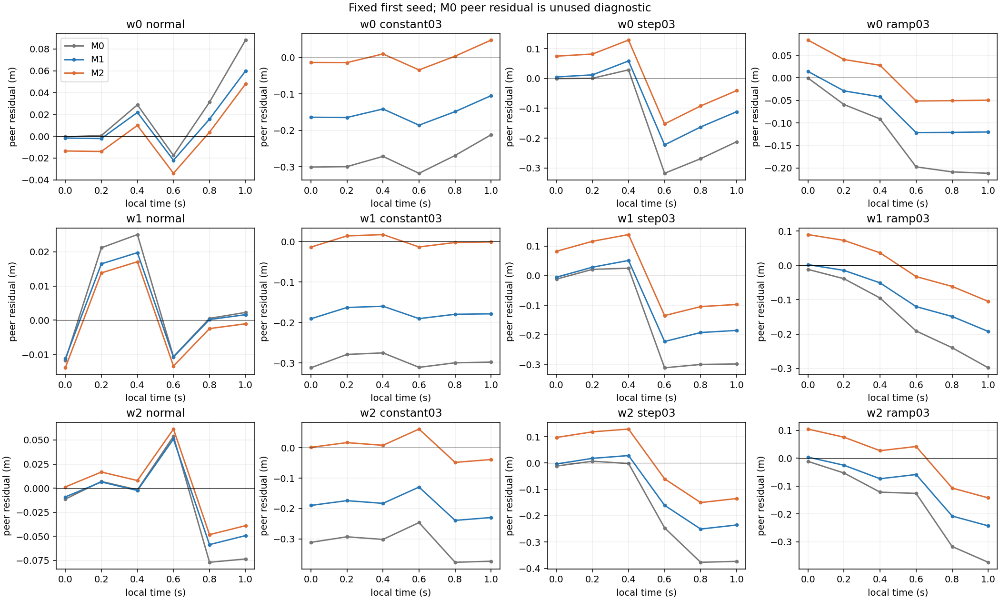
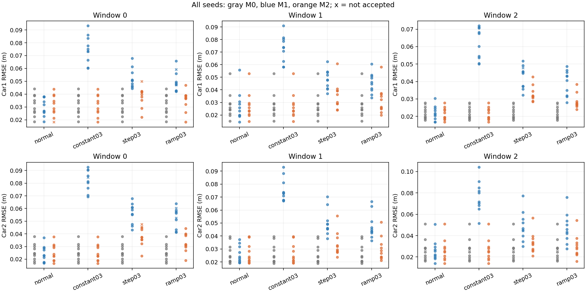
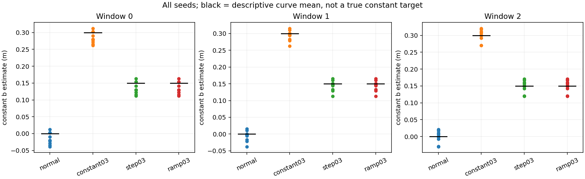
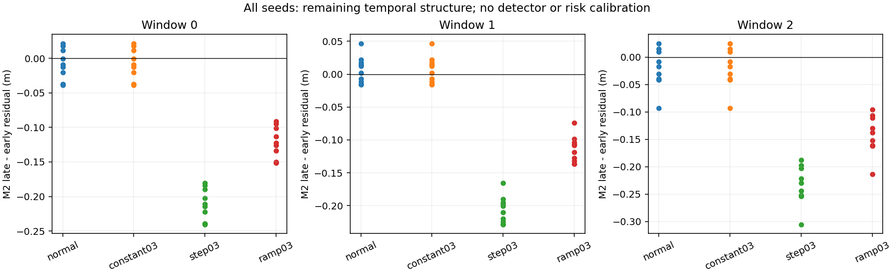

# Moon_1数值验收与时变偏差探索报告

## 完成范围

固定起点PR117 `27b0ecf4d76124d54912d26d33432e1718dca494`。
任务一无优化器复核180旧端点，保持169/11历史分类；另冻结执行22次单次继续。
任务二完成360/360方法、720/720阶段调用，全部有限，最终349接受、11未接受；没有孤立attempt、重跑或追加seed。
**formal_runs=0**。360次是方法运行数，独立seed仅10个；没有覆盖率、显著性、PL/HCPL或正式风险结论。

## 来源、模型与冻结

使用已提交PR117 reference派生三个固定窗口。归档与指定Git提交字节哈希一致，同窗20条track相同；源记录见results/FREEZE。
没有重新核验NPZ→轨迹链；继承的PR114 NPZ哈希属于历史来源回执。本轮未使用旧带噪观测作为新样本。
Moon_1来源仍是LuSNAR合成场景，不是真实月面数据。两车仍由同一GT时间偏移生成，未放大地形/改变轨迹。

0/8/16s各6点、dt=.2s；人工已知四信标，给定height-oracle高度，世界竖直天线1.16m。
距离sigma=.04m、两车合成全局XY增量sigma均.02m、正确独立Gaussian起点prior sigma=.5m及原初始化不变。
仅peer偏差曲线改变：normal / constant03 / step03 / ramp03，六点数值见CONFIG与PROTOCOL。
M2始终只有一个自由常bias，链路预先指定；不读取条件/注入标签，不是自动故障识别。

任务一设置/案例/代码冻结 `02af736734e272cd524cf38afb9991bb0b240f48`。
任务二协议/配置/seed/任务一结论/代码冻结 `7a22287b199060b4a7a6c0b68ea4ba9f5953eef9`，随后一次执行。
种子审计固定起点全仓文本与566个gzip归档，10个新seed无命中；范围及限制见SEED_AUDIT。

## 任务一：停止与门槛

详见NUMERICAL_DIAGNOSIS、diagnosis/ENDPOINTS和continuation/CONTINUATION。
独立目标/梯度/信息重算一致；没有发现基础模型错误。11例中4例ftol、7例xtol退出，nfev8…12。
GN最小特征值367.84…864.16，精确H最小特征值368.27…864.73；精确与GN相对谱范数差.000311….005867，均正定。
精确H中心差分最大差9.91e−7。局部预测逐点水平最大修正4.052…17.823nm，不能等同于实际继续结果。
坐标ULP约8.88e−16…3.55e−15m，原坐标RMSE约.0124….0544m；预测最大分量修正/原RMSE约2.21e−7…1.44e−6。
预测下降9.39e−14…3.93e−13，代价ULP约3.55e−15…1.42e−14；相减残差/累加代价的舍入影响不能只用单次ULP解释。
longdouble预测点评价支持局部下降量级，但并未运行高精度优化器或证明精确最优。

统一继续一次后，旧失败2例标签变为接受，实际最大位置变化4.085nm；9例仍未过原1e−5梯度门槛。
11个接受对照均保持接受，实际最大位置变化.437nm。
分类A=2、B=0、C=9：停止与接受标准不一致为主要解释，精度/步长停滞限制仍在，不能宣布9例“已修好”。
未把新标签回填历史。任务二继续保留原门槛，不用真值误差或纳米修正补充接受。

## 任务二：数值状态和分母

P0最多300评估；所有有限P0统一P1最多100，P1关闭ftol并采用xtol1e−15、gtol1e−9。
P0接受343/360、未接受17；P1接受349/360、未接受11。总函数评估5624，各次最多20，未触及预算上限。
最终11例均NOT_STATIONARY，不是数据缺失或秩亏；数据/总信息在所有有限阶段均满秩。
调用前attempt已fsync保存输入、配置、源码与阶段身份；已有attempt禁止自动重跑，锁测试通过。
阶段、残差、SciPy退出原因、nfev/njev、cost、gradient与信息奇异值全部保存。

|ID|条件|方法|梯度∞|
|---|---|---|---:|
|u005|constant03|M1|1.633963e-05|
|u011|ramp03|M1|1.1768851e-05|
|u015|ramp03|M1|1.000238e-05|
|u026|step03|M2|2.0315192e-05|
|u034|step03|M2|1.6232666e-05|
|u036|normal|M2|1.0962236e-05|
|u096|normal|M0|1.2577934e-05|
|u097|constant03|M0|1.2577934e-05|
|u098|step03|M0|1.2577934e-05|
|u099|ramp03|M0|1.2577934e-05|
|u118|step03|M1|1.1181625e-05|

每条件总计划90、有限90，最终接受normal88、constant03 88、step03 86、ramp03 87。
以下每项先在六时刻计算，再等权描述3窗×10seed的30项；**不是30个独立seed**。
全有限表包含数值未接受状态，完整保留分母；SUMMARY同时给出逐窗及双方接受配对子集和实际used计数。
收益=MSE(M0)−MSE(Mk)，正为改善、负为恶化，同输入配对，绝非将失败填零。

|条件|方法|计划/有限/接受|Car1 RMSE(m)|Car2 RMSE(m)|相对RMSE(m)|Car1收益(m²)|Car2收益(m²)|
|---|---|---|---:|---:|---:|---:|---:|
|normal|M0|30/30/29|0.027083|0.026420|0.037928|0.000000|0.000000|
|normal|M1|30/30/30|0.026387|0.025373|0.035559|0.000035|0.000059|
|normal|M2|30/30/29|0.026666|0.026131|0.037040|0.000019|0.000012|
|constant03|M0|30/30/29|0.027083|0.026420|0.037928|0.000000|0.000000|
|constant03|M1|30/30/29|0.069868|0.078159|0.142545|-0.004205|-0.005467|
|constant03|M2|30/30/30|0.026666|0.026131|0.037040|0.000019|0.000012|
|step03|M0|30/30/29|0.027083|0.026420|0.037928|0.000000|0.000000|
|step03|M1|30/30/29|0.047648|0.051622|0.091510|-0.001530|-0.002020|
|step03|M2|30/30/28|0.035447|0.035046|0.059805|-0.000517|-0.000545|
|ramp03|M0|30/30/29|0.027083|0.026420|0.037928|0.000000|0.000000|
|ramp03|M1|30/30/28|0.044938|0.049038|0.085811|-0.001289|-0.001758|
|ramp03|M2|30/30/30|0.031778|0.031067|0.050555|-0.000275|-0.000282|

### 常偏差匹配的一致性

M0所有条件的输入消费哈希、初值和估计不受peer曲线影响，估计逐值一致。
M2 normal→constant03的XY最大差1.20e−9m，bias平移误差最大7.05e−11m；残差变化见CONSTANT_SHIFT。
常偏差匹配的机制在新seed下可复现。其正常/常偏差的平均RMSE均约.02667/.02613m。
M1在constant03下升至.06987/.07816m，M2保留常偏差消除能力。
但正常条件M2并不必然优于M1；不能据该控制案例宣称普遍鲁棒性或完好性。

### 阶跃与斜坡：保持和退化

M2在step/ramp下平均误差仍小于M1，但较自身正常条件恶化，并且平均逐车收益相对M0为负。
step下两车平均RMSE为.03545/.03505m；ramp下为.03178/.03107m。它可吸收部分公共偏移，却无法用一个常数完整描述时间变化。
误差仍为厘米量级不等于失配可忽略：模型可能通过改变位置来消化部分时变偏差，剩余peer残差仍有明显时间结构。

|条件|M2常bias均值(m)|六点注入均值(m)，仅参照|peer残差RMS均值(m)|后3点−前3点均值(m)|
|---|---:|---:|---:|---:|
|normal|-0.007726|0|0.029305|-0.008672|
|constant03|0.292274|0.3|0.029305|-0.008672|
|step03|0.142509|0.15|0.113040|-0.217747|
|ramp03|0.142453|0.15|0.077145|-0.126943|

peer残差定义预测几何距离+估计常bias−实际观测。M0的peer残差只是未进入目标的诊断量。
step/ramp的bias−六点均值字段仅描述偏离，不是“偏差估计错误”；联合非线性估计、噪声和位置调整共同决定最优常参数。
step/ramp残差后半段相对前半段分别约−.218/−.127m，正常约−.00867m；不把这些数值直接用作检测或风险阈值。
全部seed散点与固定首seed图保留不利案例，未按结果选择展示。

## 验收、调用和限制

无优化器输入/J/配对/normal和constant03匹配验收通过；step/ramp不要求常bias在真值处零残差。
任务二独立读回残差差0、梯度差5.69e−14、J中心差分最大差1.94e−8。
原文件与压缩交付均完整读回通过，2760个JSON记录可以恢复原字节并验证哈希；两个读回的CSV及READBACK逐字节一致。
完整入口同时重算旧180端点和22继续端点；读回没有优化器调用。

|类别|方法/端点数|实际优化器调用|
|---|---:|---:|
|开发冒烟（已暴露seed）|12|24|
|任务一无优化器旧端点审计|180|0|
|任务一固定继续|22|22|
|任务二探索|360|720|
|假求解器/公式验收/读回|单独记录|0|
|合计实际SciPy调用|不作独立样本计数|766|

无GUI、车辆动力学、实车噪声标定、非oracle高度或设施不确定性实验。
本轮结果只适用于人工已知设施、理想高度、独立Gaussian研究假设及预定peer链路；未知故障发现/覆盖风险仍未验证。
建议见DECISION_MEMO：安全量化主线优先补可信观测不确定性，再用明确新协议研究最小时变bias模型；暂不将残差图直接转为检测器或保护级。
