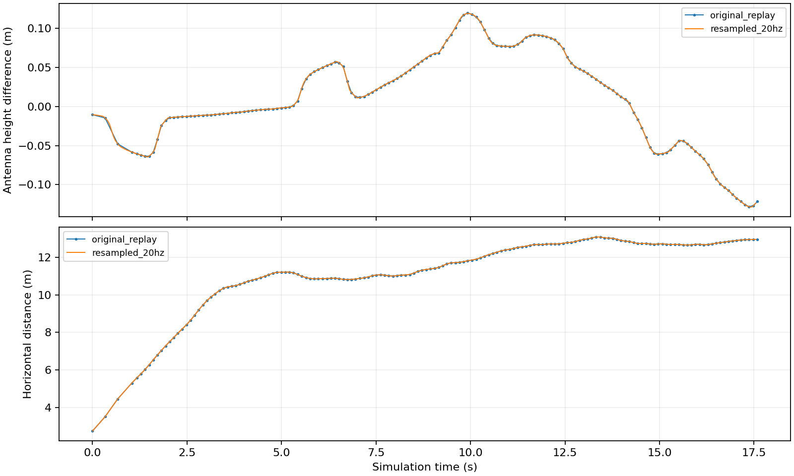
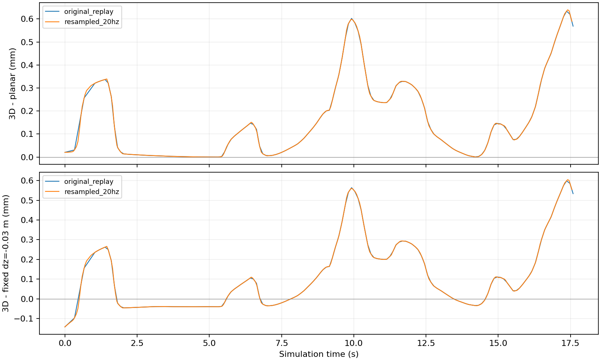
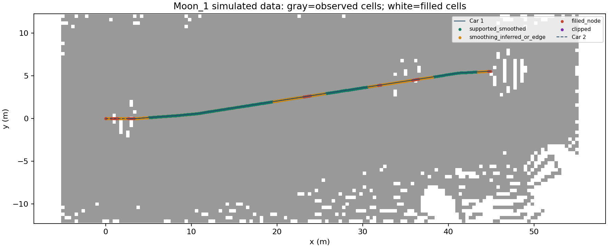
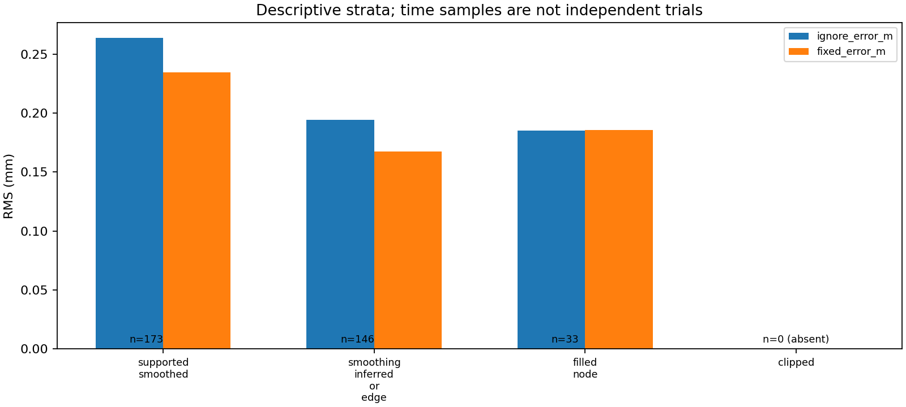

# Moon_1 场景复建与高差量级审计

日期：2026-11-17。阶段一已完成，formal_runs=0，nonlinear_solver_calls=0。

**推荐 B：保留原场景的小效应结果，优先推进运动退化或测距偏差的接口研究；若下一步专门研究高差机制，先使用单独标记、预先定义的解析坡面。** 原场景可以保留为小高差基线，尚不具备直接进入绝对定位对照的输入与可观测性契约。本次不根据小于噪声的量级推断定位影响可以忽略。

## 1. 执行身份与证据等级

固定方案为 PR113 的 `b31789444b04792df58dd78d11a906804eed95a2`，启动时 open、未合并；只读方案，没有合并或等待。实际 main 为 `db45d94d03061e6828afb25d841c2b1777d0af48`，据此建立 `/home/ubuntu22/uwb-moon1-height-audit-20261117`，分支 `research/moon1-height-audit-20261117`。执行前冻结提交完整 SHA 在 [RUN.json](results/RUN.json) 的 audit_commit；公共生成器固定为 main 上述提交，并逐文件验证一致。最终交付 SHA 以 PR 为准，避免自引用。

初始 cwd=/home/ubuntu22；来源工作树 `/home/ubuntu22/uwb-moon1-antenna-fix-20261030` 在 `fix/20261030-moon1-antenna-consistency`，HEAD `33a421f88dcdb1ff356a6552d7d785f4201601b9`，干净。remote 为本 GitHub 仓库。旧月面树 `/home/ubuntu22/uwb-lusnar-moon1-simulation` 的已有修改全部保留。任务路径原先不存在；检查祖先及固定仓库树未找到适用 AGENTS.md。新增代码、报告仅在本任务目录。

起始磁盘约23GiB可用、93%已用。进程检查只能看到当前沙箱PID命名空间（codex/bash及检查命令），不能断言宿主无其他任务。默认Python3.10.12、NumPy2.2.6与系统SciPy1.8.0不兼容；本任务新建Git外venv，NumPy2.2.6、SciPy1.15.3、Matplotlib3.10.9，BLAS/OMP/MKL线程1，无GUI/GPU依赖。未修改系统环境、旧venv或驱动。环境与开发中断记录见 [PREFLIGHT](results/PREFLIGHT.json)、[ENVIRONMENT](results/ENVIRONMENT.json)。

| 证据 | 本次结论 |
| --- | --- |
| 本次独立核实 | 原PLY/GT与六帧TXT可读；资产大小/哈希；NPZ/CSV复建与逐项对比；支持分层与几何量级；所有输入前后哈希不变 |
| 历史记录 | 六帧融合来源、Isaac截图、旧场景曾显示；不能代替本次运行证明 |
| 本次合成验收 | 平地、坡面、端点重合、填补、边界、旧CSV拒绝，均独立于Moon_1量级统计 |
| 尚未验证 | 六帧重新融合、原始下载真实性独立验证、USD重新导出、ROS/GUI运行、定位性能/覆盖/动力学/RF |

## 2. 输入与复建链

源PLY是 `/home/ubuntu22/LuSNAR-reproduction/results/moon1_fused_lidar.ply`（4,148,250字节、276,538点）；GT为同项目 `sample/Moon_1/gt.txt`（201,441字节）。PLY本身是历史六帧融合产物，不能称上游原始扫描；六帧TXT也已哈希盘点，但本轮不重复融合。源数据为LuSNAR模拟月面，不是真实月面采集。

完整实际路径、SHA256、大小、旧NPZ结构与CSV字段见 [INPUTS.json](results/INPUTS.json)。本次源哈希与生成命令构成从这些**当前输入字节**到新输出的来源链，不补造旧输出生成身份。旧USD仅盘点，旧 `isaaclab_v3_run.log` 为0字节；旧核心provenance/CSV manifest/USD manifest缺失仍如实记录。存档下载中央目录manifest只能支持历史下载线索。

复建输出位于Git外 `/home/ubuntu22/uwb-moon1-height-audit-20261117-artifacts/rebuild001/scene`。使用未修改的prepare与CSV生成器，参数在结果读取前固定：x=[−5,55]m、y=[−12,12]m，0.4m网格，GT索引0…200，两车错时5s；CSV为20Hz，seed7、噪声sigma=.03m、固定偏差/NLOS概率/丢包概率均0。噪声是历史假设，不是月面标定。

[COMMANDS](results/COMMANDS.json) 保存实际argv、cwd、返回值；[provenance](results/provenance.json)、[CSV manifest](results/uwb_replay.manifest.json)和[RUN](results/RUN.json)连通源、代码、环境与输出哈希。manifest中未取得的USD保持unavailable。

### 新旧对比

[COMPARISON](results/COMPARISON.json)逐数组、逐字段列出结果：

- NPZ全部9数组（vertices/faces/colors/observed/distance_to_observation/grid_shape/sim_time/leader/follower）shape、dtype及所有数值一致，最大绝对差0。
- summary所有字段语义值一致。9211顶点、18000三角形、151×61网格，观测格比例91.922701%；这不是定位覆盖率。
- CSV时间、两车XY/yaw、quality完全一致。旧CSV352行，新增4个body_z/gt_z字段。
- 两车z最大变化分别1.197233m、1.197298m；原因是旧CSV使用GT z，新CSV先贴地再加1.16m天线高度，不是轨迹水平变化。
- true_range最大变化0.000311m；两方向range变化最大0.000312/0.000311m。旧新“测量−true_range”差最大约1e−6m，与CSV六位小数舍入一致，支持随机扰动序列一致的解释，但不据此反推旧代码完整身份。
- 旧CSV在本任务新入口明确拒绝，列出缺失的四字段；没有静默补0、推断或覆盖旧文件。公共ROS脚本未改动，其旧有宽松读取不能视为被本PR修复；后续必须先经过本任务校验或使用新生成文件。

## 3. 坐标、时间与天线身份

单位为m、s；原GT纳秒时间转换，位置采用(x,−y,−z)。GT四元数不用于该车体姿态链。Car1在t+5s，Car2在t，来自同一条轨迹，并非独立采集。

“原始采样”指NPZ回放时间轴155点，0…17.590822656s，不等于完整GT文件；实际只使用前201 GT位姿。20Hz重采样352点，0…17.55s，不外推尾端。先在NPZ轨迹上重采样XY/原GT z，再查地形，不把插值后的body_z替代重新贴地。原非等间隔点和等间隔点的等权描述统计天然不同，不能当独立重复或置信区间样本。完整/使用GT绝对时间范围见RUN。

生产代码先把绝对纳秒转float64再相减。独立整数时间核验发现最大差2.16e−7s；本轮保留生产行为并报告，不修改时间以强行改善一致性。

NPZ leader/follower仍为转换后的GT；body_z为双线性地形高度；antenna_xyz为body XY、body_z+1.16m。这是世界竖直加高，不是完整 p_a=p_b+R_b l_ba，未建roll/pitch杆臂。yaw从水平速度导出。

视觉杆中心在车体(0.28,0,1.0)m、杆高0.55m；测距点却在车体同XY、z+1.16m，不能宣称显示杆和实际测距点一致。GUI线端点读取CSV天线，但这不使杆模型自动一致。历史/odom发布这些参考坐标且速度置零，不是独立里程计。quality=0/1是模拟NLOS标签；本轮不将其输入定位器。

## 4. 高差量级

两车同一模拟时刻，Δz=z1−z2，δr=r3D−rXY；解析交叉式Δz²/(r3D+rXY)最大差2.643e−15m。重合零分母显式返回零高差失配，并把距离雅可比列为未定义；实际轨迹没有重合点。

固定模型为sqrt(rXY²+Δz_fixed²)，Δz_fixed=0.17−0.20=−0.03m，源自冻结后端 `tools/two_car_fixed_lag_fgo_v1/config.json`，并在执行时断言来源值。只比较这个高度假设，不复用室内信标与水平杆臂，也不从本段真值拟合常数。有符号误差定义为r3D−r_fixed。

| 序列/模型 | 样本数 | 均值 mm | RMS mm | P50 mm | P95 mm | P99 mm | 最小…最大 mm |
| --- | ---: | ---: | ---: | ---: | ---: | ---: | --- |
| 原155点，忽略高差 | 155 | 0.158158 | 0.233082 | 0.099625 | 0.553941 | 0.614421 | 0.000027…0.633745 |
| 20Hz，忽略高差 | 352 | 0.157104 | 0.230184 | 0.099899 | 0.549300 | 0.617467 | 0.000008…0.639510 |
| 原155点，固定高差 | 155 | 0.115355 | 0.208432 | 0.061955 | 0.517028 | 0.579632 | −0.142677…0.598958 |
| 20Hz，固定高差 | 352 | 0.111529 | 0.204533 | 0.060569 | 0.511243 | 0.582683 | −0.142677…0.604727 |

20Hz水平间距2.756795…13.074920m；高差−0.128636…0.118886m，高差RMS0.059646m；δr最大出现在t=17.4s。全部分布（包括rXY、r3D、Δz、P05）见METRICS，逐时刻见TIMESERIES。

0.03/0.04m只作为历史假设噪声参照：20Hz δr RMS约为其0.767%/0.575%，最大值约为其2.132%/1.599%。这不是显著性检验，也不证明位置影响可忽略；系统性小偏差、弱几何和先验仍可能改变结果。

## 5. 观测、填补、平滑与裁剪

源PLY经有限值、XY范围与z∈[−1,1]m筛选，保留224148、排除52390点。每格高度中值；空格最近邻填补；sigma=.65格的高斯滤波（truncate=4、reflect，半径3格）；双线性查高。整个处理不是未经处理的地表，vertical面、高岩石等也受筛选限制。

支持分层按两车任一端较弱类别，四类互斥，优先级从下表下方到上方：

| 层 | 定义 | 原155点 n | 20Hz n | 20Hz δr RMS mm | 20Hz δr最大 mm | δr平方和占比 |
| --- | --- | ---: | ---: | ---: | ---: | ---: |
| supported_smoothed | 所有非零双线性节点及其高斯核均来自观测格，无reflect边界 | 79 | 173 | 0.263471 | 0.597875 | 64.390% |
| smoothing_inferred_or_edge | 双线性节点全观测，但平滑核涉及填补格或反射边界 | 63 | 146 | 0.194284 | 0.639510 | 29.548% |
| filled_node | 至少一端非零权重节点直接含填补格 | 13 | 33 | 0.185090 | 0.636388 | 6.062% |
| clipped | 至少一端查询按生产规则裁剪 | 0 | 0 | 不适用 | 不适用 | 0% |

实际所有反射边界计数也为0，因此第二层本次只来自平滑核填补依赖。最高单点落在第二层，但大多数失配平方和来自第一层；不能将高差效应主要归因于填补，更不能把分类占比解释为填补的因果贡献。

SUPPORT_TRACE逐车逐时刻记录4节点索引、双线性权重、observed、节点到最近观测格EDT距离、最近邻donor索引、填补质量权重、reflect及clip标记。零权重节点不算依赖。最近原PLY观测距离另用筛选后点云XY KDTree计算，不与EDT格距混用；20Hz两车查询点最近观测距离最大0.235437/0.300083m。高斯填补权重最大0.477586/0.591563，不能仅看91.92%全局网格支持率判定轨迹可信。

边界追踪区分物理越界与生产实现的上界epsilon裁剪；两者实际均0，合成测试验证边界点和越界点可检出。节点坐标步长沿用float32网格的实际差值，避免理想0.4m和生产插值实现不一致。

平滑敏感性保留同样XY、同样最近邻填补，仅比较高斯前后：20Hz未平滑δr RMS0.235752mm、最大0.670875mm；平滑后减为0.230184/0.639510mm。逐点δr变化RMS0.013808mm、绝对最大0.084451mm。属于处理敏感性，未平滑高度也不是独立真实地形；不能把差值全解释成地图误差。

## 6. 有限几何诊断

没有原场景固定信标、独立运动观测、可信先验或完整定位状态契约，不添加任意强先验。每时刻选自由两天线3D位置6维状态，单位m、尺度1m、距离权重1（非标定噪声白化）。非重合时J=[uᵀ,−uᵀ]，全部507个描述性时刻秩1，唯一非零奇异值sqrt(2)，零空间维5。RANK保存20Hz逐点SVD；读回对全部507点独立核验。

这只说明瞬时距离约束一个相对径向方向；共同平移、绕共同参考的旋转及相对切向运动存在不可观测自由度。没有运动因子，不能通过堆叠连续时刻假装定位满秩。也不能把该雅可比当成“已知地图高度随XY变化”的雅可比，后者需要地图梯度和高度误差契约。

未求伪逆位置修正、未生成有限绝对协方差、未引入假想信标、未做非线性定位矩阵。小测距误差对位置的放大系数在当前条件下不能给出。

## 7. 验收与下一步

新增5项合成测试、既有2项天线测试通过；实际CSV由天线坐标独立复算true_range，最大差1.3223e−6m，小于预定3e−6m舍入容差。这不是要求含噪range等于真几何距离。时间配对、坐标、body/gt/antenna、yaw检查通过；旧CSV明确拒绝；所有29个存在输入哈希前后不变。独立读回复核507行、1014条支持记录、70行汇总、22个生成文件哈希，PASS。统计最大差3.553e−15。命令、输入及日志均交付；原始数据及大型NPZ/USD不提交。

**选择B，不直接启动原Moon_1正式定位对照。** 本片段的自然高差导致亚毫米测距失配，主贡献并非填补，平滑前后仍属小效应；当前又缺绝对参考与独立运动观测。应保留这个结果，不改轨迹追求显著差异。

下一步先按方案阶段二隔离reference/measurements/estimates，选定后端、运动观测、参考几何与先验机制，优先评估运动退化或测距偏差。若专门验证高差机制，先在单独标记的解析坡面明确坡度、水平间距及参考几何，完成距离/雅可比一致性，再决定是否增加原场景对照。本文的2m水平、1m高差坡面只是合成几何验收，不作为Moon_1结果或定位实验。

尚未解决的来源限制是历史融合和USD原生成身份，并非本次PLY→NPZ→CSV链阻塞，因此不把C作为主要出口。A可在阶段二接口和可观测性条件满足后作为原场景小效应对照重新评估。本轮没有定位性能、误差覆盖、完好性或真实月面泛化保证。
