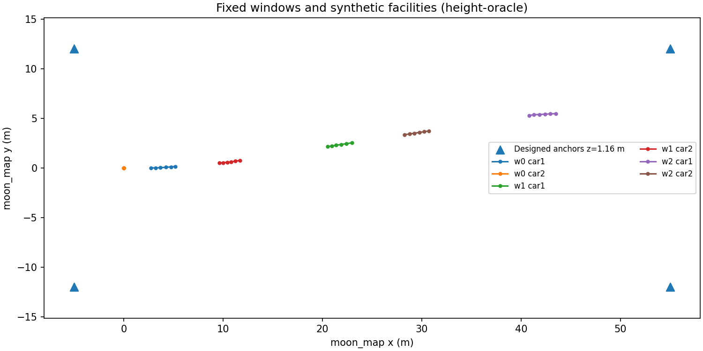
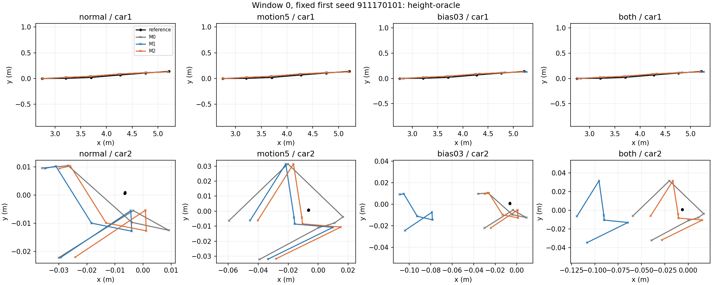
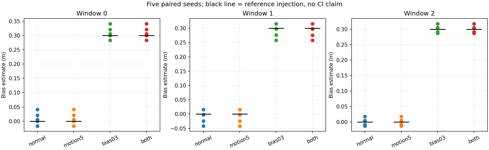

# Moon_1定位接口与短窗口验证报告

## 结论与证据边界

接口及12次无噪声验收通过；180次带噪方法运行全部完成、180次优化器调用，169次符合冻结数值接受标准，11次NOT_STATIONARY。
**formal_runs=0**。本轮是基于PR114实际复建场景轨迹的数值定位实验，而非仅用解析fixture，也非Isaac车辆物理仿真或真实月面数据。
全部方法统一采用height-oracle、人工已知信标和合成全局XY位移增量。运动退化为已知噪声增大，M2候选链路事先指定。

## 来源、轨迹与接口

PR114原SHA `4a81bbc582d2e059759b2a89201d8edbcd1a75cc`，共同起点 `d5bf9c1c7127e71bf6eb30f9a5b807952c810e53`。
独立核验实际NPZ为114428字节，SHA256 `ac283d70505a5c1f4869dbb7be84af88041de2d74bf56dcfc2360bcb513de97f`；批次后未改变。
来源回执SHA256 `241e3f164c858f5dc457f864e759fa371c8c8f7dbbb481e25fb3052f8f602579`。
本轮未重新构建场景、未修改轨迹；沿用PR114有关填补/平滑支持及小高差的结论，不补造新的原始资产来源核验。
当前NPZ独立读取及哈希验证与PR114来源报告记载分开。未使用旧CSV测距、quality标签或历史truth /odom。

原轨迹来自同一GT的5s时间偏移，并非两车独立采集。0/8/16s窗口各6时刻，末端1/9/17s均在NPZ有效范围。
在原NPZ时间轴线性插值各坐标，再调用原天线几何函数贴地+世界竖直1.16m。
0s窗口Car2原轨迹几乎静止，是继承的原始运动状态；没有因其定位结果修改窗口或轨迹。
参考GT、贴地body、天线与显示坐标单独保存；显示天线=测距天线，未运行GUI，只有坐标一致性检查。

reference保存真值/注入，measurements只含观测和明确oracle高度，estimates保存解与数值诊断。
严格schema拒绝额外truth/quality及缺字段；普通CLI禁止打开reference目录，且求解模块不导入生成/评价模块。
这是接口防误用检查，不是操作系统级恶意输入隔离；oracle高度来源被明确披露。
初始化为先验观测+合成观测增量累加+固定偏移，不读整段真值。

## 数学与可观测性

三维距离与24维XY状态匹配，XY导数为水平差/r3D，M2另加一列常偏差导数1。
M0不使用peer，M1使用peer，M2在同一预定链路加一个自由常b，无偏差prior。
冻结六时刻后端的movement和缩放SVD information只读复用；平面特例r/J对照差为0。
A/B/C代码、结果与正文无改动。

三窗所有带噪状态的数据+运动Jacobian在不加起点prior前已满秩：M0/M1 24，M2 25；加prior后仍满秩。
采用S=diag(1m,…,0.1m bias)和相对阈值1e−8。缩放数据条件数范围M0 3.562–5.652、M1 3.668–5.863、M2 22.998–24.422。
完整奇异值和先验前后协方差保存在estimates。这里可观测来自人工已知设施，不能归因于纯车间测距。
纯peer不提供绝对位置；没有通过加强prior掩盖这一点。共线合成退化测试返回秩亏和null covariance。
协方差仅为正白化尺度下GN局部诊断，不输出PL/HCPL、正式覆盖或物理安全保证。

## 无噪声验收

三个窗口×M0/M1/M2共9次零偏差匹配；另三窗M2匹配+.3m，共12次全部接受。
真值代入残差最大0；规定初始化求解位置最大分量误差4.09e−15m；中心差分雅可比最大误差1.79e−8。
所有白化尺度仍为正，零噪声不导致除零。缺字段/标签/非有限/非法时间/零尺度/负测距在优化前拒绝。
预算耗尽、异常、非有限输出及秩亏均有明确状态；两个异常optimizer stub不是实际优化器调用。
输入天线距离、motion、prior由独立读回公式重新计算，与全部保存观测一致。

代码/协议在 `e235299f804207421a6713bae25a2c39aa420b01` 冻结后，才生成5个新seed的带噪观测。
三个窗口×四条件×五seed×三方法=180；无P1，不择优重跑。标准化随机噪声跨条件共享；每个时刻一条peer，未复制反向当独立观测。

## 带噪描述结果

下表先对每个窗口/seed的6点计算RMSE，再对3窗口×5seed的15个值等权取均值。
**15不是15个独立seed**，只有5个seed；全180有限状态都计入下表，包括11个未接受状态。
这是全分母的诊断描述，不是“全部成功”的性能统计。按窗表见SUMMARY；双方接受的配对子集见PAIRED_ACCEPTED，分母单列。
收益=同输入M0 MSE−方法MSE，正值有利；不是两组不配对均值之差，也不是RMSE差。

|条件|方法|接受/计划|Car1 RMSE均值(m)|Car2 RMSE均值(m)|相对RMSE均值(m)|Car1收益(m²)|Car2收益(m²)|
|---|---|---:|---:|---:|---:|---:|---:|
|normal|M0|14/15|0.026971|0.025158|0.039173|0.000000|0.000000|
|normal|M1|13/15|0.025969|0.024083|0.036124|0.000058|0.000068|
|normal|M2|14/15|0.026286|0.024757|0.037753|0.000036|0.000017|
|motion5|M0|14/15|0.026971|0.040545|0.050987|0.000000|0.000000|
|motion5|M1|15/15|0.026050|0.038230|0.046521|0.000054|0.000181|
|motion5|M2|14/15|0.026366|0.038731|0.047799|0.000031|0.000128|
|bias03|M0|14/15|0.026971|0.025158|0.039173|0.000000|0.000000|
|bias03|M1|15/15|0.069271|0.074477|0.138671|-0.004177|-0.004965|
|bias03|M2|14/15|0.026286|0.024757|0.037753|0.000036|0.000017|
|both|M0|14/15|0.026971|0.040545|0.050987|0.000000|0.000000|
|both|M1|14/15|0.069292|0.080838|0.142062|-0.004180|-0.004870|
|both|M2|14/15|0.026366|0.038731|0.047799|0.000031|0.000128|

正常条件下M1/M2有小幅平均收益，不能据此宣称每个seed或每车都改善。
已知Car2运动增量sigma从.02增至.10m时，M0 Car2平均RMSE由.025158升至.040545m，Car1不变；M1/M2仅部分减轻。
正常运动时，+.3m偏差令M1两车平均RMSE升至.069271/.074477m；同时退化时为.069292/.080838m。
M0完全不受peer偏差影响，消费输入哈希、初始化与估计逐值一致。
M2平均偏差估计正常约.000156m、退化约.000123m，注入后分别约.300156/.300123m。
自由常b与恰好常值注入模型匹配，因此注入基本仅平移b而不改变XY；这是模型族内受控机制，不是自动发现故障。
M2无偏差时不一定比M1更好，增加自由参数会损失部分信息。各窗各seed原始偏差与误差均保留，没有据此调参数。

## 数值失败、调用与读回

11个NOT_STATIONARY的梯度∞在1.0435e−5到2.4386e−5之间，超过冻结1e−5；未降低标准。
M0/M1/M2分别4/3/4个未接受。即使SciPy成功退出，也没有直接标为接受。
所有180状态有限、信息满秩，但不能以此代替梯度验收；失败明细见STATUS_ALL，cost/gradient见PER_RUN。
无噪声12次、开发人工预算耗尽1次、带噪180次，实际SciPy调用合计193；formal_runs=0。
独立读回两次（Git外原文件及提交的压缩证据）不产生优化器调用。
残差和梯度读回差均0，协方差独立反解最大差1.35e−17，独立残差中心差分J最大差1.70e−8。
压缩证据恢复后的JSON逐字节匹配RUN中的原文件哈希。

## 图与后续

窗口1/2见[窗口1](results/figures/trajectories_w1.png)、[窗口2](results/figures/trajectories_w2.png)。固定首个seed，不挑有利结果。
图中包含未接受的有限状态（例如窗口0正常M2）；判断状态应查STATUS_ALL，不能凭曲线接近真值判定成功。

建议先补数值稳定性与观测模型证据，再冻结正式实验；完整依据见DECISION_MEMO。物理仿真可复用接口但必须重新验证。
仍缺实车参数、独立运动观测、非oracle高度、UWB传播/同步及相关性、设施误差和正式不确定性证据。
保留Moon_1小高差与原轨迹；不为显著差异变更场景。本轮不确认95%覆盖、不验证月球动力学。
