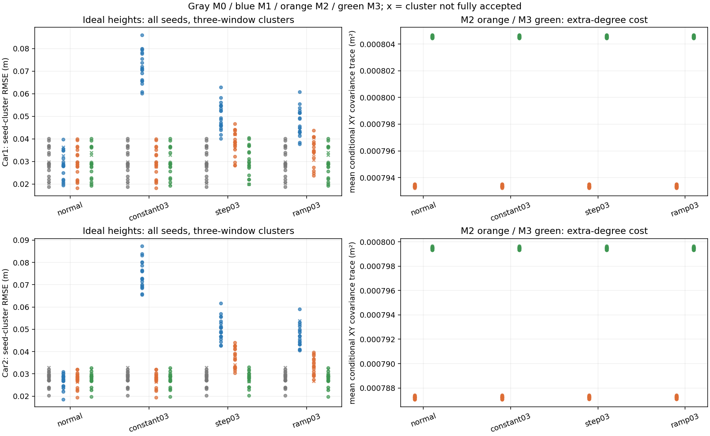
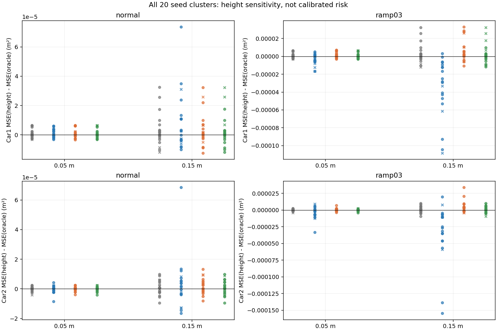
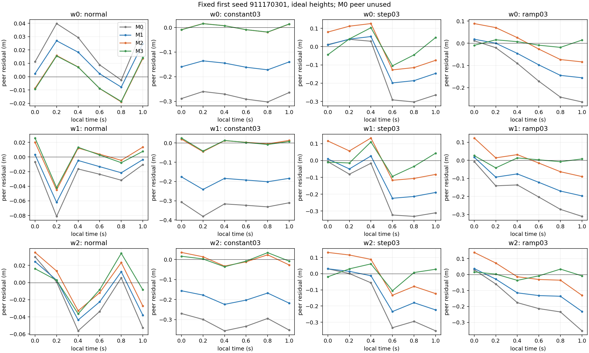
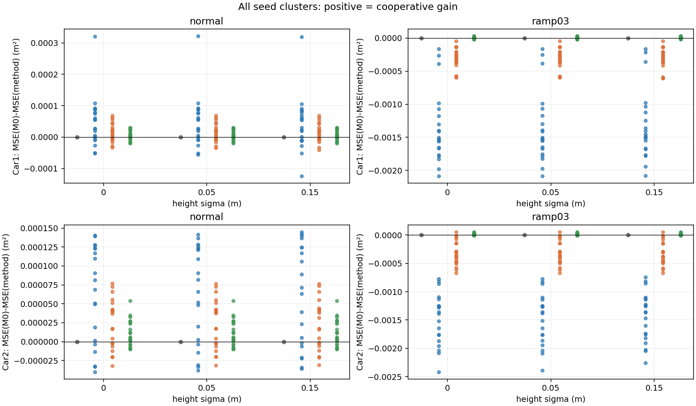

# 结果报告

## 结论与证据边界

M3能表达线性斜坡偏差，降低ramp下M2的误差；额外自由度在normal下略损失位置精度并增加条件协方差。step中M3也改善M2，但仍有明显残余时序失配，平均协同收益未超过M0。预定两档高度扰动对当前几何下的平均位置误差影响较小，仍改变收益幅度并使部分seed的收益符号改变。

本次独立核验固定PR120 reference字节哈希与同窗40条轨迹一致性，使用已提交reference派生输入。未重新验证PLY→NPZ→USD链，未运行Isaac/GUI。LuSNAR为合成场景，两车来自同轨迹错时5s，四角信标为人工已知设施。sigma=0为height-oracle；非零sigma只是供给高度误差敏感性，不是高度融合。所有sigma、偏差曲线、正确Gaussian prior和全局XY增量均是研究假设，不是月面实测标定；故障发生概率未知。

## 执行和数值状态

探索A/B各960次，合计1920唯一方法运行、3840真实调用；开发32次/64调用，总3904，formal_runs=0。所有P0有限并统一执行一次P1，未选择误差较小阶段；没有追加seed或重跑。P0接受1807、未接受113；最终P1接受1844、NOT_STATIONARY 76。有限1920、不可用0、孤立attempt 0；不把有限等同接受。总nfev=28185，单次最大21，未触及300/100预算。保持原物理梯度1e-5门槛，未放宽或改名失败。

所有阶段的range/data/total秩分别为M0=24、M1=24、M2=25、M3=26（均等于维度）；这里range含人工锚点，并非仅车间距离。信息秩依据冻结尺度和相对阈值1e-8，无ridge或偏差先验。原物理梯度含不同参数单位，仅作为已冻结数值判据。

下表每格均计划60、有限60、不可用0；括号为三窗均接受的完整seed簇数/20，失败数=60−接受数。

| 高度sigma(m) | 条件 | M0 | M1 | M2 | M3 |
|---|---|---|---|---|---|
| 0.0 | constant03 | 58/60 (18/20) | 60/60 (20/20) | 58/60 (18/20) | 57/60 (18/20) |
| 0.0 | normal | 58/60 (18/20) | 57/60 (18/20) | 59/60 (19/20) | 58/60 (18/20) |
| 0.0 | ramp03 | 58/60 (18/20) | 57/60 (17/20) | 56/60 (16/20) | 58/60 (18/20) |
| 0.0 | step03 | 58/60 (18/20) | 60/60 (20/20) | 58/60 (18/20) | 57/60 (17/20) |
| 0.05 | normal | 59/60 (19/20) | 58/60 (19/20) | 56/60 (16/20) | 57/60 (17/20) |
| 0.05 | ramp03 | 59/60 (19/20) | 55/60 (15/20) | 58/60 (18/20) | 57/60 (17/20) |
| 0.15 | normal | 57/60 (18/20) | 57/60 (17/20) | 55/60 (15/20) | 59/60 (19/20) |
| 0.15 | ramp03 | 57/60 (18/20) | 60/60 (20/20) | 55/60 (16/20) | 58/60 (18/20) |

## 理想高度的位置结果

先在同seed内平均三个窗口MSE再开方，表为20个seed簇RMSE的平均，单位m；它不等于总体MSE直接开方。全部有限端点包含未接受结果；双方接受子集另列。相对位置误差、逐车MSE和收益全量见SUMMARY及PER_WINDOW，不把三窗/两车/六时刻视为独立seed。

| 条件 | 方法 | Car1 RMSE | Car2 RMSE | 相对位置RMSE |
|---|---|---|---|---|
| constant03 | M0 | 0.029388 | 0.027889 | 0.041275 |
| constant03 | M1 | 0.071844 | 0.074427 | 0.139509 |
| constant03 | M2 | 0.029131 | 0.027453 | 0.040344 |
| constant03 | M3 | 0.029302 | 0.027655 | 0.040836 |
| normal | M0 | 0.029388 | 0.027889 | 0.041275 |
| normal | M1 | 0.028664 | 0.026746 | 0.038708 |
| normal | M2 | 0.029131 | 0.027453 | 0.040344 |
| normal | M3 | 0.029302 | 0.027655 | 0.040836 |
| ramp03 | M0 | 0.029388 | 0.027889 | 0.041275 |
| ramp03 | M1 | 0.047132 | 0.047326 | 0.085151 |
| ramp03 | M2 | 0.034281 | 0.033150 | 0.054508 |
| ramp03 | M3 | 0.029302 | 0.027655 | 0.040836 |
| step03 | M0 | 0.029388 | 0.027889 | 0.041275 |
| step03 | M1 | 0.049910 | 0.050118 | 0.091266 |
| step03 | M2 | 0.038060 | 0.037002 | 0.063686 |
| step03 | M3 | 0.029964 | 0.028018 | 0.042286 |

主要配对对比ΔMSE=MSE(M3)−MSE(M2)，负为M3改善，单位m²。双方接受要求该seed的三个窗口两方法全部接受；不将失败填零。

| 条件 | 子集 | seed数/20 | Car1 ΔMSE | Car2 ΔMSE |
|---|---|---|---|---|
| constant03 | all_finite | 20 | +9.285868e-06 | +1.103108e-05 |
| constant03 | both_accepted | 16 | +1.346569e-05 | +8.090442e-06 |
| normal | all_finite | 20 | +9.285859e-06 | +1.103108e-05 |
| normal | both_accepted | 17 | +8.073014e-06 | +9.139285e-06 |
| ramp03 | all_finite | 20 | -0.0003081021 | -0.000339143 |
| ramp03 | both_accepted | 15 | -0.000333342 | -0.0003175979 |
| step03 | all_finite | 20 | -0.0005386901 | -0.0005924579 |
| step03 | both_accepted | 15 | -0.0005491231 | -0.0006145686 |

M3正常条件的代价：Car1/Car2条件XY协方差迹约增加1.41%/1.56%，平均尺度化总条件数从M2的23.951增至65.425，RMSE约增加0.171/0.202mm。正常接受率M2为59/60，M3为58/60。本数据不支持“多加偏差参数总能改善定位”。GN协方差条件于错误被忽略的高度与声明权重，仅为局部诊断，不含模型失配，不作PL/HCPL/HMI。

M2的normal/ramp/step平均peer残差RMS约为0.02891/0.07684/0.11003m，M3为0.02588/0.02588/0.06316m。正常残差更小也可能来自拟合噪声，不能直接称精度提升或检测能力。step没有真实单一(b0,b1)，本报告不把拟合参照当真实参数；偏差状态与逐时刻残差保存在归档及CSV。

300个匹配模型恒等式检查最大残差差3.20e-14、J差0；实际保存端点XY最大差1.39e-8m，后者为实际求解一致性描述。M2常偏差平移、M3常数/线性平移符合设计；normal/constant/ramp的M3匹配参数分别(0,0)、(.3,0)、(.15,.3)，单位m及m/s。step不要求被线性趋势完全拟合。

## 高度误差结果

真实测距、运动、prior、位置初值不变，只有估计端几何h_used变化。每窗每车常量误差造成窗口内相关失配；估计器不知道误差或其sigma，也未调整权重。两档实际实现范围分别为[-.120984,.178066]m与[-.362953,.534197]m；它们是同一标准随机流缩放，并不是截断Gaussian。实现值完整记录，不只报告sigma。

以下ΔMSE=各方法非零高度−自身sigma0，正为恶化，单位m²；列出全有限和双方接受，sigma0直接引用A不重求解。

| sigma | 条件 | 方法 | 子集 | seed数/20 | Car1 ΔMSE | Car2 ΔMSE |
|---|---|---|---|---|---|---|
| 0.05 | normal | M0 | all_finite | 20 | +9.80061e-07 | -1.16101e-08 |
| 0.05 | normal | M0 | both_accepted | 17 | +1.28242e-06 | +1.77786e-07 |
| 0.05 | normal | M1 | all_finite | 20 | +1.13687e-06 | -2.5685e-07 |
| 0.05 | normal | M1 | both_accepted | 17 | +1.0718e-06 | -4.27218e-07 |
| 0.05 | normal | M2 | all_finite | 20 | +1.13085e-06 | +3.68515e-08 |
| 0.05 | normal | M2 | both_accepted | 15 | +1.27453e-06 | -8.79086e-08 |
| 0.05 | normal | M3 | all_finite | 20 | +9.89818e-07 | -2.18495e-08 |
| 0.05 | normal | M3 | both_accepted | 15 | +3.32083e-07 | -2.97763e-07 |
| 0.05 | ramp03 | M0 | all_finite | 20 | +9.80061e-07 | -1.16101e-08 |
| 0.05 | ramp03 | M0 | both_accepted | 17 | +1.28242e-06 | +1.77786e-07 |
| 0.05 | ramp03 | M1 | all_finite | 20 | -3.85952e-06 | -3.83693e-06 |
| 0.05 | ramp03 | M1 | both_accepted | 12 | -1.96788e-06 | -4.67731e-06 |
| 0.05 | ramp03 | M2 | all_finite | 20 | +1.41234e-06 | +4.57664e-07 |
| 0.05 | ramp03 | M2 | both_accepted | 14 | +1.59443e-06 | +5.96413e-07 |
| 0.05 | ramp03 | M3 | all_finite | 20 | +9.8982e-07 | -2.18526e-08 |
| 0.05 | ramp03 | M3 | both_accepted | 15 | +3.63835e-07 | -1.76899e-07 |
| 0.15 | normal | M0 | all_finite | 20 | +3.11427e-06 | +1.01113e-06 |
| 0.15 | normal | M0 | both_accepted | 16 | +5.0655e-06 | +4.8868e-07 |
| 0.15 | normal | M1 | all_finite | 20 | +8.61556e-06 | +3.15743e-06 |
| 0.15 | normal | M1 | both_accepted | 16 | +9.19514e-06 | +5.09932e-06 |
| 0.15 | normal | M2 | all_finite | 20 | +4.01772e-06 | +1.68666e-06 |
| 0.15 | normal | M2 | both_accepted | 14 | +3.06906e-06 | +1.06733e-06 |
| 0.15 | normal | M3 | all_finite | 20 | +3.1631e-06 | +9.53011e-07 |
| 0.15 | normal | M3 | both_accepted | 17 | -1.09488e-07 | +6.67469e-07 |
| 0.15 | ramp03 | M0 | all_finite | 20 | +3.11427e-06 | +1.01113e-06 |
| 0.15 | ramp03 | M0 | both_accepted | 16 | +5.0655e-06 | +4.8868e-07 |
| 0.15 | ramp03 | M1 | all_finite | 20 | -3.63398e-05 | -3.43207e-05 |
| 0.15 | ramp03 | M1 | both_accepted | 17 | -3.08405e-05 | -3.67355e-05 |
| 0.15 | ramp03 | M2 | all_finite | 20 | +6.49986e-06 | +4.4839e-06 |
| 0.15 | ramp03 | M2 | both_accepted | 14 | +6.78684e-06 | +6.42629e-06 |
| 0.15 | ramp03 | M3 | all_finite | 20 | +3.16311e-06 | +9.53013e-07 |
| 0.15 | ramp03 | M3 | both_accepted | 16 | -1.21714e-06 | +1.30625e-06 |

在normal，M1的Car1平均协同MSE收益由4.781e-5降至sigma=.15时4.231e-5m²；Car2由6.237e-5降至6.022e-5。M3的两车平均收益在两档高度下仍为正且变化小，但正常收益本来就很小。按20个完整seed簇，normal M1在.05时Car1有1个收益符号改变，.15时两车各1个；其余M2/M3 normal/ramp没有符号改变。这不是所有高度/轨迹下的稳健性保证。

ramp的M1在高度扰动后平均MSE反而略降（.15时约−3.63e-5/−3.43e-5m²），是本设计下误差相互抵消的描述，不能解释成错误高度带来可部署收益。M3 .15时相对自身理想高度ΔMSE约+3.16e-6/+9.53e-7m²，远小于本场景ramp时M3相对M2约3e-4m²的改善；这只说明本次常值高度扰动/几何下的量级。

## 图与统计限制

图保留全部seed及固定首seed911170301；未全接受点有标记。20seed只作预冻结探索描述，不作显著性、多重比较、95%覆盖或罕见风险保证；没有bootstrap区间。两部分共用20seed，不增加独立样本数。剩余失配包括阶跃/突变、非线性时间偏差、真实运动漂移/轮滑/相关噪声、非理想设施与同步；本轮不检测故障、不融合高度，不保证真实月面性能。

## 验收与建议

独立便携复核实际完成，真实优化器调用0；全阶段目标/J/梯度/标签、协方差块、输入生成/配对、M0只对peer注入不变、高度只进入估计端、匹配恒等式、统计分母、调用身份及哈希均通过。冻结数值源码和5316项历史文件不变。详见TESTS、INDEPENDENT_CHECK和READBACK。

下一轮优先研究运动观测失配，保留非理想高度建模为后续必要项，不等待保护区域原型作为启动前提。理由是当前运动增量仍为独立、正确尺度的合成全局XY观测，而本轮有限高度扰动的影响相对小；将条件GN协方差直接送入保护区域会漏掉这些观测与模型不确定性。此为下一轮建议，本轮不追加实验。
