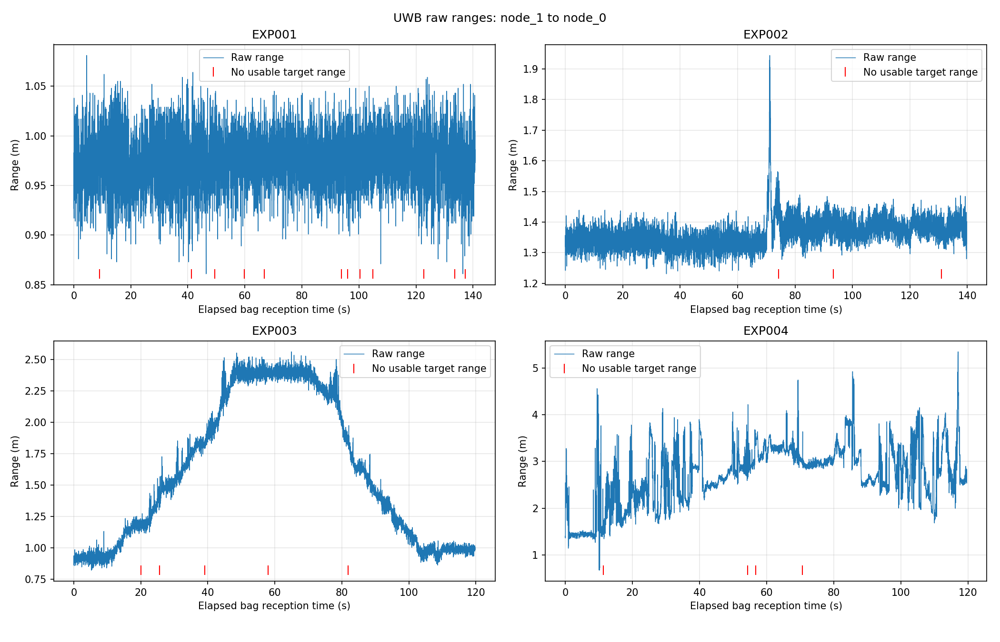
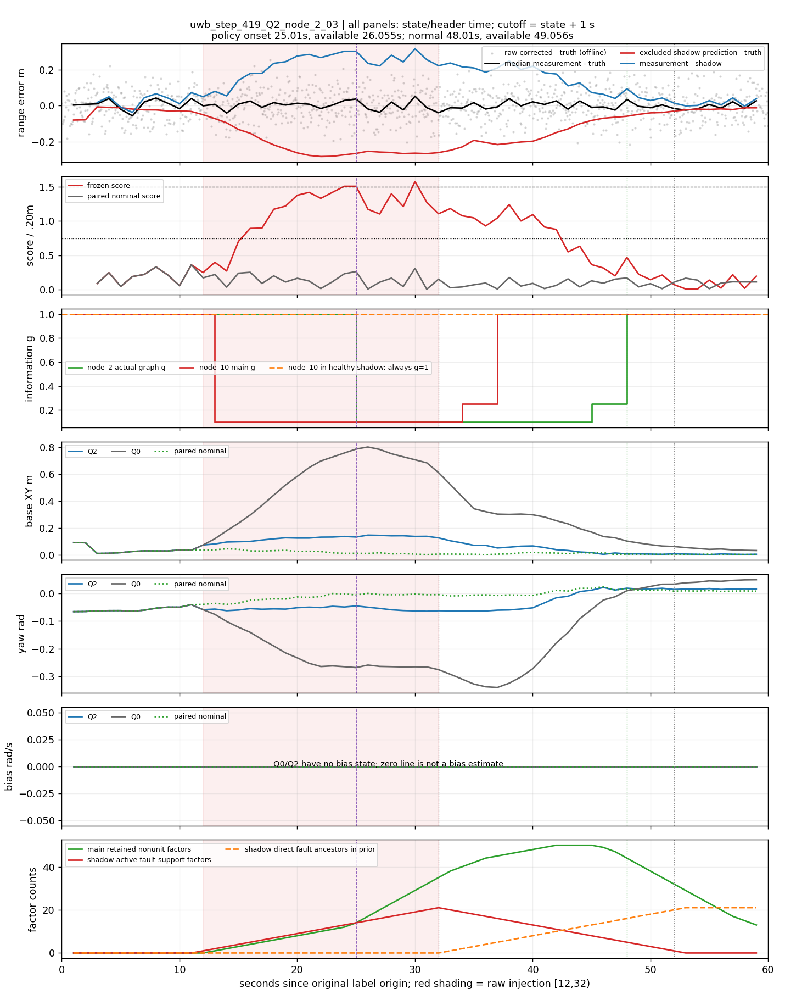
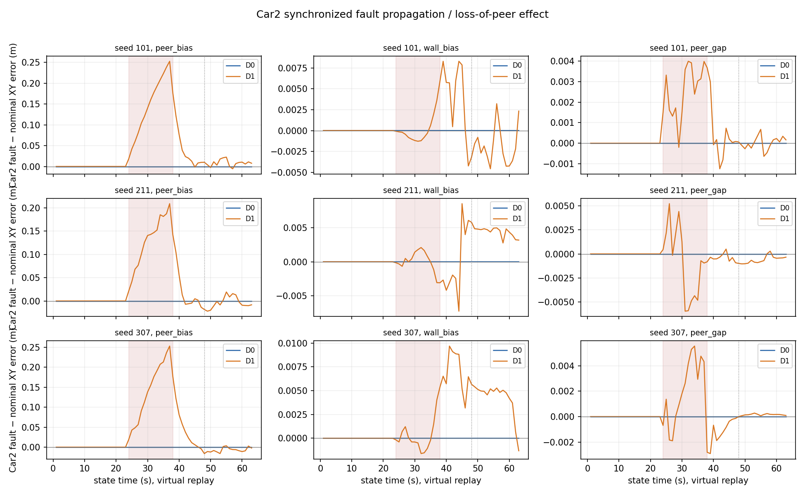
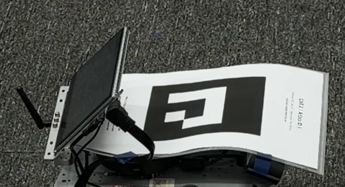

# 六幅已有图的讲法

只引用原图，不新拼图、不重绘、不续解码。路径和SHA在FIGURES.json，数值来源锁定实际main；每图先交代实验类别，不能把跨图曲线连接为一次运行。

## F1：平台为何需要处理测距退化

9月20日EXP001–004实测，横轴是各包独立的接收经过时间s，纵轴是node_1→node_0原始距离m，比较静态/动态、LOS/人体遮挡；静态均值约增加0.3888m且消息可用率仍高，说明连续输出不代表准确。静态无独立卷尺真值、动态运动不相同，不能把均值差当绝对误差或月球RF补偿模型；原表为20260920/results/summary.csv。

## F2：实包策略确实动作，但成本和准确性分开

PR65同机paced的004023/005135，上下两行分别是两包，左图g无量纲/灰色unknown，中央是残余bias rad/s，右图是真实flush发布延迟s；左横轴是state减首发布state（首state为2s），中右为centered state秒，不能按三列同一竖线作同步因果解释。它支持“Q2/Q3实际降权且Q3约1.22s含等待的发布代价”，不支持bias更准或全程位置更准；须同时展示PR65_NUMERIC_CHECK中的004023改善、005135恶化表。

## F3：不是健康测距坏了，而是参照受污染

PR63读取冻结PR61的step/seed419/Q2/node_2事件，统一横轴为原标签原点的state/header秒，纵轴依次为距离误差m、分数/0.20m、g、XY误差m、yaw rad、bias rad/s和因子计数；健康量测接近真值而排除图偏移，分数持续越界后健康因子被降权。这里Q0/Q2没有bias状态，采用修订后空曲线/null版本，8事件与未触发反例须并列；图不是双车peer因子故障验证，祖先计数不是影响幅度，动作实际可获得时刻另列。

## F4：共同原因时，位置与yaw/bias不能互相抵销

PR63同一冻结multi_common_uwb的401/419/443三列，横轴state秒（cutoff=+1s），纵轴为工程分数、g、XY误差m、yaw rad、bias rad/s及计数；Q1/Q3位置在401/443改善、419恶化，三个seed的yaw/bias均恶化。每seed是一个四链同源原因，不能算12次独立故障，也不能以小gyro残差/小分数替代真值误差；periods.csv/CONCLUSION保留全部时段与反例。

## F5：双车传播是另一个实验，不能与F3接成闭环

PR62冻结1595c98的三个seed×三故障情景，横轴state秒且为virtual，纵轴是同seed故障相对正常的Car2 XY误差增量m，各小图纵轴尺度不同，阴影24–38s；D0/D1比较显示带偏peer能将误差带给Car2并在恢复初期残留。已有peer与墙距均使用pseudo-Huber，准确说法是“无新增peer质量准入的鲁棒基线”，不能写“完全无鲁棒处理”，也不能据PR63单车影子机制声称同一双车质量系统因果验证完成。

## F6：识别出来不等于参考验收

PR64既有IMG_7367（暂按片序对应Car2-Q3）原4K选帧的native crop（图像像素、无米制坐标轴），纸面弯曲可见，作为“为什么不能默认刚性平面/零旋转”的直观证据；T10九帧两车成功识别与三个Q样本失败是不同样本范围。裁剪不能单独分离透视、镜头与板形，也不能产生天线坐标或精度参考；continuous和checkpoints_only均not_accepted，原位置/不确定度仍null。

建议中期采用F1→F2→F5→F3/F4→F6，会议候选只保留F3/F4及必要实包表；两场汇报都展示限制与负结果，不为排版拼接不同时间轴。
