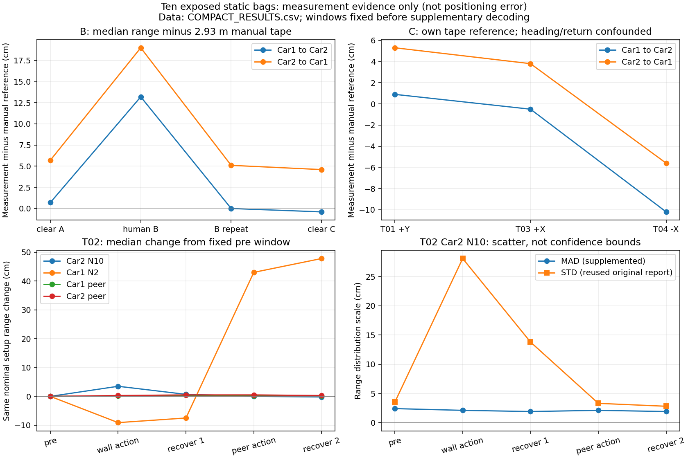

# STATIC-TO-METHOD-02：G3，现有线索不能唯一归责

**选择G3：这些实测线索能显示分链变化和测距冲突，但尚不能可靠地将故障与正常换点、朝向/回位及背景变化分开，更不足以建立候选相对同信息门控限幅的必要性。** 不选G1；本轮没有运行公平方法对照，也不能把“未证明候选必要”说成G2“简单方法已足够”。保留有限相对影响合同，暂不扩大图内硬约束贡献。

本轮确实检查了指定10个实测包：10/10原件SHA匹配，补解码60,611条ranges消息，输出300行分链/窗口描述统计（含缺项），另复用34行旧数值。全部10行证据索引见OLD_STATIC_EVIDENCE；29项同口径旧数值核对通过。没有重跑PR76、FGO、仿真矩阵或视频，也没有读取留出定位结果。重复窗口和50Hz消息不是独立试验。

## 实测证据回答了什么

**A组：已有人工XYZ允许扣除换点几何，但剩余差并非唯一故障归因；P1修正也不是通用健康认证。** P1=(2,2,.20)、P4最终更正=(3,3,.20)m。沿用原三维锚点与P1全精度分链修正；下表直接复用历史统计，单位m，都是“链路中位数减人工几何距离”，不是定位误差。

| 节点 | P1原差＝用于拟合的修正 | P4原差 | P4应用原P1修正后差 |
|---|---:|---:|---:|
| N10 | .608864 | .504621 | −.104242 |
| N2 | .449737 | .459293 | .009556 |
| N3 | .201286 | .234614 | .033328 |
| N8 | .368514 | .407212 | .038698 |

P4修正后四链绝对差平均约4.65cm，N10仍−10.42cm；支持同安装迁移存在剩余空间/朝向/几何混杂，不是已识别硬件故障。P1修正后接近零属于拟合内事实，非独立验证。没有将该修正用于B/C或Car1。A只有Car2墙话题，缺少Car1和peer记录不标成车辆/链路故障。

**B组：peer人体首录变化、重复弱效及恢复非一致都保留。** 以下为整包双向peer中位数减直接卷尺2.93m，以及MAD，单位cm；不是各车XY误差。人员进入时刻未知，首录还按预登记0–10、10–20、20–末三段全部保留，未挑“最佳遮挡窗”。

| 包 | Car1→Car2参考差 / MAD | Car2→Car1参考差 / MAD |
|---|---:|---:|
| clear_A | +0.7 / 2.3 | +5.7 / 2.5 |
| human_B | +13.2 / 5.6 | +19.0 / 5.1 |
| human_B_repeat | 0.0 / 1.7 | +5.1 / 1.7 |
| clear_C | −0.4 / 2.8 | +4.6 / 2.4 |

首录相对A的peer变化在三段分别约+3.2/+4.1、+15.7/+15.9、+15.1/+15.25cm，符合存在过渡而非整包恒定状态。与此同时，首录Car2—N8中位数较A多1.416m；重复中仍多0.370m；C恢复至+0.009m。Car1—N2在C却较A多0.405m。**B_repeat的弱效主要指peer，不应推广成所有墙链健康；peer恢复也不等于所有链恢复。** 无各车实际XY，不能把这些量称墙面绝对误差或唯一归因于人体。

**C组：操作与朝向/回位均可伴随变化，不能从标签认证健康。** T02按既定录包相对时间、两侧各去5秒；无新增边界试验。下表m。STD为原报告复用值；MAD是本轮补算，均不是中位数的置信区间。

| 窗口 | Car2—N10中位数 / MAD / 原STD | Car1→Car2 / Car2→Car1中位数 |
|---|---:|---:|
| 初始5–35 | 3.542 / .024 / .035 | 2.089 / 2.130 |
| 墙操作45–75 | 3.577 / .021 / .281 | 2.091 / 2.133 |
| 恢复85–155 | 3.549 / .019 / .138 | 2.093 / 2.135 |
| peer操作165–195 | 3.542 / .021 / .033 | 2.091 / 2.135 |
| 尾段205–238.7543 | 3.540 / .019 / .028 | 2.091 / 2.133 |

目标墙操作中位数只增3.5cm，MAD未升高，旧STD却显著升高；原报告指出少量尖峰，故只用MAD可漏掉这类变化。车间操作的两方向中位数仅较初始+2/+5mm，不能自动标强NLOS。尾段Car1—N2仍从5.169到5.647m（+47.8cm）；撤去指定操作没有使所有测量恢复。以上仅为分链变化证据。

T03/T04各去首尾5秒，peer相对各自直接卷尺分别为−0.5/+3.8cm及−10.2/−5.6cm；T04的双向MAD仅约1.6cm。相对T01同样裁边窗口，T04 Car2—N2中位数增25.1cm，而MAD仍约1.9cm；名义不动的Car1墙链也有变化。**这些是朝向、回位及环境共同变化的观察，不能全归因于朝向，更不能当相同位置的故障正类。** C组notes的target XYZ与历史沿用坐标不升级为各包实际独立测量，本轮未计算C组绝对墙几何残差。

B/C本轮没有拟合四墙几何相容性模型，因此这些量测变化不等于已证明四距在真实位置处不相容。H0的XY、H1的XY＋一个指定链偏差、H2的XY＋共同偏差具有不同假设与冗余；PR76的秩结论只是前置推导。本轮没有用更多参数带来的更小拟合残差选择故障模型。

## 只留一项最小缺项

若还要把四锚线索用于可信角色判断，缺的是：**C组各次朝向/回位后、与统计窗对应的独立天线实际XYZ及其误差记录。** 已查原归档notes、SESSION_LOG、geometry及EXPERIMENTS：T03/T04是target XYZ＋直接间距，没有足以分离回位误差的逐车实际XYZ/不确定度。先在办公室恢复旧尺量记录；找不到就缩减为“量测变化/相对影响合同”，不自动新增采集。此缺项并不阻塞有限相对位移合同，也不承诺补齐后候选必有优势。

本轮新动态要求为0。无新健康阈值、故障分类器或恢复策略；METHOD_CARD给出同信息基线及可检验问题，未将之包装成已成立方法。PR70/72/75只作为仿真错误传播和历史先验边界的引用，不能代替本轮实测结论。

