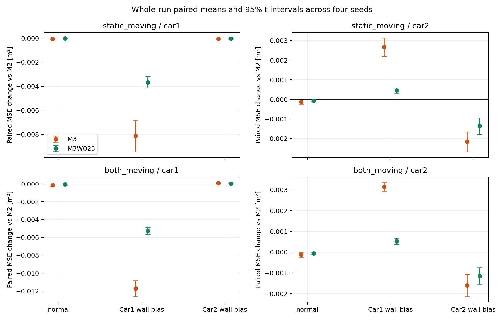
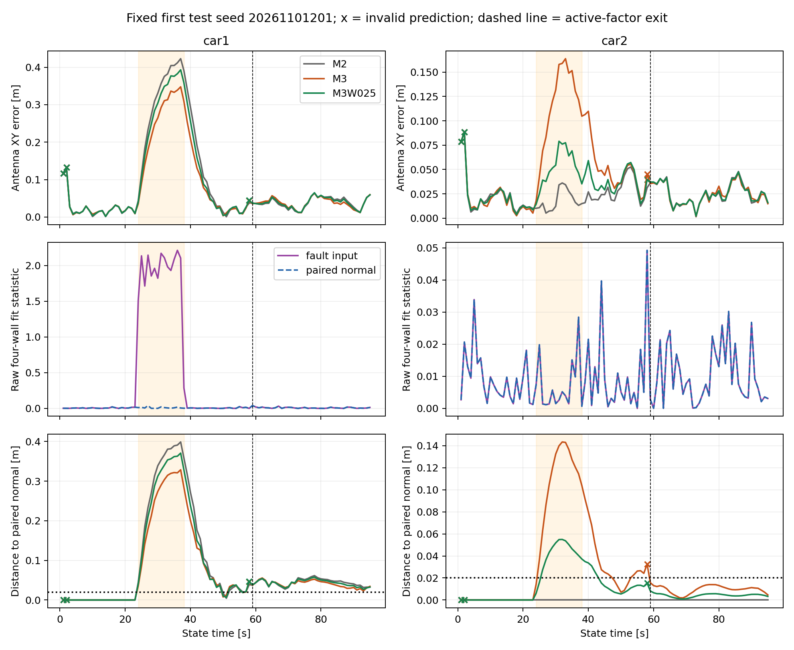
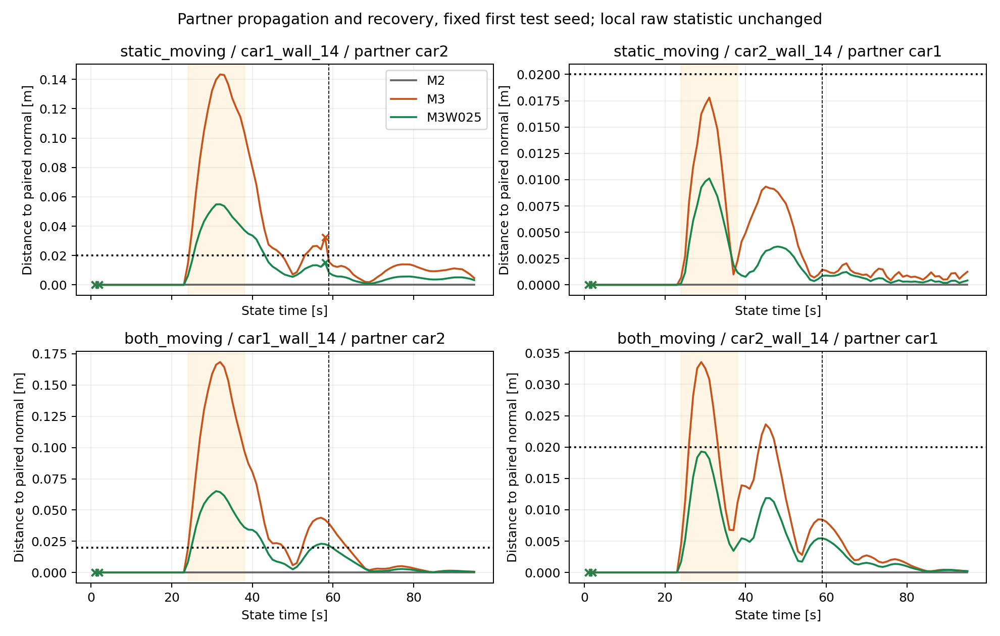

# 受控双车墙偏差传播：六条件机制结果

在预冻结的四个独立测试种子内，Car1四墙共同+.30m时，两条既定轨迹均出现“注入车获益、伙伴代价增加”；固定.25代价缩权减轻伙伴代价，也减少注入车收益。换成Car2注入后，未注入车的方向并非固定：一静一动中的Car1平均略有改善，双动态中平均略有恶化，效应及区间必须逐项读取。没有协同必然改善或未注入车必然受损的结论。

本轮只支持给定几何/噪声/时序与工程权重下的定位机制证据。IMU是成熟系统组成；测量侧四墙一致性只是次级、未校准统计，8维源排除仍unknown。没有实车连续精度、已验收安全监测、检测率/误报率优越性或新算法/新颖性结论。

## 固定范围与版本

采用main `1835472dd34087f1701f8ee8bd8f300b8c742cef`；PR89 head `b294cce0…`及PR88 head `e5151ee…`均经实时核对已合并。PR89快照补全了历史50% Car2 P1校正量条件预测失败与残差排序迁移反例的上下文；它不是“达到50%纠偏收益”的要求，这些旧实测现象不计入本轮仿真样本。

开发协议30747e1，SHA256 `4ad0848a9f70bea24d882d79adae4f21235862f661ca53d2702e7ca56c5770c9`；独立运行协议5ad1e55，SHA256 `1b6e922637d865d9434deceb57d5636a5808105a1c300f46bee7791b7a5de4b7`。时间顺序验证见FREEZE_ORDER_CHECK.json。开发执行aa12d7f，正常参考/测试执行5ad1e55，完整读表执行1fb34a7。读表字段补齐及旧版保留见READOUT_AMENDMENT.md。

seed7仅开发：两轨迹×正常/Car1故障×三方法=12单元。正常参考20261101101–102：仅正常，12单元，不拟告警阈值。独立测试20261101201–204：两轨迹×正常/Car1故障/Car2故障×三方法=72单元。**每条件独立seed数是4，条件/方法间配对；24份测试输入、72个方法单元和逐帧数据都不能当作72个独立重复。** 这不是原10条件矩阵。

原32秒轨迹重复3次，共96秒；故障[24,38)，+.30m；四墙、peer/Odom/gyro/初始随机观测的CRN逐scalar验证，所有方法共享同一输入。实际污染支持bin24–38；全部16个测试故障输入的三方法均在state59首次完全退出活动窗，随后37秒观察。范围/全部假设见PROTOCOL.md/JSON。固定车不钉死，真值仅评价。

## 名义误差与配对差

正常条件：下表为四个测试运行各自完整run、全部有限输出的天线XY RMSE的均值，单位cm；不是先池化所有帧再开方。t=0..1未发布保留分母，另有2个warmup。

|运动|车辆|M2|M3|M3W025|
|---|---|---:|---:|---:|
|一静一动|car1|2.79|2.70|2.75|
|一静一动|car2|2.79|2.58|2.69|
|双动态|car1|3.09|2.86|2.98|
|双动态|car2|2.79|2.58|2.69|

故障条件：主项为共同有效时刻的平均平方误差差 Δ=MSE(method)−MSE(M2)，以完整seed运行作配对单位。负数表示获益，正数表示代价；数值单位 **10⁻⁴ m²**，括号为四seed均值的95% Student-t区间（df=3）。小样本、模型条件性区间，不解释为稀有风险界或保证。

|运动|故障源|车辆|M3 Δ [95%区间]|M3W025 Δ [95%区间]|全有限Δ：M3 / W025|
|---|---|---|---:|---:|---:|
|一静一动|car1|car1|-81.41 [-94.63, -68.19]|-36.60 [-41.28, -31.93]|-80.71 / -36.86|
|一静一动|car1|car2|+26.69 [+21.98, +31.40]|+4.55 [+3.16, +5.94]|+25.94 / +4.39|
|一静一动|car2|car1|-0.45 [-1.18, +0.28]|-0.39 [-0.83, +0.05]|-0.44 / -0.38|
|一静一动|car2|car2|-21.62 [-26.75, -16.49]|-13.59 [-17.77, -9.41]|-21.16 / -13.30|
|双动态|car1|car1|-117.46 [-126.41, -108.51]|-52.74 [-56.81, -48.67]|-114.99 / -51.63|
|双动态|car1|car2|+31.42 [+29.33, +33.51]|+5.22 [+3.79, +6.65]|+30.76 / +5.11|
|双动态|car2|car1|+0.84 [+0.20, +1.48]|+0.41 [-0.00, +0.81]|+0.82 / +0.40|
|双动态|car2|car2|-16.07 [-21.43, -10.72]|-11.48 [-15.44, -7.53]|-15.74 / -11.24|

分阶段人读表见 [PHASE_TABLE.md](PHASE_TABLE.md)，局部一致性细表见 [LOCAL_CONSISTENCY.md](LOCAL_CONSISTENCY.md)。完整正常/故障/恢复/实际离窗前后、逐seed、全部有限与共同有效指标分别见 [PER_SEED.csv](results/test/PER_SEED.csv) 和 [RUN_LEVEL_INTERVALS.csv](results/test/RUN_LEVEL_INTERVALS.csv)。全有限配对项包含warmup/失败的有限预测，完整区间也保存；有效/未发布/unknown分母没有删除。RMSE均值和配对MSE差不是可互换的统计量。

一静一动、Car1故障时，完整run每运行RMSE均值（M2→M3→W025）：Car1约14.74→11.69→13.43cm，Car2约2.79→5.82→3.50cm。缩权同时牺牲帮助和减少代价；它不是硬影响预算，也不保证每车/每时刻更好。完整run相对M2的全有限恶化秒数亦不单调：该例Car2的M3为51.75秒、W025为52.25秒，虽然后者MSE代价更小。幅度与持续时间必须同时保留。正常输入在若干时刻也会相对M2恶化，因此相对M2的恶化秒数不能全部归因于故障传播，因果扰动另看配对正常运行。

图使用共同有效配对主项；全有限交叉口径与失败代价在表/CSV中并列。

## 因子历史、恢复与局部统计边界

物理故障结束38秒、最后污染支持bin38、活动因子退出59秒和估计恢复是四个不同对象。恢复判据仅为与同seed正常运行的天线XY距离<=.02m且双方有效连续5秒；首段确认后仍可能再次偏离，不认证绝对误差或安全。

96个“故障输入×方法×车”的测试恢复记录中4项截至96秒右删失，21项首次通过5秒后又偏离或失效；这些车/方法记录互相关联，不当独立概率样本。右删失均为一静一动Car1注入后的Car1：seed20261101201的三方法、seed20261101203的M2。前者M3末时相对正常仍约3.44cm。因子已退出活动窗不等于历史影响清零；保存的完整QR prior仍接续原始因素。输出差异不能唯一归因为prior，活动状态热启动/非线性/失败事务也参与。

测量侧四墙拟合统计由本车相同bin决定，对三方法完全相同；未注入车的本车墙观测不变，其统计也与配对正常运行逐值相同，却可伴随跨车定位变化。这给出“本地量测一致性相同而协同收益/代价不同”的受控反例。它不证明网络OR或成熟SS/NIS普遍无效，更不证明必须新算法。后验墙RMS则依赖发布位置；与Δ平方误差的逐run相关仅为描述，不能把相关帧当独立试验或据此反向设阈值。

首个测试seed在读结果前由种子顺序固定，未择优。橙色区为物理故障，虚线为实际活动因子退出，x为无效预测。Car2测量侧统计与正常重合，不意味着Car2协同误差没有变化。

## 失败、独立性范围与数值验收

新优化96单元，数值读回核验9120次联合发布、8915个接受目标、全部7104次消元及接收/gyro支持。原PR88的11项通过记录与6短例只读复用；新增6项合同检查本轮通过。所有模拟监测声明unknown。详见CHECKS.json与各分区读回。

全部新运行合计13次求解预算失败：开发0次、正常参考9次、独立test4次，逐帧清单全部保留。正常参考也存在失败，不能称已校准可用性或零失败。独立test的4次为：seed20261101201/一静一动/Car1故障，M3与W025各在t=58失败；seed20261101202同条件M2在t=43、44失败。均达到冻结max_nfev，不调预算、不重跑；发布有限预测且两车valid=false，候选解未冒充接受输出。完整96秒分母下有效时长为91–93秒；全部有限发布95秒，t=0..1无发布另计。见 [FAILURES.json](FAILURES.json)。

M2无peer目标、每车停止及先验块的数值读回通过，但共同有效发布的严格伙伴不变性检查15/16通过；上述带M2预算失败的运行最大差8.9031e−7m（约.89微米），超过预定1e−8m检查容差。已标为例外，不能称全程发布完全独立。既有联合失败事务和数值/热启动路径的各自份额没有反事实分离；含失败预测的全有限伙伴位移最大为9.3079mm（同一运行t=44，valid=false）；这与共同有效后的.89微米是两种口径，均保留在M2_INDEPENDENCE_SCOPE.json。这些不是物理peer传播证据，也没有为消除差异重跑。所有seed与失败仍在主表，原内核未改变。

第二读器不导入分析器/优化器，从published.csv、独立天线几何和单独truth重算测试分区15,360个逐run指标、576个恢复标量、16,128个运行级区间标量，并检查32,304个配对平方差恒等式。全体读回PASS是数值/实现验收，不是科学效果、监测优越性或理论风险验收。

## 论文可支持与不能支持

- 可支持：在明确受控条件、同随机观测和同8维内核下，单车局部墙偏差可通过peer因子改变另一车输出及逐车收益；固定缩权存在帮助/代价取舍，符号依赖条件。
- 可支持：本车量测侧四墙一致性并不足以唯一决定网络耦合后的本车误差；活动因子退出与配对恢复分离，首次恢复判据可能再失效。
- 不能支持：协同普遍有益/普遍有害、未注入车必受损、固定.25最优或硬安全界、IMU本身新颖、B1/B2检测或FAR优越性、8维SS已实现、真实NLOS分布规律、实车动态全程精度或外部概率保证。
- 新颖性仍须由论文近邻对照论证。SS/源分组/完整QR历史/IMU不是本轮新算法贡献；本交付止于有限机制证据，不扩算法搜索、传感器或现场场景。

现场包A1/B1与保留A2/B2仍由本地窗口处理；此处仿真四墙/源排除统计与现场同名包不同。未读取新bag或留出定位结果，未改参考、分段政策或要求补采。

精确运行/源码/协议版本见EXECUTION_MANIFEST.json；完整原始数值证据、每个seed的归档位置/字节数/逐成员SHA见ARTIFACTS.json；续接命令见COMMANDS.md。完成本有限矩阵与读回后停止。
