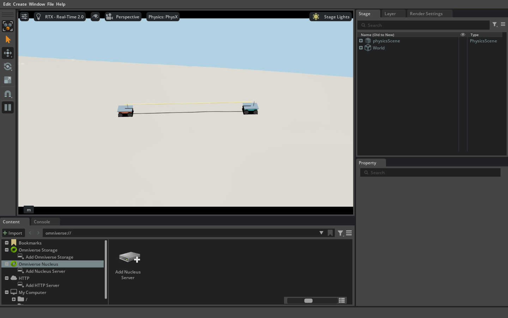
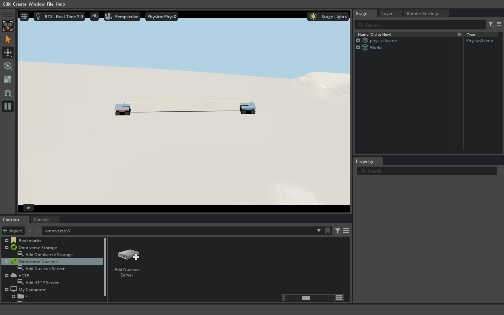
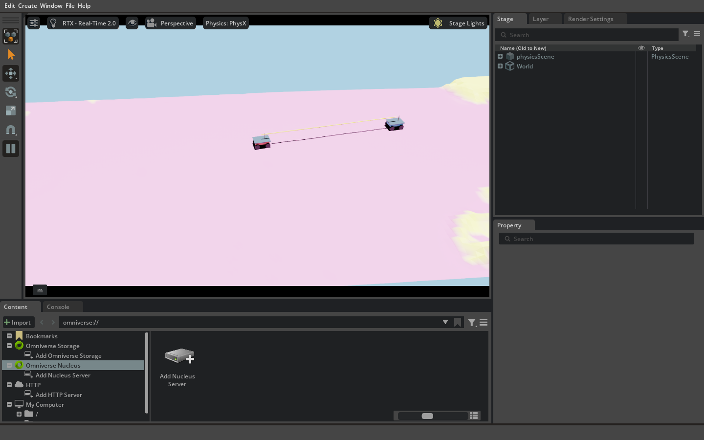

# Moon 1 双车 Isaac Lab 运行截图

这三张图片直接截自 2026-10-29 在 RTX 5060 Ti 上运行的 Isaac Lab 3.0 / Isaac Sim 6.2 图形窗口。输入是 LuSNAR Moon_1 六帧融合 LiDAR 生成的高度网格，以及同一段真值轨迹上相差五秒的两车运动学回放。蓝绿色车为 Car 1，橙色车为 Car 2；黄色线为两车 UWB 连线。

前两张使用中性灰月面显示，第三张使用源点云的月壤/岩石语义颜色，因此地面呈洋红色。颜色切换只影响视觉显示，不改变网格、碰撞或轨迹。这里的车辆按真值轨迹运动；尚未模拟车轮接触、月壤滑移或真实 UWB 传播。

运行命令与数据准备步骤见 [Moon 1 Isaac Lab README](../../../sim/isaac_lab/moon1/README.md)。
